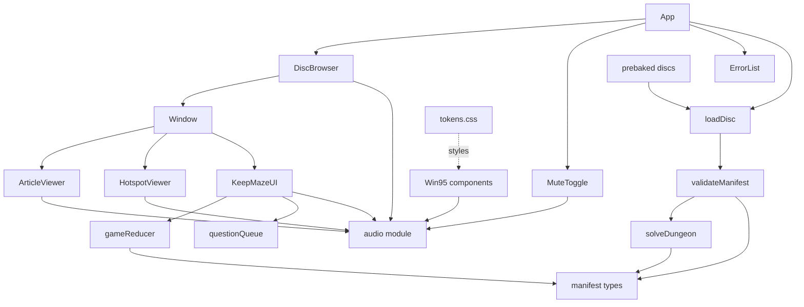

# Design Document

## Overview

DiscLore '97 is a client-only Vite + TypeScript + React application. It renders "CD-ROM discs" described by a typed `DiscManifest` in a Windows 95 look, and includes a KeepMaze dungeon and trivia game. The build output is static assets for Cloudflare Pages. No server runtime is used.

The design splits the code into three layers:

1. **Pure logic** (no React, no DOM): manifest types, `validateManifest`, `solveDungeon` (BFS), the KeepMaze game reducer, and the trivia question queue. This layer carries the correctness properties and is tested with fast-check.
2. **Audio module**: the only code that touches `AudioContext`. It exposes one function per Sound_Effect and a mute state.
3. **UI**: Win95 components, Disc_Browser, Article_Viewer, Hotspot_Viewer, and KeepMaze_UI. The UI calls the logic and audio layers and holds no game rules.

Key decisions:

| Decision | Rationale |
| --- | --- |
| Hand-written validator, no schema library | The steering file and Requirement 2.4 allow only `react`/`react-dom` at runtime. The schema is small. |
| Validator reuses `solveDungeon` | Requirements 5.10 and 5.11 define solvability and orphan errors in terms of the solver, so one implementation avoids drift. |
| KeepMaze game logic is a pure reducer | Moves, scoring, and restart become testable without rendering. |
| Plain CSS with one tokens file | Satisfies Requirement 3.4: hex values appear only in `tokens.css`. Bevels use CSS borders. |
| Audio via a singleton module with an injectable context factory | Allows tests to substitute a mock `AudioContext` and assert silence while muted. |
| No router library | Navigation state is a small in-memory object held in the App. |

Research notes: WebAudio autoplay policy requires creating or resuming an `AudioContext` inside a user gesture ([MDN: Web Audio API best practices](https://developer.mozilla.org/en-US/docs/Web/API/Web_Audio_API/Best_practices)). Cloudflare Pages serves a Vite `dist` directory directly, with build command `npm run build` and output directory `dist` ([Cloudflare Pages Vite guide](https://developers.cloudflare.com/pages/framework-guides/deploy-a-vite3-project/)). Content was rephrased for compliance with licensing restrictions.

## Architecture



### Directory layout

```
LICENSE
.gitignore
index.html
package.json, tsconfig.json, vite.config.ts
src/
  main.tsx, App.tsx
  styles/tokens.css, styles/win95.css
  model/manifest.ts        # types (Req 4.7)
  model/validate.ts        # validateManifest
  model/solver.ts          # solveDungeon
  model/game.ts            # KeepMaze reducer
  model/questionQueue.ts   # no-repeat question order
  discs/castles.ts, discs/retro.ts, discs/index.ts
  audio/audio.ts           # only module using AudioContext
  components/Window.tsx, TitleBar.tsx, BevelButton.tsx, MenuBar.tsx, Tooltip.tsx
  components/DiscBrowser.tsx, ArticleViewer.tsx, HotspotViewer.tsx, KeepMazeUI.tsx
  components/MuteToggle.tsx, ErrorList.tsx
tests/                     # Vitest + fast-check
```

### Navigation state

`App` holds `{ discId, view }` where `view` is one of `{kind:'section', section_id}`, `{kind:'diagram', diagram_id}`, `{kind:'keepmaze', dungeon_id}`. `selectSection(id)` returns the previous state unchanged when the id is unknown (Requirement 10.6) and reports a not-found message.

## Components and Interfaces

### Manifest and validation (`model/`)

```ts
export type ValidationError = { path: string; code: ErrorCode; message: string };
export type ErrorCode =
  | 'missing-field' | 'wrong-type' | 'duplicate-id' | 'coordinate-range'
  | 'dangling-reference' | 'index-range' | 'missing-room'
  | 'unsolvable-dungeon' | 'orphan-room';
export type ValidationResult =
  | { ok: true; manifest: DiscManifest }
  | { ok: false; errors: ValidationError[] };

export function validateManifest(input: unknown): ValidationResult;
```

Validation runs in two passes. Pass 1 checks shape and types and stops descending into a node that has the wrong type. Pass 2 runs only on well-typed data: uniqueness, coordinate range (`Number.isFinite` and `0..100`), reference integrity, index range, dungeon rooms, then solver-based checks. The orphan-room error carries all orphan ids in its message and the path of the dungeon. All errors are collected, not just the first.

### Solver (`model/solver.ts`)

```ts
export type SolveResult = {
  reachable: Set<string>;   // room_ids reachable from 'entrance'
  path: string[];           // shortest entrance -> throne_room, [] if none
  orphans: string[];        // rooms not in reachable
};
export function solveDungeon(d: Dungeon): SolveResult;
```

BFS from `entrance` over directed Exits with a `visited` set and a parent map. Exits to unknown rooms are ignored by the solver (the validator reports them separately). If `entrance` is absent, `reachable` and `path` are empty and all rooms are orphans. Complexity is O(rooms + exits), well inside the 100 ms budget for 500 rooms.

### KeepMaze game (`model/game.ts`, `model/questionQueue.ts`)

```ts
export type GameState = {
  roomId: string; moves: number; incorrect: number;
  pending: { exitTo: string; question: TriviaQuestion } | null;
  lastWrong: { section_id: string } | null;
  won: boolean; queue: QuestionQueue;
};
export type GameAction =
  | { type: 'selectExit'; to: string }
  | { type: 'answer'; index: number }
  | { type: 'restart' };
export function initGame(d: Dungeon, qs: TriviaQuestion[], rng: () => number): GameState;
export function gameReducer(s: GameState, a: GameAction, d: Dungeon, qs: TriviaQuestion[], rng: () => number): GameState;
```

`selectExit` draws the next question from the queue and sets `pending`. A correct `answer` moves to `exitTo`, increments `moves`, clears `pending`, and sets `won` when the new room is `throne_room`. An incorrect answer increments `incorrect`, keeps `roomId`, clears `pending`, and records the cited `section_id` in `lastWrong` so the UI can show the section title and a link. `restart` returns `initGame`.

`QuestionQueue` is a shuffled bag: it draws without replacement and reshuffles only when empty, so no question repeats until all have been presented (Requirement 12.7). The shuffle takes an injected `rng` for deterministic tests.

### Audio module (`audio/audio.ts`)

```ts
export function playSpinUp(): void;
export function playClick(): void;
export function playPageFlip(): void;
export function playTorch(): void;
export function playDoorUnlock(): void;
export function setMuted(m: boolean): void;
export function isMuted(): boolean;
export function toggleMuted(): boolean;
export function subscribeMuted(fn: (m: boolean) => void): () => void;
export function __setContextFactory(f: (() => AudioContext) | null): void; // test hook
```

Behavior:
- The context is created on the first play call that follows a user gesture. Because every Sound_Effect is triggered from a click, key, or pointer handler, the first play call is the gesture. If the `AudioContext` constructor is missing, play calls return silently.
- If `ctx.state === 'suspended'`, call `ctx.resume()` before scheduling nodes.
- When muted, every play function returns before touching the context.
- Every effect routes through one master `GainNode`. `setMuted(true)` sets master gain to 0 immediately (`cancelScheduledValues`, `setValueAtTime(0, now)`) and stops active oscillators, which meets the 50 ms silencing bound.
- Effects are oscillator and noise bursts with short gain envelopes: spin-up is a rising sawtooth sweep, click is a 15 ms square blip, page flip is filtered noise, torch is low-passed noise with a flicker, door unlock is two ascending square tones.
- Components import only these functions. A lint rule (`no-restricted-globals` on `AudioContext`, `OscillatorNode`) outside `src/audio` enforces Requirement 13.6.

### Win95 components

| Component | Props | Notes |
| --- | --- | --- |
| `Window` | `title`, `onClose`, `menu?`, `children` | `role="dialog"`, `aria-labelledby` the title. Content area uses an outset bevel class. |
| `TitleBar` | `title`, `onClose` | Navy background, white text, close `BevelButton` with `aria-label="Close"`. |
| `BevelButton` | `onClick`, `disabled?`, `children` | Native `<button>`. CSS `:active` and a `data-pressed` state swap to inset. Calls `playClick()` then `onClick`. Disabled buttons do neither and use the shadow color. |
| `MenuBar` | `menus: {label, items:{label, onSelect}[]}[]` | `role="menubar"`, `menu`, `menuitem`. Arrow keys move, Enter or Space activates, Escape closes. Selecting an item calls its callback and closes. |
| `Tooltip` | `text`, `children` | Shows on `pointerenter`/`focus`, hides on `pointerleave`/`blur`. Linked with `aria-describedby`. Uses tooltip fill and a 1px outer-edge border. |

### Viewers

- `DiscBrowser`: lists discs (title, tagline). Opening a disc calls `playSpinUp()` and opens a `Window` with a tree of sections, diagrams, a "Trivia" group, and dungeons.
- `ArticleViewer`: renders the section title and paragraphs in the serif token, calls `playPageFlip()` on selection, and resets `scrollTop` to 0 through a ref when `section_id` changes.
- `HotspotViewer`: renders shapes inside `<svg viewBox="0 0 100 100">`. Each hotspot is a focusable `<g role="button" tabindex="0" aria-label={label}>` positioned at `(x, y)`, wrapped by a Tooltip. Click or Enter navigates to the referenced section and calls `playPageFlip()`.
- `KeepMazeUI`: HUD in the sans-serif token showing room name, description, exits, moves, and incorrect count. It dispatches to `gameReducer`, calls `playTorch()` on room entry and `playDoorUnlock()` on a correct answer, and shows the victory message and a restart control.
- `MuteToggle`: a `BevelButton` with `aria-pressed`, rendered in the App shell so it appears on every screen.
- `ErrorList`: shown in place of a disc when `validateManifest` fails for any non-pre-baked source (Requirement 5.12). Pre-baked discs skip this path, and a test asserts they validate anyway.

### Design tokens (`styles/tokens.css`)

```css
:root {
  --surface:#C0C0C0; --title-bg:#000080; --title-text:#FFFFFF;
  --bevel-hi:#FFFFFF; --bevel-shadow:#808080; --bevel-edge:#000000;
  --tooltip-bg:#FFFFE1;
  --font-serif: Georgia, "Times New Roman", serif;
  --font-ui: "MS Sans Serif", Tahoma, sans-serif;
  --bevel-w: 2px;
}
* { border-radius: 0; }
```

Hex values appear only in this file. `win95.css` composes bevels from the variables, for example `border: var(--bevel-w) solid; border-color: var(--bevel-hi) var(--bevel-edge) var(--bevel-edge) var(--bevel-hi);` for outset, with the reverse for inset. No blurred shadows, `backdrop-filter`, or gradients are used.

## Data Models

```ts
export interface DiscManifest {
  disc_id: string; title: string; tagline: string;
  sections: Section[];          // non-empty
  diagrams: Diagram[];
  trivia: TriviaQuestion[];
  dungeons: Dungeon[];
}
export interface Section { section_id: string; title: string; paragraphs: string[]; } // non-empty
export type Shape =
  | { kind: 'rect'; x: number; y: number; width: number; height: number; fill?: string; stroke?: string }
  | { kind: 'circle'; cx: number; cy: number; r: number; fill?: string; stroke?: string }
  | { kind: 'line'; x1: number; y1: number; x2: number; y2: number; stroke?: string }
  | { kind: 'polygon'; points: [number, number][]; fill?: string; stroke?: string };
export interface Hotspot { label: string; x: number; y: number; section_id: string; }
export interface Diagram {
  diagram_id: string; title: string; viewBox: '0 0 100 100';
  shapes: Shape[]; hotspots: Hotspot[];
}
export interface TriviaQuestion {
  question_id: string; prompt: string; options: string[]; // length >= 2
  correct_index: number; section_id: string;
}
export interface Exit { to: string; }          // destination room_id, directed
export interface Room { room_id: string; name: string; description: string; exits: Exit[]; }
export interface Dungeon { dungeon_id: string; title: string; rooms: Room[]; }
```

Notes:
- Shape colors in pre-baked discs use `fill`/`stroke` values of `currentColor` or `none`, or reference CSS variables through `var(--...)`, so hex literals stay out of data files and component code (Requirement 3.4).
- Reserved room ids: `entrance` and `throne_room`.
- Duplicate-id scopes: section ids, diagram ids, question ids, and dungeon ids across the manifest; room ids within a dungeon.
- JSON compatibility: all fields are JSON primitives, arrays, and plain objects with no `undefined` values (optional shape styling fields are omitted, not set to `undefined`), so JSON round trip is lossless.

## Correctness Properties

*A property is a characteristic or behavior that should hold true across all valid executions of a system-essentially, a formal statement about what the system should do. Properties serve as the bridge between human-readable specifications and machine-verifiable correctness guarantees.*

### Property 1: Validator result shape

*For any* unknown input value, `validateManifest` returns either `{ok:true}` with a manifest or `{ok:false}` with a non-empty list of errors, and every error has a non-empty `path` and a non-empty `message`. It never throws.

**Validates: Requirements 5.1**

### Property 2: Manifest JSON round trip

*For any* valid DiscManifest, serializing it to JSON, parsing, and validating yields `ok: true` with a manifest deep-equal to the original.

**Validates: Requirements 5.13**

### Property 3: Missing or mistyped fields are reported by path

*For any* valid DiscManifest and any required field in it, deleting that field or replacing it with a value of the wrong type causes `validateManifest` to return an error whose `path` names that field.

**Validates: Requirements 5.2**

### Property 4: Duplicate identifiers are rejected

*For any* valid DiscManifest and any identifier scope (sections, diagrams, trivia questions, dungeons, or rooms within a dungeon) with at least two items, setting one item's identifier equal to another's causes a `duplicate-id` error.

**Validates: Requirements 5.3**

### Property 5: Out-of-range hotspot coordinates are rejected

*For any* valid DiscManifest containing a hotspot, setting that hotspot's `x` or `y` to a value below 0, above 100, `NaN`, or an infinity causes a `coordinate-range` error.

**Validates: Requirements 5.4**

### Property 6: Dangling references are rejected

*For any* valid DiscManifest, pointing a hotspot or trivia question at a `section_id` that is not in the manifest, or an exit at a `room_id` not in its dungeon, causes a `dangling-reference` error at the path of the modified reference.

**Validates: Requirements 5.5, 5.6, 5.9**

### Property 7: Answer index out of range is rejected

*For any* valid DiscManifest containing a trivia question, setting `correct_index` to a negative value or to a value at or above the number of options causes an `index-range` error.

**Validates: Requirements 5.7**

### Property 8: Missing entrance or throne room is rejected

*For any* valid DiscManifest and any dungeon in it, removing the `entrance` room or the `throne_room` room causes a `missing-room` error.

**Validates: Requirements 5.8**

### Property 9: Unsolvable and orphaned dungeons are reported

*For any* dungeon that contains `entrance` and `throne_room` and has no path between them, `validateManifest` returns an `unsolvable-dungeon` error. *For any* dungeon with a non-empty set of orphan rooms, it returns an `orphan-room` error that lists exactly those room ids.

**Validates: Requirements 5.10, 5.11**

### Property 10: Reachable set and orphans partition the rooms

*For any* generated dungeon (including cycles, self-loops, and exits to unknown rooms), the set returned as `reachable` equals the set computed by an independent depth-first reference, `orphans` equals all rooms minus `reachable`, and the two sets are disjoint and together cover every room.

**Validates: Requirements 7.1, 7.4, 8.6**

### Property 11: Shortest path is valid and minimal

*For any* generated dungeon with directed exits, if the throne room is reachable then the returned path starts at `entrance`, ends at `throne_room`, every consecutive pair is connected by an exit in that direction, and its length equals the length computed by an independent reference (so no shorter path exists); if the throne room is unreachable then the path is empty. The solver terminates and each room appears at most once in the path.

**Validates: Requirements 7.2, 7.3, 7.5, 7.7, 8.5, 8.7**

### Property 12: Correct answer moves the player

*For any* dungeon, game state with a pending exit, and the correct answer index for the pending question, the reducer sets `roomId` to the exit's destination, increases `moves` by 1, leaves `incorrect` unchanged, and sets `won` exactly when the destination is `throne_room`.

**Validates: Requirements 12.3, 12.5**

### Property 13: Incorrect answer keeps the player in place

*For any* dungeon, game state with a pending question, and any answer index other than the correct one, the reducer keeps `roomId` and `moves` unchanged, increases `incorrect` by 1, and records the question's cited `section_id` in `lastWrong`.

**Validates: Requirements 12.4**

### Property 14: Restart resets the game

*For any* reachable game state, the `restart` action yields a state with `roomId` equal to `entrance`, `moves` 0, `incorrect` 0, and no pending question.

**Validates: Requirements 12.6**

### Property 15: Questions do not repeat until all are used

*For any* non-empty list of N questions and any random source, in any window of N consecutive draws starting at a multiple of N, every question appears exactly once.

**Validates: Requirements 12.7**

### Property 16: Muted audio is silent

*For any* sequence of Sound_Effect requests made while muted, the audio module creates no oscillator or buffer-source nodes and starts no sound on a mock `AudioContext`.

**Validates: Requirements 8.11, 13.7**

## Error Handling

| Situation | Handling |
| --- | --- |
| Manifest from a non-pre-baked source is invalid | `ErrorList` replaces the disc and shows `path: message` for each error. |
| Input to the validator is not an object, or is `null` | Single error at path `$` with `wrong-type`. No exception. |
| Section id not found on navigation | Article_Viewer shows a not-found message. Navigation state is unchanged. |
| Dungeon has no entrance | Solver returns empty reachable set and path. Validator reports `missing-room`. |
| Exit to unknown room at play time | Reducer ignores `selectExit` for destinations not in the dungeon. |
| Disc has no trivia questions | Validator does not require them, but KeepMaze_UI disables Start with a message, because exits cannot be unlocked. |
| `AudioContext` unavailable or its constructor throws | Audio module catches the error, marks audio unavailable, and ignores later requests. |
| `ctx.resume()` rejects | Caught and ignored. The effect is skipped. |
| Hotspot at the viewBox edge | Allowed (0 and 100 inclusive). Tooltip positions clamp inside the viewer. |

## Testing Strategy

PBT applies to the pure logic: the validator, the solver, the game reducer, the question queue, and the mute behavior of the audio module. It does not apply to Win95 component rendering, static checks, or content, which use example, snapshot, and static-scan tests.

**Tooling:** Vitest (`vitest --run` through `npm test`), fast-check for properties, and React Testing Library with jsdom for components. No property-based testing is written from scratch.

**Property tests**
- Each of Properties 1 through 16 is implemented by one fast-check test running at least 100 cases (`numRuns: 100` or more).
- Each test carries a comment in the form `Feature: disclore-97-core, Property N: <property text>`.
- Generators: an `arbDungeon` that builds rooms with random directed exits, cycles, self-loops, and sometimes missing `entrance` or `throne_room`; an `arbManifest` that builds a valid manifest by construction (references drawn from generated ids, coordinates in range, a solvable dungeon with no orphans); mutation helpers that apply one defect to a valid manifest for Properties 3 through 9.
- Reference models for Properties 10 and 11 are written separately from the solver (an iterative DFS for reachability and a Bellman-Ford style distance relaxation for shortest length).
- Property 16 injects a mock `AudioContext` through `__setContextFactory`, mutes, calls random sequences of the five effects, and asserts the mock created no oscillators or sources.

**Unit and example tests**
- Pre-baked disc invariants (Requirements 8.1 to 8.3, 6.1 to 6.4): for each disc, validator returns zero errors, every hotspot is in range with an existing section, every trivia question cites an existing section, every dungeon is solvable with zero orphans, and the content minimums hold (5 sections, 1 diagram with 3 hotspots, 5 questions, 1 dungeon with 8 rooms).
- Solver performance: a 500-room dungeon solves in under 100 ms (Requirement 7.6).
- Component tests: Window close callback, BevelButton pressed state, disabled behavior, click sound request, MenuBar item selection and Escape, Tooltip show and hide on pointer and focus, roles and keyboard operation, Disc_Browser listing and spin-up, Article_Viewer scroll reset and not-found behavior, Hotspot_Viewer navigation, KeepMaze_UI flow and victory message, ErrorList display for an invalid manifest.
- Audio example tests with the mock context: lazy context creation, resume when suspended, silent no-op when `AudioContext` is missing, master gain set to 0 on mute during playback, mute toggle state flip, and one exported function per effect.

**Static and smoke checks** (a `tests/static.test.ts` that scans the repository)
- `LICENSE` contains MIT text; `.gitignore` lists the required entries; no `.env` files and no `.mp3`, `.wav`, or `.ogg` files are present (Requirements 1.1 to 1.4).
- Hex color literals appear only in `tokens.css`, and the tokens match Requirement 3.1 (Requirements 3.1, 3.4).
- Stylesheets contain no nonzero border-radius, no blurred box-shadow, no `backdrop-filter`, and no gradients (Requirements 3.5, 3.6).
- `AudioContext` and `createOscillator` appear only under `src/audio` (Requirement 13.6), and no source file fetches audio.
- `package.json` runtime dependencies equal `react` and `react-dom`, and `tsconfig.json` has `"strict": true` (Requirements 2.3, 2.4).
- `npm run build` is run in CI or manually to confirm `dist` is produced (Requirement 2.1).

**Not automated:** originality of text and artwork, and relevance of dungeon descriptions to the disc subject (Requirements 6.5, 6.6), are checked by review. Visual fidelity to Win95 is checked by manual inspection.
