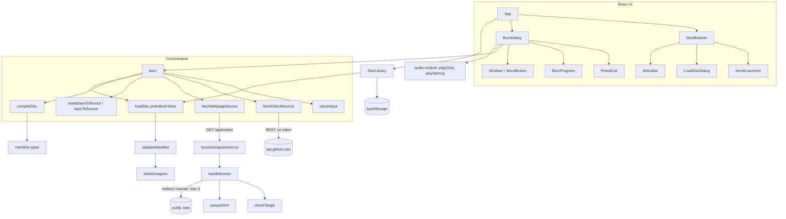
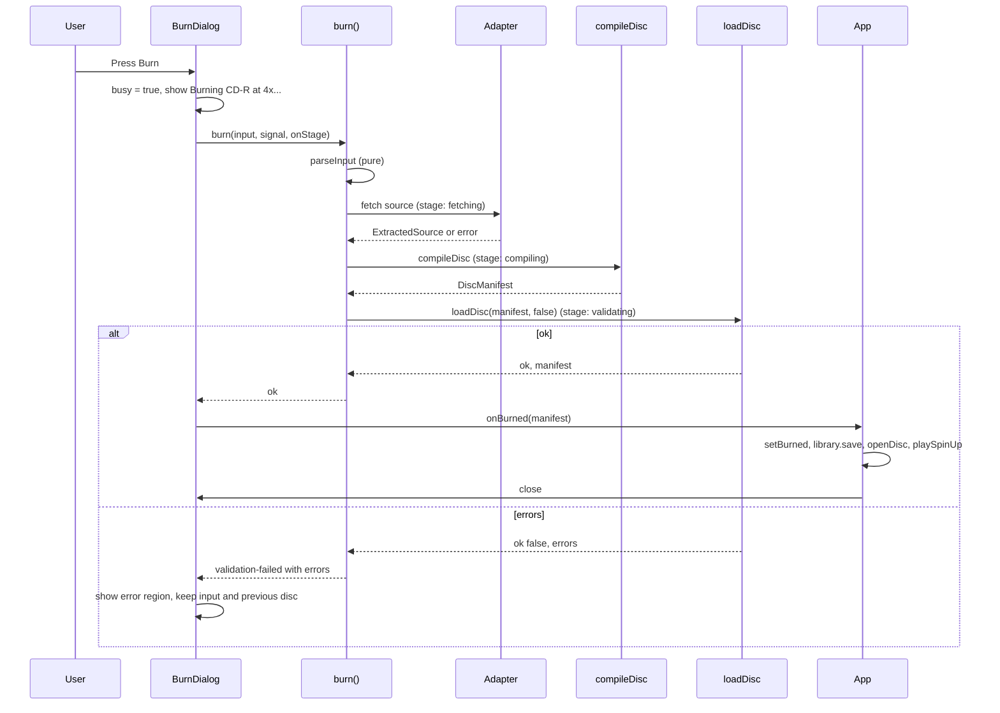

# Design Document

## Overview

This is the design for Spec #2, `dynamic-disc-compiler`. It adds a "Burn New CD-R Disc..." flow to DiscLore '97. The user pastes a GitHub repository URL, a webpage URL, Markdown, or a topic. The App turns that input into a `DiscManifest`, passes it through `loadDisc(manifest, false)`, and mounts it next to the two pre-baked discs.

The design has five layers, each testable on its own:

1. **Pure core.** `src/model/compiler.ts` exports `compileDisc(source: ExtractedSource): DiscManifest`. It does no I/O, reads no clock, and uses no `Math.random`. All "random" choices come from a seeded PRNG whose seed is a hash of the input. Validity is guaranteed by construction, and the validator is the independent check.
2. **Pure parsers.** `parseInput` classifies the user's text. `markdownToSource` and `topicToSource` build an `ExtractedSource` with no network access. `extractHtml` and `checkTarget` (the SSRF guard) are pure and have no DOM dependency.
3. **Adapters with injectable `fetch`.** The GitHub adapter calls `https://api.github.com` from the browser. The webpage adapter calls the same-origin `/api/extract`. Both return a `Result` and never throw.
4. **Optional Cloudflare Pages Function.** `functions/api/extract.ts` is a thin wrapper over the testable `handleExtract` in `src/extract/handler.ts`. The App builds and runs without it.
5. **App integration.** `App` owns burned discs and the dialog state. A new `BurnDialog` is reachable from the Home launcher, the File menu, and the Load Disc dialog. A `DiscLibrary` persists burned discs in `localStorage`.

### Key design decisions

| Decision | Choice | Reason |
|---|---|---|
| Source type name | `ExtractedSource` in `src/model/source.ts`, re-exported by `compiler.ts` | It is the Source_Content of the requirements. Types live apart from code so adapters do not import compile internals. |
| Randomness | `fnv1a32` seed over a canonical string, then `mulberry32`, one independent stream per stage | Deterministic, small, no dependency. A per-stage salt keeps a change in one stage from shifting another. |
| Validity | Constructive: every id is generated from a counter, every reference is taken from a list that was already built, every dungeon is built as a tree rooted at `entrance` | `validateManifest` stays the independent check, and Property 1 tests the construction. |
| Section content | Flat `headings` and `paragraphs` lists, split into sections by proportional chunking | Matches the Source_Content definition. Association between a heading and its text is lost in the flat form. This is a known limit and is stated in Error Handling. |
| Trivia answers | The correct option is a sentence from the cited section, or the cited section's title | Satisfies "answer taken from the cited section". The test can check the answer against the section text. |
| SSRF | Guard parses with the WHATWG `URL` class and checks the normalized `hostname` | The URL parser already turns decimal, octal, hex, and short IPv4 forms into dotted quads, so one range check covers Requirement 10.5. |
| Pages Function testing | `functions/api/extract.ts` only adapts `Request` to `handleExtract`. All logic lives under `src/extract/`. | The existing `vitest`, `tsc`, and `eslint` setup already covers `src/` and `tests/`. Only `functions` is added to the `tsconfig.json` `include`. |
| Persistence | One `localStorage` key per disc, `disclore97.disc.<disc_id>`, value is a versioned envelope with a sequence number | Oldest-first eviction needs an order and the compiler may not read the clock. A sequence number needs neither. |
| `sources` prop | `App` keeps `sources` as the base list. Burned discs are appended. A library is created only when `sources` is omitted. | The existing `App` tests pass `sources` and must not see leaked `localStorage` state. |

### Research notes

- Pages Functions use file-based routing from a `/functions` directory at the project root, so `functions/api/extract.ts` serves `/api/extract` ([Routing](https://developers.cloudflare.com/pages/functions/routing/), [Get started](https://developers.cloudflare.com/pages/functions/get-started)). When both `onRequest` and `onRequestGet` exist, only the method-specific handler runs for that method ([API reference](https://developers.cloudflare.com/pages/functions/api-reference/)). This design exports only `onRequest` and answers non-`GET` methods itself with 405, so the method rule is testable in `handleExtract`.
- Unauthenticated GitHub REST requests are limited to 60 per hour ([GitHub rate limits](https://docs.github.com/en/rest/overview/rate-limits-for-the-rest-api)). One burn costs up to 3 requests, so the adapter makes the repository request first and skips the other two on failure.
- The repository README endpoint returns file content as base64 in JSON ([GitHub repository contents API](https://docs.github.com/en/rest/repos/contents)). The adapter decodes base64 to bytes and the bytes as UTF-8. It does not use the `atob` result as text, because `atob` returns Latin-1 characters.
- Content was rephrased for compliance with licensing restrictions.

## Architecture



### Burn sequence



### Directory layout

New files are marked `+`. Modified files are marked `~`.

```
functions/
+ api/extract.ts               # thin Pages Function wrapper
src/
~ App.tsx                      # burned discs, burn dialog state, library
  model/
+   source.ts                  # ExtractedSource, SourceKind, SourceMetadata
+   compiler.ts                # compileDisc (single public import path)
+   compile/text.ts            # sanitizeLine, sanitizeParagraph, truncate, stripMarkdownInline
+   compile/prng.ts            # fnv1a32, mulberry32
+   compile/ids.ts             # slug, discId, hash4
+   compile/sections.ts        # section planning, facts, timeline, plates
+   compile/diagram.ts         # shapes and hotspots
+   compile/trivia.ts          # questions
+   compile/dungeon.ts         # rooms and exits
+   sourceInput.ts             # parseInput
+ adapters/
+   types.ts                   # Result, BurnErrorCode, BurnError, FetchLike
+   errors.ts                  # ERROR_MESSAGES, FALLBACK_CODES
+   http.ts                    # fetchWithDeadline
+   markdown.ts                # parseMarkdown, markdownToSource, topicToSource (Fallback_Adapter)
+   github.ts                  # fetchGithubSource, decodeReadme
+   webpage.ts                 # fetchWebpageSource
+   burn.ts                    # burn, burnFallback
+ extract/
+   ssrf.ts                    # checkTarget (SSRF_Guard)
+   htmlExtract.ts             # extractHtml (HTML_Extractor)
+   handler.ts                 # handleExtract
+ library/discLibrary.ts       # createDiscLibrary, getBrowserStorage
  components/
+   BurnDialog.tsx, BurnProgress.tsx, PresetList.tsx, useModalDialog.ts
~   DiscBrowser.tsx            # onBurnNew, File menu item, passes to Home and Load dialog
~   HomeLauncher.tsx           # "Burn New CD-R Disc..." card
~   LoadDiscDialog.tsx         # "Burn New Disc..." button, Remove buttons
~   ExpansionPackList.tsx      # optional renderExtra slot
  styles/
+   burn.css
tests/
~ generators.ts                # new arbitraries
+ properties/dc01-... dc25-... # one file per property
+ compiler/, adapters/, extract/, library/, components/  # unit and component tests
+ dynamic-static.test.ts
~ ../tsconfig.json             # include gains "functions"
```

### Module dependency rules

- `src/model/**`, `src/adapters/**`, `src/extract/**`, and `src/library/**` import no React, no `src/components`, and no browser global at module scope. `adapters` and `library` receive `fetch` and `Storage` as parameters.
- `src/extract/**` imports nothing from `adapters`, `components`, or `library`, so the Pages Function bundle stays small.
- `src/model/compiler.ts` imports only `src/model/source.ts`, `src/model/manifest.ts`, and `src/model/compile/*`. It does not import `validate.ts`; tests and `burn` call the validator.
- `tests/dynamic-static.test.ts` enforces these rules by scanning import lines (see Testing Strategy).

## Components and Interfaces

### Source types (`src/model/source.ts`)

```ts
export type SourceKind = 'github' | 'webpage' | 'markdown' | 'topic';

export interface SourceMetadata {
  kind: SourceKind;
  /** Source URL or a short label, for example "https://github.com/o/r" or "Topic: Lighthouses". */
  source: string;
  description?: string;
  languages?: string[];
  author?: string;
  /** Pre-formatted plain-text facts, for example "Stars: 1200". Used for Quick Facts. */
  facts?: string[];
}

export interface ExtractedSource {
  title: string;
  headings: string[];
  paragraphs: string[];
  metadata: SourceMetadata;
}
```

Optional fields are omitted, never set to `undefined`, as in `manifest.ts`.

### Compiler (`src/model/compiler.ts`)

```ts
export function compileDisc(source: ExtractedSource): DiscManifest;
export type { ExtractedSource, SourceKind, SourceMetadata } from './source';
export { sanitizeLine, sanitizeParagraph } from './compile/text';   // used by adapters and tests
export const ALLOWED_TOKENS: readonly string[];                      // the --color-* names the compiler may emit
```

`compileDisc` is total on type-correct input. It also tolerates runtime garbage (non-array lists, non-string items, missing metadata) by coercing through `normalizeSource(unknown)`, so Requirement 2.11 holds even when a caller bypasses TypeScript.

#### Pipeline

```
ExtractedSource
  -> normalizeSource      sanitize, truncate, drop empties, dedupe headings
  -> seed = fnv1a32(canonical(normalized))
  -> planSections         titles, paragraph chunks, facts, timeline, plate
  -> buildDiagram         shapes + hotspots (uses sections only)
  -> buildTrivia          questions (uses sections and seed)
  -> buildDungeon         rooms and exits (uses sections and seed)
  -> assemble DiscManifest
```

Each stage takes already-built data and returns plain JSON values. No stage reads a global.

#### Text sanitization (`compile/text.ts`)

`sanitizeLine(raw: string, max: number): string` applies these steps in order. Every regex is linear (no nested quantifiers), and the input is first cut to `max * 8` UTF-16 units to bound work.

1. Remove Markdown images `` entirely. Replace links `[text](url)` with `text`. Replace reference links `[text][ref]` with `text`. Remove link reference definitions.
2. Remove HTML tags with `/<[^<>]*>/g`, repeated until the string stops changing (at most 5 passes). This defeats `<scr<script>ipt>`.
3. Delete every remaining `<` and `>`. After this step no string can contain a tag, whatever the input was. Text such as `a < b` loses its angle bracket; this is the price of the "no HTML tag" guarantee.
4. Remove control characters other than `\n` and `\t`: `U+0000` to `U+0008`, `U+000B`, `U+000C`, `U+000E` to `U+001F`, `U+007F` to `U+009F`. Also remove bidirectional override and isolate characters (`U+202A` to `U+202E`, `U+2066` to `U+2069`), zero-width characters (`U+200B` to `U+200D`, `U+FEFF`), and lone surrogates.
5. Replace every run of whitespace (including `\n` and `\t`) with one space, then trim. Paragraphs use the same step. This is stricter than Requirement 7.1 requires, and it keeps the dungeon and article text on one line.
6. Truncate to `max` UTF-16 units. If the cut falls between a surrogate pair, drop the lone high surrogate. If the cut shortens the text and a space exists in the last 20 units, cut there. When text was shortened, the last kept unit is replaced by `…`, so the result never exceeds `max`.

`sanitizeParagraph(raw)` is `sanitizeLine(raw, 1200)`. Titles and headings use `max = 120`. Disc title uses 80, tagline 140, hotspot labels 40, trivia prompts 200, trivia options 120.

The strings `javascript:` and `onerror=` stay as inert text, because they are not tags and React renders them as text. The compiler never places source text in a shape attribute.

#### Seeded PRNG (`compile/prng.ts`)

```ts
export function fnv1a32(s: string): number;            // over UTF-16 code units, Math.imul, >>> 0
export function mulberry32(seed: number): () => number; // returns [0, 1)
export function stream(seed: number, salt: string): () => number; // mulberry32(seed ^ fnv1a32(salt))
```

The canonical string is `kind \u0001 source \u0001 title \u0001 headings.join(\u0002) \u0001 paragraphs.join(\u0002)` taken after normalization. Equal sources therefore have equal seeds, and the streams `'trivia'`, `'dungeon'`, `'diagram'` do not influence each other. Both functions use only integer arithmetic, so the result is the same on every JavaScript engine.

#### Identifiers (`compile/ids.ts`)

- `slug(s)`: `s.normalize('NFKD')`, remove combining marks (`/\p{M}/gu`), lowercase, replace each run of characters outside `[a-z0-9]` with `-`, trim `-`.
- `hash4(s)`: `fnv1a32(s).toString(36).padStart(4, '0').slice(-4)`.
- `discId(kind, identity)`: `kind + '-' + head + '-' + hash4(kind + identity.trim().toLowerCase())`, where `head = slug(identity)` cut to `48 - kind.length - 1 - 5` characters with trailing `-` removed, and the `head` part and its dash are omitted when `head` is empty. The result matches `^(github|webpage|markdown|topic)(-[a-z0-9]+)*$`, is at most 48 characters, and starts with its Source_Kind. This prefix means a compiled id can never equal `castles` or `retro-dialup` (Requirement 15.10).
- The hash is always appended, so two different topics with the same slug ("C++" and "C#") get different ids, and the same repository in a different letter case gets the same id.
- Identity: for `github` the path after `github.com/`, for `webpage` the host and path of the source URL, for `markdown` and `topic` the title. If `source` is not a parseable URL, the whole `source` string is the identity.
- Section ids: `s{NN}` or `s{NN}-{slug(title) cut to 24}`, where `NN` is the two-digit index. Diagram `diagram-1`. Trivia `q-{NN}`. Dungeon `dungeon-1`. Rooms: `entrance`, `throne_room`, `hall_{NN}`. A counter makes every id unique in its scope, so no duplicate check is needed.

#### Section planning (`compile/sections.ts`)

1. **Titles.** Take usable headings in order, dropping case-insensitive duplicates, up to 12. If fewer than 5 remain, append titles from the fixed pool `Overview`, `Key Ideas`, `Background`, `How It Works`, `In Practice`, `Terms to Know`, `Going Further`, `Summary`, skipping any that duplicate an existing title, until there are 5. The pool has 8 entries and at most 4 are used up by headings, so 5 titles always exist.
2. **Paragraphs.** With `P` usable paragraphs and `N` sections, section `i` receives paragraphs `floor(i*P/N)` up to `floor((i+1)*P/N)`, capped at 8 (7 for the first section, which also carries the attribution). A section with no source paragraph receives one template paragraph: `This article introduces "{title}" as part of "{discTitle}". It was generated from {kindLabel} content, so treat it as a starting point and check the source for details.`
3. **Attribution.** The last paragraph of section 0 is `Source ({kindLabel}): {label}`, with `label = sanitizeLine(metadata.source, 300)`. `kindLabel` is `GitHub repository`, `Web page`, `Markdown text`, or `Topic`. If `source` is empty, `label` is `unknown source`.
4. **Facts.** Up to 4 per section: the first sentence of each of the first 3 paragraphs (split on `/(?<=[.!?])\s+/`, at most 140 units). Section 0 also gets `metadata.facts`, then `Languages: ...` and `By: author` when present. If the list is still empty, the fact is `Article {i+1} of {N} in "{discTitle}".`
5. **Timeline.** Entry `{ when: "Part {i+1} of {N}", event: "{title} in {discTitle}" }`, plus `{ when: "Before", event: "Previous article: {prevTitle}" }` and `{ when: "After", event: "Next article: {nextTitle}" }` when they exist. The timeline shows reading order. It does not invent dates.
6. **Plate.** `plate` is chosen from keys that `Plate.tsx` defines, by kind: `github` uses `terminal`, `computer`, `disc`; `webpage` uses `browser`, `bbs`, `modem`; `markdown` uses `book`, `disc`, `phone`; `topic` uses `book`, `computer`, `browser`. The key is `list[i % 3]`.
7. **Disc title and tagline.** `title = sanitizeLine(source.title, 80)`, falling back to the label of `metadata.source`, then `Untitled Disc`. `tagline` is `metadata.description`, else the first sentence of the first paragraph, else `A {kindLabel} Expansion Pack compiled from {label}.`, cut to 140 and never empty.

#### Diagram (`compile/diagram.ts`)

One diagram, `diagram-1`, titled `Map of {discTitle}`. `K = min(N, 8)` hotspots (`K >= 5` because `N >= 5`). Node `i` is placed at `cx = 18 + (i % 3) * 32 + j`, `cy = 30 + floor(i / 3) * 24 + j'`, where `j, j'` are integers in `[-3, 3]` from the `'diagram'` stream, so every point is inside `[15, 85]` by `[27, 81]`.

Shape list, all numeric:

- background `rect 0 0 100 100`, fill `var(--color-parchment)`, stroke `none`;
- banner `rect 0 0 100 14`, fill `var(--color-sky-deep)`;
- floor strip `rect 0 90 100 10`, fill `var(--color-parchment-dark)`;
- for consecutive nodes, a `line` with stroke `var(--color-ink)`;
- per node, a card `rect (cx-10, cy-7, 20, 14)` with fill from the cycle `sky`, `forest-light`, `gold-light`, `crimson-light`, `wood-light`, `stone-light` and stroke `var(--color-ink)`, then a marker `circle (cx, cy, 2.5)` with fill `var(--color-gold)` and stroke `var(--color-gold-dark)`.

The hotspot for node `i` is `{ label: truncate(title, 40), x: cx, y: cy, section_id: sections[i % N].section_id }`. The modulo implements Requirement 3.9, though `K <= N` means it never wraps today. Distinct tokens always present: `parchment`, `sky-deep`, `parchment-dark`, `ink`, `gold`, `gold-dark`, and at least `K` card colors, so Requirement 3.6 (at least 3) holds.

#### Trivia (`compile/trivia.ts`)

Let `T = min(max(N, 5), 10)`, `count = 3 + (seed % 2)` (the same option count for every question of a disc), and `offset = (seed >>> 3) % count`. Question `q` cites `sections[q % N]`. Because `N >= 5`, the first 5 questions cite 5 different sections.

- **Even `q`, "statement" form.** Prompt: `Which statement appears in the article "{title}"?`. Correct option: a sentence of the cited section (the longest sentence of at least 20 units among the first 3 paragraphs, else the first paragraph), cut to 120 units. Distractors: sentences from other sections, picked by the `'trivia'` stream, rejected if they equal the correct option or any sentence of the cited section (compared lowercase and trimmed).
- **Odd `q`, "title" form.** Prompt: `Which article contains this passage: "{snippet}"?` with `snippet` the first 100 units of the section's first paragraph. Correct option: the section title (at most 120). Distractors: other section titles.
- **Filling.** If fewer than `count - 1` distractors remain after rejection, the rest come from `GENERIC_DISTRACTORS`, a fixed pool of 8 original false statements, for example `It is a recipe for baking bread.` and `It lists the rules of a chess opening.`, skipping any equal to an option already chosen. The pool has more than `count` entries, so the fill always succeeds.
- **Order.** The distractors are shuffled with the `'trivia'` stream (Fisher-Yates). The correct option is inserted at `correct_index = (offset + q) % count`. Over any `count` consecutive questions every position is used once, so with `T >= 5 > count` at least 3 positions appear (Requirement 4.7).
- **Distinctness.** Options are truncated first, then compared by `trim().toLowerCase()`. A duplicate is dropped before the fill step.
- If the pool of other sections yields no usable text, the fill step supplies the options. `T`, `count`, and the options are therefore always valid.

#### Dungeon (`compile/dungeon.ts`)

`R = clamp(N + 3, 8, 12)` rooms, so `R >= 8` and `R` never exceeds 12. Let `m = R - 2` be the number of halls.

1. Create `entrance`, `throne_room`, and `hall_01` to `hall_{m}`. Room `k` links to section `k % N` for names and text: `entrance` uses section 0, `throne_room` uses section `N - 1`, `hall_k` uses section `k % N`.
2. **Spanning tree.** Shuffle the halls with the `'dungeon'` stream. Maintain `attached = [entrance]`. For each hall in shuffled order, pick a parent from `attached` among those with fewer than 3 tree children, add the exit `parent -> hall`, and append the hall to `attached`. A parent always exists: a tree on `n` nodes has `n - 1` children in total, so not every node can hold 3.
3. **Throne.** Pick the parent of `throne_room` from the attached halls whose depth is at least 2 (or any hall if none), by the stream, and add the exit `parent -> throne_room`. `throne_room` gets no outgoing exits.
4. **Loops.** `E = 2 + floor(R / 3)` attempts. Each picks a random source among non-throne rooms and a random target among all rooms except itself. It adds the exit only if the pair is new and the source has fewer than 5 exits. The loop runs at most `4 * E` iterations, so it terminates.
5. **Dead ends.** Every non-throne room with no exits gets one exit to its tree parent. (`entrance` has at least one child, so it never needs this.)
6. **Text.** Names: `entrance` is `Entrance: {discTitle}`, `throne_room` is `Throne Room of {discTitle}`, `hall_k` is `Hall of {sectionTitle}` (name cut to 80). Descriptions pick one of 6 original templates by the stream, and every template quotes the linked section title, for example `Torches light a room that holds the article "{sectionTitle}".`

Why it is valid: every room except `entrance` is attached to the tree by an exit from an earlier attached room, so every room is reachable from `entrance` (zero orphans), `throne_room` is reachable (non-empty BFS path), every exit target is a room id from the list, exactly one room has each reserved id, and steps 4 and 5 only add exits between existing rooms. The dungeon title is `Keep of {discTitle}`.

### Input parser (`src/model/sourceInput.ts`)

```ts
export type InputErrorCode = 'empty-input' | 'unsupported-scheme' | 'input-too-long' | 'invalid-github-url';

export type ParsedInput =
  | { ok: true; kind: 'github'; owner: string; repo: string; url: string }
  | { ok: true; kind: 'webpage'; url: string }
  | { ok: true; kind: 'markdown'; text: string }
  | { ok: true; kind: 'topic'; text: string }
  | { ok: false; error: InputErrorCode };

export function parseInput(raw: string): ParsedInput;
```

Order of checks, applied to `raw.trim()` (named `s`):

1. `s === ''` gives `empty-input`.
2. `s.length > 20000` gives `input-too-long`.
3. Scheme check: if `s` starts with `^[a-z][a-z0-9+.-]*:` (case-insensitive) and the scheme is not `http` or `https`, and either `//` follows the colon or the scheme is one of `javascript`, `data`, `file`, `vbscript`, `mailto`, `ftp`, `ws`, `wss`, `blob`, `about`, `tel`, `sms`, `view-source`, return `unsupported-scheme`. A colon after an ordinary word such as `Rust: a language` is not a scheme, so it stays a topic. This is a stated reading of Requirement 1.6 that avoids rejecting topics.
4. Single-line `http(s)://` input without whitespace: parse with `new URL`. If parsing throws, treat the input as a topic. If the host (without `www.`, lowercase) is `github.com`, take non-empty path segments `[owner, repo, ...]`. Fewer than 2 segments, a segment other than `.` or `..` that fails `^[A-Za-z0-9._-]{1,100}$`, a segment equal to `.` or `..`, or an empty repo after removing a `.git` suffix gives `invalid-github-url`. Otherwise return `github` with `url = https://github.com/{owner}/{repo}`. Any other host returns `webpage` with `url = url.href` without the fragment.
5. If `s` contains a line break, or any line matches `^ {0,3}#{1,6}\s+\S`, return `markdown` with `text = s`.
6. Otherwise return `topic` with whitespace collapsed.

The function throws no exception: the `new URL` call sits in a `try`. It reads no global other than the `URL` constructor.

### Fallback adapter (`src/adapters/markdown.ts`)

```ts
export function parseMarkdown(md: string): { title?: string; headings: string[]; paragraphs: string[] };
export function markdownToSource(md: string, source?: string): ExtractedSource;   // kind 'markdown'
export function topicToSource(topic: string): ExtractedSource;                     // kind 'topic'
```

`parseMarkdown` is one pass over lines (CRLF normalized), so 20000 characters take well under 50 ms.

- Fenced code (three or more backticks or tildes, closed by the same character with at least the same length, or the end of the input) is skipped.
- Lines starting with `<` and a letter, `/`, or `!` open an HTML block that is skipped to the next blank line. Indented code (four spaces or a tab after a blank line) is skipped. Table rows (starting with `|`) and horizontal rules are skipped.
- Headings of level 1 to 3 go to `headings`. The first level-1 heading becomes `title` and is left out of `headings`. Headings of level 4 to 6 are treated as paragraph text.
- Consecutive non-blank lines join into one paragraph with a space. Each list item (`-`, `*`, `+`, `1.`) is its own paragraph with the marker removed. A leading `>` is removed.
- Paragraph text goes through the inline stripping of `sanitizeLine` (images dropped, links reduced to text) before an empty check, so badge-only lines vanish.

`markdownToSource` sets the title to the first level-1 heading, else the first heading, else the first 6 words, else `Untitled Markdown`. `source` defaults to `Markdown text`.

`topicToSource(t)` sets `title = t` and `source = "Topic: " + t`. It returns 6 template headings (`What is {t}?`, `Key terms in {t}`, `How {t} is used`, `Questions to explore about {t}`, `Where to learn more about {t}`, `Putting {t} into practice`) and one template paragraph for each. The paragraphs are study prompts, not factual claims, for example `Use this page to write down what you already know about {t}.`, so a topic disc never states unverified facts. The result is documented to the user in the dialog as an outline.

### GitHub adapter (`src/adapters/github.ts`)

```ts
export type FetchLike = (input: string, init?: RequestInit) => Promise<Response>;

export interface AdapterOptions {
  fetch?: FetchLike;          // default: globalThis.fetch bound
  signal?: AbortSignal;       // user cancel
  timeoutMs?: number;         // default 8000 (github), 12000 (webpage)
}

export function fetchGithubSource(owner: string, repo: string, opts?: AdapterOptions): Promise<Result<ExtractedSource>>;
export function decodeReadme(content: string): string;   // base64 -> UTF-8, at most 100000 chars
```

Requests, all `GET`, all with only the header `Accept: application/vnd.github+json` (CORS-safelisted, so there is no preflight) and no `Authorization`:

1. `https://api.github.com/repos/{enc(owner)}/{enc(repo)}`. Fields used: `full_name`, `name`, `description`, `topics`, `license.name`, `stargazers_count`, `default_branch`, `language`, `owner.login`.
2. After the first request succeeds, in parallel: `.../languages` (object of `name: bytes`) and `.../readme` (object with `encoding` and `content`).

Behavior:

- **Deadline.** `fetchWithDeadline(fetch, url, init, ms, outer)` creates an `AbortController`, aborts it after `ms`, and also aborts when `outer` aborts. The timer covers reading the body (`res.json()` runs inside the same guard), and it is cleared in `finally`. Outcomes: `outer.aborted` gives `cancelled`, deadline gives `timeout`, any other throw gives `network`.
- **Status mapping, repository request.** 404 gives `repo-not-found`. 403 or 429 gives `rate-limited`. A 200 response whose `x-ratelimit-remaining` is `0` is a success (the data is in hand). Other non-2xx status gives `fetch-failed` with a generic message.
- **Secondary requests.** The two follow-up requests are best effort. Any failure, including 403, 429, 404, timeout, or malformed JSON, leaves that part empty and does not fail the burn (Requirement 8.8). A `cancelled` outcome still propagates. This is the stated reading of Requirement 8.7: the repository request decides the error code, because by then we hold usable data.
- **README decoding.** If `encoding !== 'base64'` or `content` is not a string, there is no README. Otherwise remove whitespace, keep at most the first 133336 base64 characters (a multiple of 4, enough for 100000 bytes), decode with `atob` to a binary string, copy it into a `Uint8Array`, decode with `new TextDecoder('utf-8')` (non-fatal), and cut to 100000 UTF-16 units. A trailing partial multi-byte sequence becomes `U+FFFD`, which `sanitizeLine` accepts as text.
- **Build.** `parseMarkdown(readme)` supplies headings and paragraphs. Paragraph list is `[description, "Repository facts: ..." , ...readme paragraphs]` and headings are `["About this repository", ...readme headings]`. `title = full_name`. Metadata: `kind: 'github'`, `source: https://github.com/{owner}/{repo}` built from the parsed owner and repo (not from the response), `description`, `languages` (top 8 by bytes, ties by name), `author: owner.login`, `facts: ["Stars: n", "Default branch: x", "License: y", "Primary language: z", "Topics: a, b"]` with absent items omitted.
- The adapter fetches no URL found in the README or the API response.

### Webpage adapter (`src/adapters/webpage.ts`)

```ts
export function fetchWebpageSource(url: string, opts?: AdapterOptions & { endpoint?: string }): Promise<Result<ExtractedSource>>;
```

`GET {endpoint ?? '/api/extract'}?url={encodeURIComponent(url)}`, deadline 12000 ms, same-origin, no credentials option set (`credentials: 'same-origin'` is the default and no custom headers are sent).

| Response | Result |
|---|---|
| 404, or any non-JSON body (including the SPA fallback `index.html` with status 200) | `unavailable` |
| Non-2xx with JSON `{ error: { code, message } }` | `fetch-failed`, message taken from `error.message` (string, cut to 200 units, passed through `sanitizeLine`) |
| Non-2xx with other JSON | `fetch-failed`, generic message |
| 200 JSON where `title` is not a string, or `headings` or `paragraphs` is not an array of strings | `fetch-failed` |
| 200 valid JSON | `ExtractedSource` with `kind: 'webpage'`, `source` = response `url` if it is a string that parses as `http(s)`, else the requested URL; title falls back to the host name |
| Deadline | `timeout` |
| Throw | `network` |

The adapter keeps at most 12 headings and 40 paragraphs from the body, whatever the server sent.

### Burn orchestrator (`src/adapters/burn.ts`)

```ts
export type BurnStage = 'fetching' | 'compiling' | 'validating';

export interface BurnDeps {
  fetch?: FetchLike;
  signal?: AbortSignal;
  onStage?: (s: BurnStage) => void;
}

export type BurnResult =
  | { ok: true; manifest: DiscManifest }
  | { ok: false; error: BurnError };

export function burn(input: string, deps?: BurnDeps): Promise<BurnResult>;
export function burnFallback(topic: string, deps?: BurnDeps): Promise<BurnResult>;   // topicToSource path
```

`burn` runs `parseInput`, calls the adapter for the kind (`markdown` and `topic` need no network and skip `fetching`), calls `compileDisc`, then `loadDisc(manifest, false)`. A validation failure yields `{ code: 'validation-failed', validation: errors }`. The whole body is in a `try`: an exception in an adapter becomes `fetch-failed`, and an exception in the compiler becomes `validation-failed` (Requirement 14.5). `signal.aborted` after any `await` returns `cancelled`. For errors in `FALLBACK_CODES` (`network`, `timeout`, `rate-limited`, `repo-not-found`, `unavailable`, `fetch-failed`) the error carries `fallbackTopic`, which is the repository name or the page host name, so the dialog can offer the offline burn (Requirement 11.3). `burnFallback` runs the same compile and validate steps on `topicToSource(fallbackTopic)`.

### Error codes and messages (`src/adapters/errors.ts`)

```ts
export type BurnErrorCode =
  | 'empty-input' | 'unsupported-scheme' | 'input-too-long' | 'invalid-github-url'
  | 'repo-not-found' | 'rate-limited' | 'timeout' | 'network' | 'unavailable'
  | 'fetch-failed' | 'validation-failed' | 'cancelled';

export interface BurnError { code: BurnErrorCode; message: string; validation?: ValidationError[]; fallbackTopic?: string }
export const ERROR_MESSAGES: Record<BurnErrorCode, string>;
export const FALLBACK_CODES: ReadonlySet<BurnErrorCode>;
```

`Record<BurnErrorCode, string>` makes the compiler reject a missing message. Adapter `message` strings are always taken from `ERROR_MESSAGES`, except the sanitized server message of `fetch-failed`, which is appended after the standard text.

### SSRF guard (`src/extract/ssrf.ts`)

```ts
export type SsrfReason =
  | 'bad-url' | 'scheme' | 'credentials' | 'port' | 'host-name' | 'blocked-suffix' | 'private-address';

export type SsrfVerdict = { ok: true; url: URL } | { ok: false; reason: SsrfReason };

export function checkTarget(raw: string | URL): SsrfVerdict;
```

Steps, in order:

1. `new URL(raw)`; failure gives `bad-url`.
2. `protocol` is `http:` or `https:`, else `scheme`.
3. `username` and `password` are empty, else `credentials`.
4. `port` is `''`, `'80'`, or `'443'`, else `port`. (The URL parser already drops a default port, so `:80` on `http:` becomes `''`.)
5. `host = hostname.toLowerCase()` with one trailing `.` removed.
6. **IPv6.** If `host` starts with `[`, parse the inside into 8 hextets (own parser: handles `::`, mixed dotted-quad tails, and rejects anything malformed with `private-address`). Reject if the address is `::`, `::1`, in `fc00::/7`, in `fe80::/10`, in `ff00::/8`, in `100::/64`, or in `2001:db8::/32`. Extract the embedded IPv4 from `::ffff:0:0/96` (mapped), `64:ff9b::/96` (NAT64), and `2002::/16` (6to4) and reject if that IPv4 is blocked. The extra ranges beyond Requirement 10.4 are conservative.
7. **IPv4.** If `host` matches `^\d{1,3}(\.\d{1,3}){3}$`, convert to an unsigned 32-bit integer and compare against the range table. Decimal (`2130706433`), hex (`0x7f.1`), octal (`0177.0.0.1`), and short (`127.1`) forms never reach this step in a non-normalized form, because the WHATWG `URL` parser has already rewritten them to a dotted quad (or thrown, which is `bad-url`). As a second layer, a host whose last label is all digits, or starts with `0x`, is rejected as `host-name`, because no public top-level domain looks like that.
8. **Names.** Reject `host-name` for `localhost`, names ending in `.localhost`, `.local`, `.internal`, `.localdomain`, or `.home.arpa`, names with no dot, and names with an empty label. Reject `blocked-suffix` for `nip.io`, `sslip.io`, `xip.io`, `localtest.me`, and `lvh.me` (and their subdomains), because those names resolve to whatever address is written in them.
9. Otherwise `{ ok: true, url }`.

IPv4 blocked ranges (base, prefix): `0.0.0.0/8`, `10.0.0.0/8`, `100.64.0.0/10`, `127.0.0.0/8`, `169.254.0.0/16`, `172.16.0.0/12`, `192.0.0.0/24`, `192.0.2.0/24`, `192.168.0.0/16`, `198.18.0.0/15`, `198.51.100.0/24`, `203.0.113.0/24`, `224.0.0.0/4`, `240.0.0.0/4` (which includes `255.255.255.255`), plus the single address `168.63.129.16`. The first list matches Requirement 10.3. The documentation, reserved, and Azure addresses are extra. Membership test: `(ip >>> (32 - bits)) === (base >>> (32 - bits))`.

**Stated limit (DNS rebinding).** The guard checks the text of the URL. It cannot see which address a public hostname resolves to, and Cloudflare Workers offer no way to pin the resolved address for a `fetch`. A hostname that resolves to a private address, or an attacker DNS record that changes between check and fetch, is not detected by this code. The suffix list above blocks the common wildcard-DNS services only. The Workers runtime itself does not route `fetch` to the private networks of its own edge, which limits the impact, but this design does not rely on that as a proof. Optional hardening outside this spec: a DNS-over-HTTPS lookup before the fetch (still racy), a Cloudflare WAF rate-limit rule on `/api/extract`, and an allowlist of hostnames.

### HTML extractor (`src/extract/htmlExtract.ts`)

```ts
export interface Extracted { title: string; headings: string[]; paragraphs: string[] }
export function extractHtml(html: string): Extracted;
export function decodeEntities(s: string): string;
```

A single linear scan, no DOM and no dependency.

- **Tokens.** Find `<` with `indexOf`. Text before it goes to the active buffer. `<!--` skips to `-->`. `<!`, `<?` skip to `>`. Otherwise read the tag name (`[A-Za-z][A-Za-z0-9:-]*`), then skip attributes to the closing `>`, honoring single and double quotes so that `>` inside an attribute value does not end the tag. An unterminated tag or comment ends the scan.
- **Raw text elements.** After `<script` or `<style` open tags, jump to the matching `</script` or `</style` with a case-insensitive sticky regex (`lastIndex`, not `toLowerCase`, because lower-casing can change string length for some characters). The content is dropped.
- **Discarded subtrees.** For `noscript`, `template`, `svg`, `iframe`, a depth counter suppresses all captured text while it is above zero. A self-closing `<svg/>` does not increase it. An element that is never closed suppresses the rest of the document.
- **Capture.** The first `<title>` seen outside a discarded subtree supplies `title`; its content runs to `</title`. Opening `h1`, `h2`, or `h3` starts a heading buffer. Opening `p` starts a paragraph buffer. A closing `h1` to `h3` or `p`, a new `p` or `h1` to `h3`, a block-level open or close tag (`div`, `ul`, `ol`, `li`, `table`, `tr`, `td`, `section`, `article`, `header`, `footer`, `nav`, `aside`, `main`, `blockquote`, `pre`, `form`, `h4` to `h6`), and the end of input flush the active buffer. `br` adds a space. Other inline tags are ignored.
- **Flush.** Decode entities, collapse whitespace, trim, drop empty strings, cut to 1200 units, and stop collecting after 12 headings or 40 paragraphs. A buffer stops growing once it holds 2400 units, which bounds memory.
- **Entities.** One pass with `/&(#x[0-9a-f]{1,6}|#[0-9]{1,7}|[a-z][a-z0-9]{1,8});/gi`. Named entities come from a table of about 30 common names (`amp`, `lt`, `gt`, `quot`, `apos`, `nbsp`, `copy`, `reg`, `ndash`, `mdash`, `hellip`, `lsquo`, `rsquo`, `ldquo`, `rdquo`, `bull`, `middot`, `trade`, `laquo`, `raquo`, `euro`, `pound`, and similar). Numeric references use `String.fromCodePoint`. Zero, surrogates, and values above `0x10FFFF` become `U+FFFD`. An unknown name stays as written. Decoding runs once, so `&amp;lt;` becomes `&lt;`, not `<`.
- HTML with no title, headings, or paragraphs returns `{ title: '', headings: [], paragraphs: [] }` with no error.

The extractor output can contain `<` characters that came from decoded entities (`&lt;b&gt;`). That is plain text, and `compileDisc` removes the angle brackets later.

### Extract handler (`src/extract/handler.ts`) and Pages Function

```ts
export interface ExtractDeps { fetch: (input: string, init?: RequestInit) => Promise<Response> }
export function handleExtract(request: Request, deps: ExtractDeps): Promise<Response>;
```

```ts
// functions/api/extract.ts
import { handleExtract } from '../../src/extract/handler';

/** Minimal shape of the Pages Functions context. The full type package is not a dependency. */
interface PagesContext { request: Request; env: Record<string, unknown> }

export const onRequest = (ctx: PagesContext): Promise<Response> =>
  handleExtract(ctx.request, { fetch: (input, init) => fetch(input, init) });
```

Flow:

1. `request.method !== 'GET'` gives 405 with `Allow: GET`.
2. Read `url` from the query string. Missing or empty gives 400.
3. `checkTarget(url)`. Rejection gives 403 with `{ error: { code: 'blocked', message: <reason text> } }`. The message names the reason and echoes no upstream content.
4. One `AbortController` with an 8000 ms timer covers the whole chain and body read. Loop at most 4 times (the initial request and 3 redirects): `fetch(current, { method: 'GET', redirect: 'manual', headers, signal })`. Headers are only `User-Agent: DiscLore97-Extract/1.0 (CD-ROM encyclopedia demo; Cloudflare Pages Function)` and `Accept: text/html,application/xhtml+xml;q=0.9`. No `Cookie`, `Authorization`, or other incoming header is forwarded.
5. For status 301, 302, 303, 307, 308 with a `Location`, resolve it against the current URL and run `checkTarget`. Rejection gives 403. A fifth hop gives 502 (`too-many-redirects`).
6. Other responses: content type (before `;`, lowercased) must be `text/html` or `application/xhtml+xml`, else 415. A `Content-Length` above 1 MiB gives 502 (`too-large`) without reading. Read the body through `response.body.getReader()` and stop with 502 when the total passes 1048576 bytes (`reader.cancel()`). Decode with `TextDecoder` using the `charset` of the `Content-Type` header (fall back to UTF-8 on an unknown label). Charset in `<meta>` is not read.
7. `extractHtml`, then respond 200 with `{ title, headings, paragraphs, url: <final URL> }`.
8. Failures map: abort by timer gives 504, `fetch` throw gives 502, non-2xx upstream gives 502 (`upstream-status`).

Every response sets `Content-Type: application/json; charset=utf-8` and `X-Content-Type-Options: nosniff`. Success sets `Cache-Control: public, max-age=300`, errors set `no-store`. No CORS header is set, so only same-origin pages can read it. The module reads no environment binding and contains no secret or private URL.

**Type-check, lint, and test within the existing setup.**

- `tsconfig.json` `include` becomes `["src", "tests", "functions", "vite.config.ts"]`. `Request`, `Response`, `URL`, `TextDecoder`, and `AbortController` come from the existing `DOM` lib, so `@cloudflare/workers-types` is not needed. `npm run build` runs `tsc --noEmit` and therefore type-checks `functions/`. Vite does not bundle it, since it is not reachable from `index.html`.
- `eslint .` already covers `**/*.ts`.
- The static tests walk the whole repository, so `functions/` is scanned for `.env` files and audio assets.
- Wrangler bundles `functions/` with its own esbuild at deploy time. Local preview uses `npx wrangler pages dev dist`, which is documented in the README and is not a dependency.
- Tests for `ssrf`, `htmlExtract`, `handler`, and the adapters declare `// @vitest-environment node`. The default `jsdom` environment replaces `AbortController` and `AbortSignal` with jsdom versions, which Node's own `Request` and `fetch` can reject.

### Disc library (`src/library/discLibrary.ts`)

```ts
export type StorageLike = Pick<Storage, 'getItem' | 'setItem' | 'removeItem' | 'key' | 'length'>;
export type SaveResult = { saved: true } | { saved: false; reason: 'unavailable' | 'quota' };

export interface DiscLibrary {
  load(): DiscManifest[];                 // validated, oldest first
  save(m: DiscManifest): SaveResult;
  remove(discId: string): void;
}

export const KEY_PREFIX = 'disclore97.disc.';
export const MAX_DISCS = 10;
export function createDiscLibrary(storage: StorageLike | null): DiscLibrary;
export function getBrowserStorage(): StorageLike | null;   // try/catch around window.localStorage and a probe write
```

- **Format.** Key `disclore97.disc.{disc_id}`, value `{"v":1,"seq":<integer>,"manifest":{...}}`. The envelope version `v` lets a later format change be detected. A value with any other `v`, a non-integer `seq`, or a `manifest.disc_id` that does not match the key is treated as corrupt.
- **`load`.** Collect the keys with the prefix first (so deleting while iterating is safe). For each, parse JSON in a `try`, check the envelope, run `loadDisc(env.manifest, false)`. A failure removes the key (`removeItem` in its own `try`) and skips the entry. Sort valid entries by `seq`. If more than `MAX_DISCS` remain (storage edited by hand), remove the oldest extras. Return the manifests.
- **`save`.** `seq = 1 + max(seq of stored entries, 0)`. `setItem(key, JSON.stringify(envelope))` replaces an entry with the same `disc_id`. Then remove the oldest entries (never the one just written) until at most 10 remain. If `setItem` throws, evict the oldest other entry and retry, until it succeeds or no other entry is left. Then return `{ saved: false, reason: 'quota' }`. A `null` storage returns `{ saved: false, reason: 'unavailable' }` without trying anything.
- **`remove`.** `removeItem` in a `try`.
- The library stores only manifests, never tokens or credentials, and every call is wrapped so that a throwing `Storage` never escapes.

### App integration (`src/App.tsx` and plumbing)

New props and state:

```ts
export interface AppProps {
  sources?: readonly unknown[];
  skipSplash?: boolean;
  /** Disc library. Omit to use localStorage when `sources` is omitted, none when `sources` is given. Pass null to disable. */
  library?: DiscLibrary | null;
  /** Injected for tests. */
  burnDeps?: Pick<BurnDeps, 'fetch'>;
  /** Passed to BurnDialog. Tests pass 0. */
  minBurnMs?: number;
}
```

```ts
const baseSources = sources ?? prebakedDiscs;
const library = useMemo(() => props.library !== undefined ? props.library : sources === undefined ? createDiscLibrary(getBrowserStorage()) : null, []);
const [burned, setBurned] = useState<DiscManifest[]>(() => library?.load() ?? []);
const [burnOpen, setBurnOpen] = useState(false);
const [notice, setNotice] = useState<string | null>(null);

const discSources = useMemo(() => {
  const baseIds = new Set(baseIdsOf(baseSources));   // ids of base entries that are objects with a string disc_id
  return [...baseSources, ...burned.filter((d) => !baseIds.has(d.disc_id))];
}, [baseSources, burned]);
```

The existing `useMemo` that runs `loadDisc(src, false)` over `discSources` is unchanged, so every stored disc is validated a second time at render time. A burned disc whose id equals a base id is dropped (it cannot happen with compiled ids, which carry a kind prefix, so this is defensive only).

Handler for a finished burn:

```ts
const onBurned = (m: DiscManifest) => {
  setBurned((prev) => [...prev.filter((d) => d.disc_id !== m.disc_id), m]);   // same id replaces
  const r = library?.save(m);
  setNotice(r && !r.saved ? 'The disc is open, but it could not be saved to this browser.' : null);
  setBurnOpen(false);
  openDisc(m.disc_id);
  playSpinUp();
};
```

State updates are batched, so the render after `onBurned` already has the disc in `discs` when `nav.discId` points at it. The notice is a `<p role="status" className="app-not-found">` next to the existing not-found paragraph.

Entry points. `App` passes `onBurnNew={() => setBurnOpen(true)}` to `DiscBrowser`:

1. **Home launcher.** `HomeLauncher` gains an optional `onBurnNew` prop and a `Card` in the "Utilities" group: icon `cd`, title `Burn New CD-R Disc...`, text `Make a disc from a URL, topic, or Markdown.`
2. **File menu.** In `renderOpen`, the File menu items become `Load Disc...`, `Burn New Disc...` (only when `onBurnNew` exists), `Close Disc`. The Home screen has no menu bar, so its entry point is the card.
3. **Load Disc dialog.** `LoadDiscDialog` gains `onBurnNew?` and a `Burn New Disc...` `BevelButton` in the button row. `DiscBrowser` passes `() => { setLoadOverId(null); onBurnNew?.(); }`, so the Load dialog closes first and then the Burn dialog opens.

`LoadDiscDialog` also gains `removableIds?: ReadonlySet<string>` and `onRemove?: (id: string) => void`. It passes a `renderExtra` function to `ExpansionPackList`, which renders a `Remove` `BevelButton` with `aria-label="Remove {title} from library"` beside each removable disc that is not the currently open one. `App` computes `removableIds` from `burned` and implements `onRemove` as `setBurned(filter)` plus `library?.remove(id)`.

The Burn dialog renders as the last child of `.desktop__work` (the positioned container that `.modal-layer` fills), so it covers the workspace over both the Home window and an open disc window.

### Burn dialog components

```
BurnDialog                         (div.modal-layer, ref for focus trap)
└─ Window title="Burn New CD-R Disc..." modal onClose={cancel}
   └─ div.burn-dialog__body
      ├─ p.burn-dialog__prompt
      ├─ label[for=input] "URL, topic, or Markdown"
      ├─ textarea#input  (rows 6, maxLength not set, disabled while busy)
      ├─ PresetList      (fieldset.groupbox, legend "Presets", ul of BevelButtons)
      ├─ BurnProgress    (only while busy)
      ├─ div[role=alert].burn-dialog__errors     (only after a failure)
      │   ├─ p message
      │   ├─ ul of "path: message" (validation-failed)
      │   └─ BevelButton "Burn offline from {topic}" (fallback codes)
      ├─ div[role=status][aria-live=polite]      (progress and offline notes, visually part of the body)
      └─ div.burn-dialog__buttons: BevelButton "Burn", BevelButton "Cancel"
```

```ts
export interface BurnDialogProps {
  onBurned: (m: DiscManifest) => void;
  onClose: () => void;
  fetch?: FetchLike;
  minBurnMs?: number;      // default 800
  online?: () => boolean;  // default () => navigator.onLine !== false
}
```

- **Focus and keys.** `useModalDialog(layerRef, onCancel)` holds the logic of `LoadDiscDialog`: remember `document.activeElement`, focus the first control (the textarea), trap `Tab` and `Shift+Tab` inside the layer, call the latest `onCancel` on `Escape`, restore focus on unmount if the old element is still connected. The `Escape` handler reads `onCancel` through a ref, so it needs no re-registration. `LoadDiscDialog` is left as it is.
- **State.** `text`, `busy`, `error: BurnError | null`, `stage`. An `AbortController` lives in a ref.
- **Burn button.** `disabled` when `busy` or `text.trim() === ''` (Requirement 13.7). Activation sets `busy`, clears the error, creates a new `AbortController`, and runs `Promise.all([burn(text, { fetch, signal, onStage }), delay(minBurnMs, signal)])`. A result that arrives after `signal.aborted` is ignored. On success it calls `onBurned(manifest)`. On failure it sets `busy = false`, sets `error`, and returns focus to the textarea. The input text is kept.
- **Cancel.** Enabled at all times. It aborts the controller and calls `onClose`. The `Escape` key and the title bar close button do the same. An unmount effect also aborts, so a pending request cannot call `onBurned` later.
- **Offline.** `online()` false and a `github` or `webpage` input: skip the network, set `error` to a notice `URL sources need a connection.` with the offline burn control. `markdown` and `topic` inputs burn normally (they need no network).
- **Offline burn control.** A `BevelButton` `Burn offline from "{fallbackTopic}"` calls `burnFallback`, with the same busy handling.
- **Editing.** `onChange` on the textarea clears `error` (Requirement 14.7).
- **Presets.** `PresetList` holds two GitHub URLs (`https://github.com/vitejs/vite`, `https://github.com/denoland/deno`) and two topics (`Lighthouses and sea navigation`, `How volcanoes work`). Selecting one sets `text` and moves focus to the textarea. While `busy`, the buttons are disabled.
- **Sound.** Every `BevelButton` already calls `playClick`. The dialog imports no audio code. `App.onBurned` calls `playSpinUp()` from the audio module, and both functions respect the Mute toggle.
- **Accessibility.** The textarea has a `<label>`. The `Window` supplies `role="dialog"`, `aria-labelledby`, and `aria-modal`. Progress uses `role="progressbar"` with `aria-label="Burn progress"`, `aria-valuemin="0"`, `aria-valuemax="100"`, `aria-valuenow`, and `aria-valuetext`. The text `Burning CD-R at 4x...` sits in the `role="status"` region. The error region has `role="alert"`. Every control is a native `button` or `textarea`, so the dialog works by keyboard alone.

`BurnProgress` shows the text and 20 flat blocks. A timer (100 ms interval, cleared on unmount) fills one more block per tick up to a cap set by the stage: 12 blocks (60%) while `fetching`, 17 (85%) while `compiling`, 19 (95%) while `validating`. The progress bar reaches 20 blocks only when the dialog closes. For `markdown` and `topic` the stage starts at `compiling`. Blocks are `span` elements with token background colors and CSS borders, with no image.

**Progress timing.** The compile itself takes milliseconds, so without a floor the dialog would flash. `BurnDialog` waits for `max(burn, minBurnMs)` (default 800 ms) before it acts on a success, which lets the user see the state. Tests pass `minBurnMs={0}`. A failed burn shows its error without waiting for the floor. Cancel ends the wait at once.

### Styles (`src/styles/burn.css`)

Imported by `BurnDialog.tsx`. Only existing tokens, no hex values. `border-radius` is not set (tokens.css sets `* { border-radius: 0 }`), no gradient, no `backdrop-filter`, no `box-shadow` with a blur. `.window.burn-dialog` uses `width: min(600px, 100%)`. The textarea uses `font-family: var(--font-ui)`, `background: var(--color-paper)`, `color: var(--color-ink)`, and an inset border built from `--color-bevel-shadow`, `--color-bevel-hi`, and `--color-bevel-edge`. Progress blocks use `var(--color-title-bg)` when filled and `var(--color-surface)` when empty, each with a `1px solid var(--color-bevel-shadow)` border. The error region uses `var(--color-crimson)` text on `var(--color-tooltip-bg)`. Compiled disc text is rendered by the existing `ArticleViewer` in `var(--font-serif)`.

**Design tokens used by compiled shapes** (all exist in `src/styles/tokens.css`): `--color-parchment`, `--color-parchment-dark`, `--color-sky-deep`, `--color-ink`, `--color-gold`, `--color-gold-dark`, `--color-sky`, `--color-forest-light`, `--color-gold-light`, `--color-crimson-light`, `--color-wood-light`, `--color-stone-light`. `ALLOWED_TOKENS` lists exactly these, and a static test checks that each one is defined in `tokens.css`.

## Data Models

### Source and manifest

`ExtractedSource` is defined above. `DiscManifest`, `Section`, `TimelineEntry`, `Diagram`, `Shape`, `Hotspot`, `TriviaQuestion`, `Dungeon`, `Room`, and `Exit` are the existing types in `src/model/manifest.ts` and are not changed. The compiler produces values of these types only.

Compiled manifest limits:

| Field | Limit |
|---|---|
| `disc_id` | 1 to 48 chars, `[a-z0-9-]`, starts with Source_Kind |
| `title` | 1 to 80 chars |
| `tagline` | 1 to 140 chars |
| `sections` | 5 to 12 |
| `section.title` | 1 to 120 chars |
| `section.paragraphs` | 1 to 8 items, each 1 to 1200 chars |
| `section.facts` | 1 to 4 items, each at most 140 chars |
| `section.timeline` | 1 to 3 entries |
| `diagrams` | exactly 1, viewBox `0 0 100 100`, at least 3 shapes, `K` hotspots (5 to 8) |
| `hotspot.label` | 1 to 40 chars, `x` and `y` within `[15, 85]` and `[27, 81]` |
| `trivia` | 5 to 10; prompt 1 to 200 chars; 3 or 4 options of 1 to 120 chars |
| `dungeons` | exactly 1, 8 to 12 rooms, each non-throne room with 1 to 5 exits |

Shape colors are drawn from `none` or `var(--color-...)` using the 12 tokens above. Shapes carry only numbers and these strings.

### Parse and error types

`ParsedInput`, `InputErrorCode`, `BurnErrorCode`, `BurnError`, and `Result<T>` (`{ ok: true; value: T } | { ok: false; error: BurnError }`) are defined with their modules above. `SsrfVerdict` and `SsrfReason` are in `ssrf.ts`.

### Extract function wire format

Request: `GET /api/extract?url=<encoded absolute URL>`.

Success (200):

```json
{ "title": "string", "headings": ["string"], "paragraphs": ["string"], "url": "https://final.example/page" }
```

Error (400, 403, 405, 415, 502, 504):

```json
{ "error": { "code": "bad-request | blocked | method-not-allowed | unsupported-media | upstream-failed | too-large | too-many-redirects | upstream-status | timeout", "message": "plain English text" } }
```

| Status | Code | When |
|---|---|---|
| 400 | `bad-request` | `url` missing or empty |
| 403 | `blocked` | initial or redirect target rejected by the guard |
| 405 | `method-not-allowed` | method is not `GET` |
| 415 | `unsupported-media` | upstream content type is not HTML or XHTML |
| 502 | `upstream-failed`, `too-large`, `too-many-redirects`, `upstream-status` | fetch throw, body over 1 MiB, more than 3 redirects, upstream non-2xx |
| 504 | `timeout` | 8000 ms total exceeded |

### GitHub API fields read

Repository: `full_name` (string), `name`, `description` (string or null), `topics` (string array), `license` (object with `name`, or null), `stargazers_count` (number), `default_branch` (string), `language` (string or null), `owner.login`. Languages: object of `name: number`. README: `{ encoding: 'base64', content: string }`. Every field is type-checked before use, and a field of the wrong type is treated as absent.

### Library envelope

```ts
interface StoredDisc { v: 1; seq: number; manifest: DiscManifest }
```

Stored as JSON at `disclore97.disc.{disc_id}`. The library holds at most 10 entries and orders them by `seq`.

### Pre-baked collisions and id uniqueness

| Scope | Rule |
|---|---|
| Within a manifest | Counters generate section, diagram, trivia, dungeon, and room ids, so duplicates cannot occur. |
| Compiled vs pre-baked | Compiled ids start with `github-`, `webpage-`, `markdown-`, or `topic-`. Pre-baked ids are `castles` and `retro-dialup`. They cannot be equal. |
| Compiled vs burned | Same `disc_id` replaces the earlier burned disc in `App` state and in the library. |
| Compiled vs `sources` prop | A burned disc whose id equals a base id is dropped when the lists are merged. |

## Correctness Properties

*A property is a characteristic or behavior that should hold true across all valid executions of a system-essentially, a formal statement about what the system should do. Properties serve as the bridge between human-readable specifications and machine-verifiable correctness guarantees.*

Reflection on redundancy: the per-criterion checks of Requirements 2, 3, 4, and 5 were merged into one property per output area (structure, diagram, trivia, dungeon), because each shares one generator and one compiled value. Requirement 5.8 and 2.10 are one determinism property. Requirement 7.7 and 2.12 are one attribution property. Requirements 10.3 and 10.5 are one property because the notation variants are generated from the same address. Criteria that depend on a UI, a fixed status mapping, or a single scenario are covered by example tests in the Testing Strategy, not by properties.

### Property 1: Compiled discs always validate

For any `ExtractedSource` value whose fields satisfy the type constraints, including empty lists, empty strings, very long strings, Unicode text, HTML-like text, Markdown-like text, and duplicate headings, `compileDisc` returns without throwing and `validateManifest` on the result returns `ok: true` with no errors.

**Validates: Requirements 2.11, 6.1, 17.2**

### Property 2: Structural minimums and limits

For any `ExtractedSource`, the compiled manifest has 5 to 12 sections; each section has a non-empty title, 1 to 8 paragraphs, at least 1 fact, at least 1 timeline entry, and a string `plate`; it has at least 1 diagram, at least 5 trivia questions, and at least 1 dungeon with at least 8 rooms; `title` has 1 to 80 characters and `tagline` 1 to 140; every section, diagram, trivia, dungeon, and room id is unique in its scope; and sources with fewer than 5 headings (including none) or more than 12 headings still meet these bounds.

**Validates: Requirements 2.1, 2.2, 2.3, 2.4, 2.5, 2.6, 2.8, 2.9, 4.1, 5.1, 7.3, 17.4**

### Property 3: Disc id shape

For any `ExtractedSource`, `disc_id` matches `^(github|webpage|markdown|topic)(-[a-z0-9]+)+$`, has at most 48 characters, begins with the source's own kind, and is not equal to any pre-baked disc id.

**Validates: Requirements 2.7, 15.10**

### Property 4: Determinism

For any `ExtractedSource`, compiling it twice, and compiling a deep copy of it, produce deep-equal manifests, including the same dungeon structure.

**Validates: Requirements 2.10, 5.8, 17.7**

### Property 5: JSON round trip

For any `ExtractedSource`, the compiled manifest contains no `undefined` property value at any depth, and `JSON.parse(JSON.stringify(m))` is deep-equal to `m` and passes `validateManifest`.

**Validates: Requirements 6.4, 17.9**

### Property 6: Diagram geometry, references, and colors

For any `ExtractedSource`, every compiled diagram has `viewBox` `0 0 100 100`, at least 3 shapes, and at least 3 hotspots; every hotspot has finite `x` and `y` within 0 to 100, a label of 1 to 40 characters, and a `section_id` of a section in the same manifest; every shape `fill` and `stroke` is `none`, `currentColor`, or `var(--color-NAME)` with `NAME` defined in `tokens.css`; at least 3 distinct `var(--color-...)` references occur per diagram; the serialized shapes contain no hex color literal and no character of the source text.

**Validates: Requirements 3.1, 3.2, 3.3, 3.4, 3.5, 3.6, 3.7, 3.8, 7.5, 17.5**

### Property 7: Trivia integrity

For any `ExtractedSource`, every trivia question cites a section of the same manifest, has 3 or 4 options that are distinct after trimming, has an integer `correct_index` in `0 .. options.length - 1`, has a prompt of 1 to 200 characters and options of 1 to 120 characters, and its correct option (with a trailing `…` removed) is a substring of the cited section's title or paragraphs; at least 3 distinct sections are cited; and the correct positions are not all equal.

**Validates: Requirements 4.2, 4.3, 4.4, 4.5, 4.6, 4.7, 4.8, 17.5**

### Property 8: Dungeons are solvable with no orphans

For any `ExtractedSource` and every compiled dungeon, exactly one room has id `entrance` and exactly one has id `throne_room`; `solveDungeon` returns a non-empty path and an empty `orphans` list; every exit target is a room id of the same dungeon; every room other than `throne_room` has at least 1 exit; and every room name and description is non-empty, with the description containing the title of some section.

**Validates: Requirements 5.2, 5.3, 5.4, 5.5, 5.6, 5.7, 17.6**

### Property 9: Sanitization of hostile text

For any `ExtractedSource` whose strings contain HTML tags, `<script`, `javascript:`, `onerror=`, control characters, Markdown links, Markdown images, runs of whitespace, and very long text, every string in the compiled manifest contains no `<` or `>`, no control character other than newline and tab, no run of two whitespace characters in a single-line field, no URL taken from a Markdown image, and the visible text of each Markdown link; titles and headings are at most 120 characters, paragraphs at most 1200, and each section has at most 8 paragraphs.

**Validates: Requirements 7.1, 7.2, 7.3, 7.6, 7.8, 17.8**

### Property 10: Source attribution

For any `ExtractedSource`, at least one paragraph of the compiled manifest contains the display label of the source kind and the sanitized, truncated `metadata.source` label.

**Validates: Requirements 2.12, 7.7**

### Property 11: GitHub URL classification

For any valid owner and repository names (letters, digits, `-`, `_`, `.`, not only dots) and any decoration (optional `www.`, optional `.git`, optional trailing `/`, optional sub-path, query, or fragment, surrounding whitespace), `parseInput` returns kind `github` with exactly that owner and repository (without `.git`); and when either name has a character outside the allowed set, `parseInput` returns `invalid-github-url`.

**Validates: Requirements 1.1, 1.8**

### Property 12: Classification partition, trim invariance, and purity

For any string `s` that does not hit an error rule, `parseInput` returns `webpage` for a single `http(s)` URL that is not a GitHub repository URL, `markdown` for text with a line break or a heading line, and `topic` for other single-line text; `parseInput(s)` equals `parseInput(w1 + s + w2)` for any whitespace strings `w1` and `w2`; and no call invokes `fetch` or throws.

**Validates: Requirements 1.2, 1.3, 1.4, 1.9, 1.10**

### Property 13: Input error codes

For any whitespace-only string, `parseInput` returns `empty-input`; for any string longer than 20000 characters after trimming, `input-too-long`; and for any string that starts with a scheme other than `http` and `https` followed by `//`, `parseInput` returns `unsupported-scheme`.

**Validates: Requirements 1.5, 1.6, 1.7**

### Property 14: SSRF guard blocks private IPv4 in every notation

For any IPv4 address inside a blocked range (the ranges of Requirement 10.3 and the extra ranges of the design), written as a dotted quad, a decimal integer, a hexadecimal integer, an octal dotted quad, or a short form where one exists, and for any `http` or `https` URL with that host, `checkTarget` returns `ok: false`.

**Validates: Requirements 10.3, 10.5, 17.13**

### Property 15: SSRF guard blocks private and mapped IPv6

For any IPv6 address in `fc00::/7` or `fe80::/10`, any `::ffff:` IPv4-mapped address whose embedded IPv4 is blocked (in dotted and hexadecimal forms), and `::` and `::1`, `checkTarget` on the URL with that bracketed host returns `ok: false`.

**Validates: Requirements 10.4**

### Property 16: SSRF guard rejects bad scheme, credentials, and ports

For any URL whose scheme is not `http` or `https`, `checkTarget` returns `ok: false`; for any public hostname with a username or password, `ok: false`; and for any public hostname with an explicit port other than 80 and 443, `ok: false`.

**Validates: Requirements 10.1, 10.6, 10.7**

### Property 17: SSRF guard permits public hostnames

For any hostname made of letters, digits, and hyphens with at least one dot and a top-level domain of letters, not in the blocked suffix list, with scheme `http` or `https` and port absent, 80, or 443, `checkTarget` returns `ok: true`.

**Validates: Requirements 10.12**

### Property 18: HTML extraction round trip

For any document structure made of a title, up to 12 headings (`h1` to `h3`), and up to 40 paragraphs of arbitrary text, rendered to HTML with `&`, `<`, `>`, and quotes entity-encoded and wrapped in arbitrary inline tags, `extractHtml` returns the same title, headings, and paragraphs, with whitespace collapsed and each string cut to 1200 characters.

**Validates: Requirements 9.2**

### Property 19: HTML extraction discards, limits, and totality

For any generated document that places unique marker text inside `script`, `style`, `noscript`, `template`, `svg`, `iframe`, and comment nodes, no marker occurs in the output; for any string at all, `extractHtml` returns without throwing, with at most 12 headings, at most 40 paragraphs, every string at most 1200 characters, and empty lists when the input has no title, heading, or paragraph element.

**Validates: Requirements 9.3, 9.4, 9.5**

### Property 20: Markdown and topic fallback produces valid discs

For any Markdown string and any topic string, `parseInput`, then the fallback adapter, then `compileDisc` produces a manifest that passes `validateManifest`; and text placed inside fenced code blocks, HTML blocks, and Markdown images never appears in the paragraphs of the adapter's `ExtractedSource`.

**Validates: Requirements 11.6, 11.7, 17.3**

### Property 21: README decoding round trip and limit

For any string `s` (Unicode, including multi-byte characters and line breaks), encoding it as UTF-8 and base64 and wrapping the base64 text at 60 columns, then calling `decodeReadme`, returns `s`; and for any `s`, the result is at most 100000 characters.

**Validates: Requirements 8.3, 8.12**

### Property 22: Webpage response shape validation

For any JSON value returned with status 200 by the injected `fetch`, `fetchWebpageSource` returns `ok: true` only when `title` is a string and `headings` and `paragraphs` are arrays of strings, and otherwise returns `fetch-failed`; for any non-JSON body it returns `unavailable`.

**Validates: Requirements 12.3, 12.6**

### Property 23: Burn never throws and never yields an invalid disc

For any input string and any injected `fetch` behavior (resolving with arbitrary status and body, rejecting, or aborting), `burn` resolves to either `{ ok: true, manifest }` with a manifest that passes `validateManifest`, or `{ ok: false, error }` with an error code from the defined set and a non-empty message that contains no `<` or `>`.

**Validates: Requirements 6.3, 14.5**

### Property 24: Library round trip, capacity, and replacement

For any sequence of compiled manifests saved to an in-memory storage, `load()` returns at most 10 discs; they are the most recently saved distinct ids in save order; a manifest saved twice under one id appears once with the later content; and each loaded manifest is deep-equal to the one saved.

**Validates: Requirements 15.2, 15.8, 15.9**

### Property 25: Library skips and removes corrupt entries

For any set of values stored under keys with the prefix `disclore97.disc.` that are not valid JSON, not an envelope of version 1, or not a valid manifest, `load()` returns only the valid stored discs, and afterwards the corrupt keys are no longer present in storage.

**Validates: Requirements 15.4**

## Error Handling

| Situation | Handling |
|---|---|
| Empty, over-long, bad-scheme, or bad GitHub input | `parseInput` returns an error code. `burn` returns it with the message from `ERROR_MESSAGES`. The dialog shows it in the `role="alert"` region and keeps the text. |
| GitHub repository 404 | `repo-not-found`. The dialog offers `Burn offline from "{repo}"`. |
| GitHub 403 or 429 on the repository request | `rate-limited`. Offer the offline burn. The 60 per hour limit counts per IP address. |
| GitHub follow-up request (languages, README) fails | The disc is built from what was returned. No error is shown. A note is not added to the disc. |
| Request exceeds its deadline (8000 ms GitHub, 12000 ms webpage) | The adapter aborts and returns `timeout`. |
| `fetch` throws a network error | `network`. Offer the offline burn. |
| `/api/extract` missing (404, or the SPA returns `index.html`) | `unavailable`: the message says the web page service is not part of this deployment. Offer the offline burn. |
| `/api/extract` returns an error JSON | `fetch-failed` with the sanitized server message appended. |
| `/api/extract` returns 200 with the wrong shape | `fetch-failed`. |
| Compiled manifest fails `loadDisc(m, false)` | `validation-failed`. The dialog lists each `path: message`. The previous disc stays open and nothing is mounted. This is a defect in the compiler, and Property 1 exists to prevent it. |
| Exception inside an adapter | Caught in `burn`; code `fetch-failed`. |
| Exception inside `compileDisc` | Caught in `burn`; code `validation-failed`. The open disc is untouched. |
| User cancels while burning | `AbortController.abort()`. Pending requests end. A result that arrives later is ignored. The dialog closes and nothing mounts. Internally the code is `cancelled` and is never shown. |
| Browser offline and input is a URL | The dialog shows `URL sources need a connection.` and the offline burn control. `markdown` and `topic` inputs still burn. |
| `localStorage` unavailable, throws, or is full | The disc still mounts. `App` shows `The disc is open, but it could not be saved to this browser.` Quota errors evict the oldest stored disc and retry before giving up. |
| Stored disc is corrupt or invalid | Skipped and removed on load. It never appears in the Load Disc dialog. |
| Hostile text in a source | Stripped by `sanitizeLine`. Rendered only as React text. No `dangerouslySetInnerHTML` or `innerHTML` exists in `src/`. |
| SSRF guard rejects a target | `handleExtract` answers 403 with the reason, and has not called `fetch`. |
| Redirect to a rejected target, or more than 3 redirects | 403 for a rejected target. 502 `too-many-redirects` for a fifth hop. |
| Upstream is not HTML | 415. |
| Upstream body over 1 MiB | The read stops and the function answers 502 `too-large`. |
| Upstream slower than 8000 ms in total | 504. |
| Source has fewer than 5 usable headings, or is empty | Template sections fill the gap. The disc is valid and says in its text that it is a starting point. |

Stated limits of the design:

- **Heading-to-text association.** The flat `headings` and `paragraphs` lists lose which paragraphs came under which heading. Sections receive paragraph chunks in reading order, so a section can hold text from a neighboring heading. Adding an optional ordered outline to `ExtractedSource` would fix this and is out of scope.
- **Topic discs hold no facts.** `topicToSource` produces study prompts, not researched content, so the quiz questions only test the template text.
- **DNS rebinding and wildcard DNS.** See the SSRF guard section. The guard cannot detect a public name that resolves to a private address.
- **No `<meta charset>` sniffing.** The Pages Function decodes with the `Content-Type` charset or UTF-8.
- **Public function.** `/api/extract` fetches arbitrary public pages for anyone who can reach the site. A Cloudflare rate-limit rule is recommended and is not part of the code.

## Testing Strategy

PBT applies to the pure logic: the compiler, the text sanitizer, the input parser, the SSRF guard, the HTML extractor, the Markdown fallback, the README decoder, the webpage response validation, the burn orchestrator, and the library. PBT does not apply to the React dialog, the Pages Function wiring, the stylesheet, or fixed status mappings. Those use example-based component tests, handler tests with an injected `fetch`, and static scans.

### Property tests

- Library: `fast-check` (already a dev dependency, `^4.10.3`). No hand-written property runner.
- Each property is one test with `fc.assert(fc.property(...), { numRuns })`. `numRuns` is 200 for Properties 1 and 2, and at least 100 for the others.
- Each test carries the comment `// Feature: dynamic-disc-compiler, Property N: <title>` and `// **Validates: Requirements ...**`, as in the existing `tests/properties/p01` to `p13` files.
- Files: `tests/properties/dc01-validity.test.ts` through `dc25-library-corrupt.test.ts`, one per property (Properties 2 to 10 may share a file per output area: `dc02-structure`, `dc06-diagram`, `dc07-trivia`, `dc08-dungeon`, `dc09-sanitize`).
- Tests of `ssrf`, `htmlExtract`, `handler`, `github`, `webpage`, and `burn` start with `// @vitest-environment node`.

### Generators (additions to `tests/generators.ts`)

| Generator | Produces |
|---|---|
| `arbText` variants | `fc.string({ unit: 'grapheme' })`, `fc.string({ unit: 'binary' })` (full Unicode, including odd code points), HTML-like fragments (tags, `<scr<script>ipt>`, entities), Markdown-like fragments (links, images, fences, headings), whitespace runs, control characters, and a 5000-character string. |
| `arbExtractedSource` | `kind` from the four kinds; `title` from `arbText` or empty; `headings` 0 to 20 items drawn from a small pool (so duplicates occur) mixed with free text; `paragraphs` 0 to 30 items; `metadata.source` as a URL or label; optional `description`, `languages`, `author`, `facts`. |
| `arbThinSource` | 0 to 4 headings, 0 to 2 paragraphs, empty strings. |
| `arbHostileSource` | Every string contains at least one of `<script>alert(1)</script>`, `javascript:`, `onerror=`, ``, `[label](http://link.example)`, control characters. |
| `arbMarkdown`, `arbTopic` | Markdown text with fences, HTML blocks, lists, tables, and headings of levels 1 to 6; single-line topic strings. |
| `arbOwnerRepo`, `arbGithubUrl` | Names from `[A-Za-z0-9._-]{1,39}` that are not only dots, with the decorations of Property 11. |
| `arbBlockedIPv4` | Pick a range from the table, then a random address in it. Helpers render it as dotted, decimal, hex, octal, and short forms. |
| `arbBlockedIPv6`, `arbPublicHost` | Addresses in `fc00::/7` and `fe80::/10` and mapped blocked IPv4; hostnames of 1 to 3 labels plus a letter TLD. |
| `arbHtmlDoc` | A structure of title, headings, paragraphs, noise tags, and discarded elements with marker strings, rendered to HTML. |
| `arbWebpageJson` | `fc.jsonValue()` mixed with valid-shape objects. |
| `arbFetchBehavior` | Resolve (status, JSON or text body), reject with an `Error`, or never resolve until aborted. |
| `arbCompiledManifest` | `arbExtractedSource` mapped through `compileDisc`. |

### Unit and example tests

- **Parser** (`tests/compiler/sourceInput.test.ts`): each kind, each error code, `www.`, `.git`, sub-path, `Rust: a language` stays a topic, `javascript:alert(1)` is `unsupported-scheme`, `https://github.com/owner` is `invalid-github-url`, `http://` falls back to topic.
- **HTML extractor** (`tests/extract/htmlExtract.test.ts`): title, `h1` to `h3`, paragraphs, entities (named, decimal, hex, invalid, double-encoded), discarded elements, comments, unterminated tags, `>` inside attribute values, limits of 12 and 40, no content.
- **SSRF guard** (`tests/extract/ssrf.test.ts`): `localhost`, `LOCALHOST.`, `a.localhost`, `printer.local`, `db.internal`, one-label names, each private IPv4 range at both ends, `255.255.255.255`, `::1`, `::`, `fd00::1`, `fe80::1`, `::ffff:127.0.0.1`, `::ffff:7f00:1`, `2130706433`, `0x7f000001`, `0177.0.0.1`, `127.1`, credentials, ports 22 and 8080, `ftp:`, `file:`, `nip.io` names, and `https://example.com`.
- **GitHub adapter** (`tests/adapters/github.test.ts`): success with all three responses, README missing, README `encoding` not base64, `repo-not-found`, `rate-limited` (403 and 429), timeout with fake timers, network failure, cancel, every recorded URL starts with `https://api.github.com/`, no `Authorization` header, no request outside `api.github.com`.
- **Webpage adapter** (`tests/adapters/webpage.test.ts`): request URL and encoding, success, 404, SPA `index.html` with status 200, error JSON, wrong shape, timeout.
- **Handler** (`tests/extract/handler.test.ts`): 400, 403 (initial and after a redirect), 405 for `POST`, `PUT`, `DELETE`, `HEAD`, 200, 415, 502, 504, redirect chain of 3 succeeds and of 4 fails, body over 1 MiB, the mock `fetch` is never called for a rejected URL, upstream headers contain a `User-Agent` and no `Cookie`.
- **Compiler** (`tests/compiler/compiler.test.ts`): a fixed small source and a snapshot of the key fields; the hotspot-to-section mapping function with more hotspots than sections; the empty source; `ALLOWED_TOKENS` against `tokens.css`.
- **Fallback timing**: one 20000-character Markdown input finishes in under 50 ms (best of three runs, to avoid noise).
- **Burn dialog** (`tests/components/burn.test.tsx`, jsdom): the three entry points; Preset selection; `Burn` disabled for empty and whitespace input; the `Burning CD-R at 4x...` text, the `progressbar`, and the disabled input, Presets, and `Burn`; a successful topic burn that closes the dialog and mounts the disc; an error display with the offline control; Cancel during a pending `fetch` aborts the signal and mounts nothing; Escape cancels; Tab stays inside; focus returns to the opener; roles and names; typing clears the error. Tests pass `minBurnMs={0}` and a stub `fetch`.
- **Library** (`tests/library/discLibrary.test.ts`): key prefix, envelope shape, a `Storage` fake that throws on every method, a fake that throws only on `setItem` with a quota error, and `App` tests for the notice, restore at start, and the `Remove` control.
- **Presets**: every preset parses to its declared kind.
- **Error messages**: for each code in `BurnErrorCode`, the message is non-empty and has no angle brackets.
- **No real network**: the affected test files replace `globalThis.fetch` with a function that throws, so an unintended call fails the test (Requirement 17.18).

### Static tests (`tests/dynamic-static.test.ts`)

The existing `tests/static.test.ts` already scans every `.css` file for non-zero radius, blurred shadows, gradients, and `backdrop-filter`, and every `src/` file for hex literals, so `burn.css` and the new `.ts` files are covered. Beyond that, the new file asserts:

- `src/styles/burn.css` exists, uses `var(--font-ui)`, and has no `url(`.
- The compiler files (`src/model/compiler.ts`, `src/model/compile/*`, `src/model/sourceInput.ts`, `src/extract/ssrf.ts`) import nothing from `react`, `src/components`, `src/adapters`, or `src/library`, and contain none of `Math.random`, `Date.now`, `new Date`, `document`, `window`, `localStorage`, and `fetch(`.
- No file under `src/` contains `dangerouslySetInnerHTML` or `innerHTML`.
- `src/adapters/*` contain no `Authorization`, and the only absolute `http` URL in `src/` (outside comments and tests) is `https://api.github.com` and `https://github.com/`.
- `functions/` and `src/extract/` contain no `process.env`, `API_KEY`, `token`, or `secret` string.
- Every `--color-*` name in `ALLOWED_TOKENS` is defined in `tokens.css`.
- `App.tsx` and the tests import `compileDisc` only from `src/model/compiler`.
- `tsconfig.json` `include` contains `functions`.
- `package.json` runtime dependencies are still exactly `react` and `react-dom` (the existing test already checks this).

Two rules for new `src/` code keep the existing hex-literal scan green: no `#` followed by 3 to 8 hexadecimal characters in code or comments (for example `#123` in a comment, or an HTML numeric entity such as `&#169;` in a string), and no CSS id selector that is spelled like a hex color. The entity regex in `htmlExtract.ts` is written as `#x...` and `#[0-9]` so it does not match. Tests under `tests/` are not scanned and can use entities freely.

### Verification commands

`npm test` (`vitest --run`), `npm run build` (`tsc --noEmit && vite build`, which now also type-checks `functions/`), and `npm run lint` (`eslint .`) must all pass, with the existing 24 test files and 111 tests still green. `App` tests that pass `sources` get no library, so they never read `localStorage`.

### Implementation order (for the tasks phase)

1. `source.ts`, `compile/*`, `compiler.ts`, and Properties 1 to 10.
2. `sourceInput.ts` and Properties 11 to 13.
3. `adapters/markdown.ts` and Property 20.
4. `extract/ssrf.ts`, `extract/htmlExtract.ts`, `extract/handler.ts`, `functions/api/extract.ts`, the `tsconfig.json` change, and Properties 14 to 19.
5. `adapters/github.ts`, `adapters/webpage.ts`, `adapters/burn.ts`, and Properties 21 to 23.
6. `library/discLibrary.ts` and Properties 24 and 25.
7. Dialog components, `burn.css`, `App` and `DiscBrowser`, `HomeLauncher`, `LoadDiscDialog`, `ExpansionPackList` changes, and the component tests.
8. `tests/dynamic-static.test.ts`, README notes for the optional function (`npx wrangler pages dev dist`), and a full run of the three verification commands.
