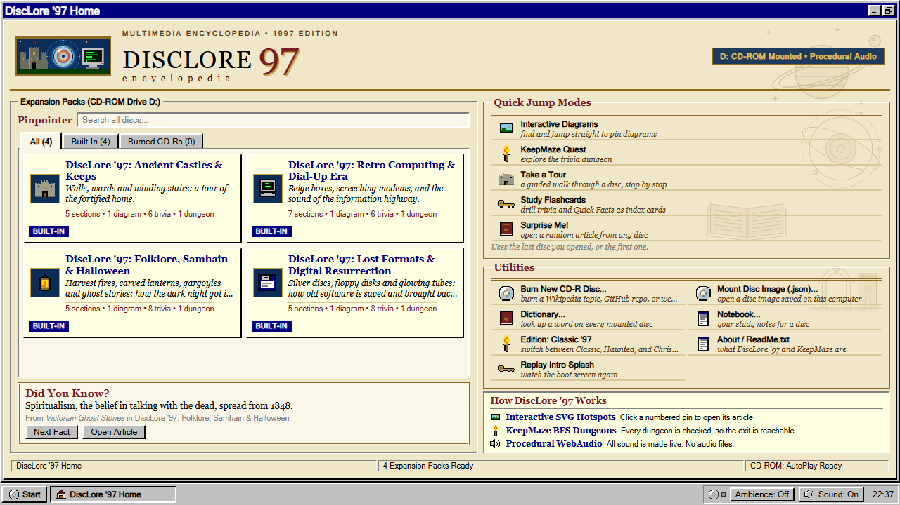
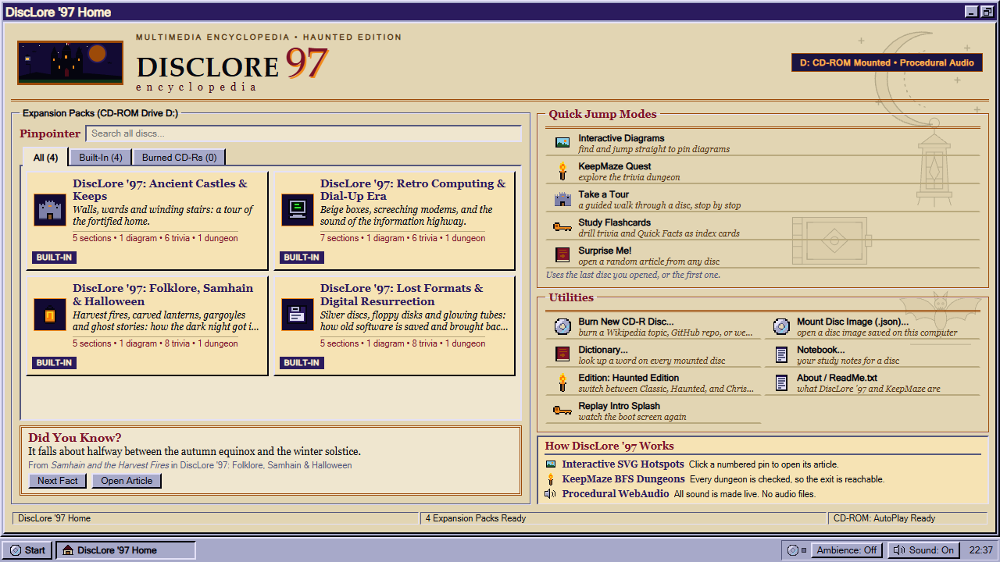

# DiscLore '97

**Live demo: [https://disclore-97.reprodev.com](https://disclore-97.reprodev.com)** · Source: [github.com/reprodev/disclore-97](https://github.com/reprodev/disclore-97)

Studying a subject on the web usually means a dozen tabs, sidebars, pop-ups, and autoplaying video, and nothing you can take with you when you close them. DiscLore '97 turns a subject into a focused, self-contained study disc in the style of a 1997 Encarta CD-ROM. The source can be a Wikipedia topic, a GitHub repository, a web page, or your own Markdown. A disc holds one subject: short articles with Quick Facts and a chronology, an illustrated diagram, flashcards, a guided tour that can read itself aloud, and KeepMaze, a trivia dungeon that quizzes you on what you just read. Discs are compiled in the browser, checked by the same validator as the built-in ones, kept on your machine, and portable as a single `.json` disc image.

### Try It in 30 Seconds

Use a desktop browser window of 1280 x 720 or larger. Sound starts after your first click, and the **Sound** button in the taskbar mutes everything.

1. **Pinpointer → burn a Wikipedia topic.** On the Home window, type a subject that is not on the shelf, such as `Lighthouse`, into the Pinpointer. Pick the last row, **Burn CD-R for "Lighthouse" (Wikipedia)...**. The article is compiled into a disc and opens with its own diagram, trivia, and dungeon. Shortcut: [`?topic=Lighthouse`](https://disclore-97.reprodev.com/?topic=Lighthouse).
2. **KeepMaze.** Press **KeepMaze** in the toolbar, then **Start**, and pick an exit. Each door asks an illuminated "Q" question with A to D answers, and the room changes as you move: a gate, a passage, a library, a tower, and a hall. Shortcut: [`?disc=castles&view=keepmaze`](https://disclore-97.reprodev.com/?disc=castles&view=keepmaze).
3. **Take a Tour or Flashcards.** Press **Tour**, then **Play Show**, to have the disc narrated stop by stop. Or press **Flashcards** and flip cards with **Space**. Shortcuts: [`?disc=castles&view=tour`](https://disclore-97.reprodev.com/?disc=castles&view=tour), [`?disc=halloween&view=flashcards`](https://disclore-97.reprodev.com/?disc=halloween&view=flashcards).
4. **Switch Editions.** Use **Start > Edition Switcher** to move between **Classic '97**, **Haunted Edition**, and **Christmas Edition**. The colours, artwork, lettering, and chime all change.

The live site is Cloudflare Pages: the static app plus the `/api/extract`, `/api/topic`, and `/api/define` Pages Functions, with no keys or accounts. On a phone or a window under 768px wide, the desktop icons fold into a strip along the top, the Home columns and the disc sidebar stack, KeepMaze scrolls inside its pane, and the taskbar keeps **Start** and **Sound** on one row.

## Screenshots

Captured at 1280 x 720 from the production build (`npm run build` then `vite preview`) in headless Microsoft Edge.

| | |
| --- | --- |
|  |  |
| **Home.** The Encarta '97-style masthead, the disc shelf with the Pinpointer, Quick Jump Modes, and Utilities. | **Article and MediaReel.** A disc burned from the Wikipedia topic "Apollo 11", with its pinned header, picture reel, and Quick Facts. |
|  |  |
| **KeepMaze.** The gate room under a starry sky, the mini-map, the torch rack and "P" medallion, and an open "Q" question. | **Haunted Edition.** The same Home window in the Kiroween edition. |

The article screenshot shows text from the English Wikipedia article [Apollo 11](https://en.wikipedia.org/wiki/Apollo_11), available under [CC BY-SA 4.0](https://creativecommons.org/licenses/by-sa/4.0/), so that one image is shared under the same license. Its picture is [*A Man on the Moon*](https://commons.wikimedia.org/wiki/File:A_Man_on_the_Moon,_AS11-40-5903_(cropped).jpg) by Neil A. Armstrong (NASA), in the public domain. The other three screenshots show only this project's original content.

## Features

- **Win95-style CD-ROM encyclopedia.** Windows 95 chrome, article browsing, and original disc content on the four built-in discs.
- **Locked window chrome, inner-only scrolling.** The open disc window never scrolls as a whole. The title bar, menu bar, toolbar, breadcrumb, and status bar stay in view at any window height. `.disc-browser`, the disc window, its content box (`.disc-window .window-content`), and `.disc-workspace` are flex boxes with `min-height: 0` and `overflow: hidden`, and the chrome is `flex: 0 0 auto` so it never shrinks.
  - **Contents sidebar.** `.disc-tree` has `min-height: 0` and `overflow-y: auto`, so a 12-section burned disc scrolls inside the sidebar instead of stretching the window.
  - **Pinned article header.** `ArticleViewer` is a fixed column. An `article-header` holds the title, the tool row (Show in Diagram, Cite / Print Preview, Bookmark, Read Aloud, Find in Article, + Quote, 1x / 1.2x), and the Find bar, and stays pinned. Below it, an `article-body` with `overflow-y: auto` and `min-height: 0` is the only part that scrolls. A section change starts the body back at the top.
  - **No gap in short articles.** Chronology and See Also use `display: flow-root` instead of `clear: both`. They follow the text directly, beside the floated picture and Quick Facts, rather than dropping below them and leaving an empty band.
  - **Compact + Note micro-buttons.** Each Quick Fact ends with a 10px inline "+ Note" micro-button (`padding: 1px 5px`, no wrapping). It rides at the end of the fact's last line, so it never splits a word or adds a line. The facts themselves are 11px, and an empty "Added to Notebook." line takes no room.
  - **Measured.** In a headless Edge check at 1280 x 720, the page and every locked box had 0px of overflow. All 22 built-in articles, Motte and Bailey included, fit with no scrollbar at all. A long burned Wikipedia article scrolled only inside its body, and the chrome, the article header, and the sidebar did not move. `tests/components/scroll-lock-layout.test.tsx` checks the lock rules, where each part sits, the pinned header, the scroll reset, the flow-root blocks, and the + Note buttons.
- **Encarta-style Home screen.** A warm parchment masthead with a tracked uppercase eyebrow, a serif DISCLORE beside a large burgundy 97, and a wide-tracked lowercase "encyclopedia" subtitle. Faint **engraved watermarks** sit behind it: a ringed planet, an open encyclopedia, an arch and keep, and orbiting CD rings. They are flat SVG line art in two sepia tokens (`--color-watermark-ink`, `--color-parchment-tint`), with no gradients and no images.
- **Editorial action rail.** Quick Jump Modes (Interactive Diagrams, KeepMaze Quest, Surprise Me!) and Utilities (Burn New CD-R Disc, Mount Disc Image, About / ReadMe, Replay Intro Splash) are rows with a 24px icon, a bold title, and a quiet italic subtitle. A row rests flat on the parchment, raises like a Win95 button on hover or focus, and sinks when pressed.
- **Pinpointer search.** A search bar over every disc, with a sunken results list that shows each article's disc and an origin badge. Its last row is always **Burn CD-R for "<query>" (Wikipedia)...**, a search-anything bridge: when nothing matches, it takes the place of a dead end, and picking it (Enter or click) opens the Burn dialog and starts a topic burn for what you typed. The arrow keys, Enter and Escape work across the local results and that row.
- **Burn New CD-R Disc.** Compile a new disc in the browser from GitHub, a web page, a topic, or Markdown. Burned discs are validated like the built-in ones and saved in `localStorage`.
- **Interactive diagrams.** Each diagram is an SVG on a 0..100 coordinate grid with clickable hotspots. Burned discs get an illustrated 1997 scene that matches their source, drawn by `src/model/compile/diagram.ts` from rectangles, circles, lines, and polygons in the 12 `ALLOWED_TOKENS` colors. A polyline is drawn as joined line segments, so the manifest schema did not change.
  - **Topic: Atlas / Orrery plate.** A double parchment cartouche border, a ringed celestial globe with latitude and longitude arcs, an 8-point compass rose at the hub, and `glint` star accents.
  - **Web page: 1997 browser window.** A title bar with three window buttons, an address bar, a status bar, and hypertext globe and page nodes, with a `glint` connection light.
  - **GitHub: CRT workstation.** A retro CRT monitor showing the repository blueprint, a server rack, circuit traces, and `blink` status LEDs.
  - **Markdown: open folio.** A leather-bound book with a spine, ruled parchment pages, a bookmark ribbon, and a desk lamp with a `flicker` bulb.

  The pins keep their scene slots and the seeded jitter, so the same source still gives the same diagram. `tests/compiler/diagram-scenes.test.ts` checks every scene: token colors only, only its own animation, polygons inside 0..100, and pins inside 5..95 and at least 8 apart.
- **1997 Multimedia Experience.**
  - **MediaReel.** A beveled picture frame in the article sidebar with Prev, Next, Enlarge, and a "Frame X / Y" counter. Pictures load without a referrer, show a loading note, and fall back to an SVG plate if they fail.
  - **Pop-Out Picture Viewer.** A Win95 modal window with the full-size picture, the caption, and a thumbnail filmstrip. It is the only place the slideshow plays: Play / Pause advances every 4 seconds, and closing the window pauses it. Space toggles Play, the left and right arrow keys step, and Escape closes it. The footer shows these shortcuts.
  - **Read Aloud.** The browser's Web Speech API narrates the article one paragraph at a time. The paragraph being read is highlighted, and the button shows live progress such as "Stop (2/5)". A **1x / 1.2x** button sets the speed, and changing it mid-narration carries on from the current paragraph. It stops on Mute, on a section change, and when the article closes.
- **Authenticity and study tools.** A Chronology strip, Show in Diagram (highlights the matching pin), Cite / Print Preview with Copy Citation and a **Print...** button, and a Victory Certificate in KeepMaze.
- **Explore History.** A **Timeline** button in the disc toolbar (beside Diagram and KeepMaze, dimmed when no article has dated events) opens a disc-wide chronology. It gathers every timeline event from every article, orders them by the first year in each date (`1100s`, `After 1066`, `280 BC`), and lays them out as a horizontal strip of century columns, with undated events under "Other dates". Each event carries its article as a badge, and clicking it opens that article with normal Back and Forward history. The logic is in `src/model/timeline.ts`.
- **Diagram pin previews.** Hovering or focusing a numbered pin shows a Win95 preview card with the target article's title and its first Quick Fact (or its first sentence), before you click.
- **Numbered Callout Key.** Under every diagram, `HotspotViewer` shows a sunken ivory "Callout Key" that lists each pin as `[1] <section title>`, `[2] <section title>`, and so on (the pin label when no sections are passed). Clicking an entry opens that article, with the same page flip as clicking its pin. The highlight works both ways: hovering or focusing an entry lights its pin (gold fill, dashed crimson frame), and hovering or focusing a pin lights its entry. The key sits below the square diagram plate, so the pin percentages still line up with the SVG.
- **Drive D: activity LED.** The Drive D: light in the taskbar tray stays steady gold while a disc is in the drive. Every disc seek (opening, burning, or mounting a disc, and moving between articles and views) bumps an `activityKey` from `App`, and the LED flashes hot amber and gold in hard CSS steps for 700 ms (`SEEK_PULSE_MS` in `Taskbar.tsx`), then settles back to gold. A new seek during a flash restarts it. Under `prefers-reduced-motion: reduce` the flash animation is off.
- **Inline cross-links.** When a paragraph mentions another article's title from the same disc, the words become a link. It is built in pure React from text pieces (`src/model/crossLinks.ts`), never from HTML. The article itself is never linked, each target is linked at most once per paragraph, longer titles win over shorter overlapping ones, and titles under four characters are skipped.
- **Bookmarks.** A **Bookmark / Bookmarked** toggle in the article tools saves the article in `localStorage` per disc (`disclore97.bookmarks.<disc_id>`, apart from the burned-disc library). A **Bookmarks** list appears in the contents sidebar once there is at least one.
- **Encarta Dictionary.** A **Dictionary** toolbar button, a **View > Dictionary...** item, and a **Dictionary...** card in the Home Utilities open a Win95 dialog. Double-clicking a single word in an article opens it pre-filled with that word. While you type, it lists whole-word matches from every mounted disc: section titles, Quick Facts, and body sentences (`findMentions` in `src/model/discSearch.ts`). Press **Look Up** for a short plain-text definition from `/api/define`, which calls the free Dictionary API. If the word is not found or the network is down, the dialog says so and keeps the disc matches, so it still works offline.
- **Media Gallery.** A **Gallery** toolbar button and **View > Gallery** item open a contact sheet for the open disc. A disc with extracted pictures shows every picture with its caption, and clicking one opens the Picture Viewer at that frame. A built-in or offline disc has no pictures, so each article's SVG plate is shown instead, and clicking a plate opens that article.
- **Study progress.** Each article you open is remembered per disc in `localStorage` as `disclore97.visited.<disc_id>`, apart from bookmarks and the burned-disc library. The contents sidebar puts a check mark on read articles and shows an "X / Y read" note.
- **Find in Article.** A **Find in Article** toggle in the article tools opens a search bar with Previous match, Next match, and an "X of Y" counter. Enter goes to the next match, Shift+Enter to the previous, and Escape closes the bar. Matches are highlighted with `<mark>`. The text is split in pure React (`src/model/findInText.ts`), so cross-links stay buttons and no HTML is built.
- **KeepMaze.** A trivia dungeon with a Quest console, a mini-map with a legend, Peek Hint, and a torchlight pulse on each room. Maze layouts are verified with breadth-first search (BFS), so the exit is always reachable.
- **Full-pane MindMaze-style KeepMaze.** The game is laid out like the 1997 Encarta MindMaze screen and fills its whole pane, on a dark dungeon-slate frame with no empty gray area. Everything uses token colors, square corners, and no gradients or blurred shadows.
  - **Zero-scroll fit.** At 1280 x 720 the whole screen fits with no vertical scrolling, including an open question with all four answers and Peek Hint. A headless Edge check measured 0px of vertical overflow on both `.disc-main` and `.keepmaze`, before Start and during questions in all five room scenes.
  - **Thin panoramic room stage.** `DungeonViewport.tsx` draws the room as a 440 x 200 panorama across the full width at the top, `height: clamp(130px, 26vh, 175px)`. Each scene's wall, ceiling or sky, floor, and some side furniture run 400 units past the scene's edges, and the view uses `meet`. A wide pane therefore shows more of the room instead of cropping it or leaving an empty band.
  - **Five room scenes.** `roomVariant(room)` picks one of five scenes, deterministically, from the room's name keywords, then its id (the entrance is a gate, the throne room a hall), then a stable FNV-1a hash of the id. Compiled rooms are all named "Hall of <article>", so that prefix is ignored, which keeps a 10-room compiled dungeon from looking the same in every room.
    Each scene has its own wall, ceiling or sky, and floor material, so no two look alike:
    - `gate`: an open night sky (`--color-sky-deep`) with stars above crenellated battlements and a gatehouse, a grey stone curtain wall, and a cobbled courtyard floor. A voussoir stone archway, iron portcullises (one half raised), drawbridge chains on wall pulleys, and drawbridge planks.
    - `passage`: dark slate dungeon walls (`--color-dungeon-bg`, `--color-dungeon-stone`), damp with moss and drips, and a slate floor. A vaulted corridor of stone ribs, a floor grate, barred windows, and wall chains on iron brackets.
    - `library`: warm oak panelling (`--color-wood`, `--color-wood-dark`) under a gold cornice, an oak board floor, and a crimson carpet runner (`--color-crimson`). Tall bookshelves of coloured book spines, scroll cubbies, and a lectern with an open book.
    - `tower`: pale tower stone around a tall gothic lancet window onto the starry night (`--color-night`) with a crescent moon, a second lancet further along, a stone spiral stair, and a crimson banner.
    - `hall`: warm plaster with half-timber posts above a stone wainscot and a wooden chair rail, under timber ceiling rafters. A crimson-and-gold woven rug, a framed portrait, a navy tapestry, twin arched oak side doors, and heraldic shields.

    Every scene keeps the central door with its locked padlock, open shackle, and victory gold way, and two wall torches with a flat glow and a stepped flicker (off under `prefers-reduced-motion`).
  - **Console strip.** Below the stage, the console (the `KeepMaze Quest` region) stretches to the bottom of the pane. On the left is the HUD cluster: the mini-map with its Current / Visited / Unexplored legend and "Rooms explored:", beside an ivory plaque with the torch rack and the Score Medallion. On the right is the main panel.
  - **Torch rack and "P" Score Medallion.** Three 24px pixel torches (gold when lit, slate and dimmed when spent), a gold **P** coin, Score (with "pts" drawn by CSS, so the value stays a number), Streak, and the "Personal Best:" line, or "No best yet". These are the only Score, Streak, Torches, and Personal Best on screen, and they keep the labels and the "3 of 3 torches lit" image that screen readers and tests use.
  - **Unified ivory manuscript panel.** One warm ivory card with a navy "KeepMaze Quest" caption bar and gold and burgundy trim. Before Start it is a Welcome card with the dungeon title, the objective, and **Start**. While exploring it shows the room name, description, Moves and Incorrect, **Restart**, and the Exits. During a question the room card folds into one header row, `<Room Name> • Moves: X • Incorrect: Y` and **Restart**, above the question card. The room description and the exits come back once the door is decided.
  - **Illuminated "Q" question card.** The open question sits on parchment in a stepped navy, gold, and burgundy frame (a border, an outline, and an inner keyline). A large serif drop-cap **Q** on a gold square sits top left, beside the prompt and Peek Hint. It is an `aria-hidden` `<span>`, so the prompt is still the card's first paragraph.
  - **A. / B. / C. / D. answer strips.** Each option is a full-width button led by a navy letter badge, with slightly tighter padding than a standard button so all four fit. The badge is `aria-hidden`, so the button's accessible name is still the option text.
  - **Victory.** The room stage stays on top and the Victory Certificate, with its Restart button, fills the rest of the pane.

  `tests/components/keepmaze-look.test.tsx` checks the stage and console layout, the panel in all three states and its styling, the one-row question header, the CSS that keeps the legend and plaque inside the console, that no stat or label appears twice, the variant rules, each scene's own furniture and materials, token-only paints in every scene, and the scene changing as the player moves.
- **KeepMaze MindMaze scoring.** The Score Medallion shows **Score** and **Streak**, and the torch rack shows **Torches**. A right answer earns 100 points plus a streak bonus of 10 per answer already in a row (capped at +50), or 50 points with no bonus if Peek Hint was used. A wrong answer resets the streak and dims one of three torches. The score never goes down and torches stop at zero, so a player can never be locked out of finishing the maze. The Victory Certificate is stamped with Score, Best Streak, and a **Scholar Rank** (Royal Archivist, Court Scholar, Keep Explorer, or Torchbearer), set by the share of the best possible score for the moves taken. The rules are pure functions in `src/model/game.ts`.
- **KeepMaze Personal Best.** Each disc remembers its best finished run in `localStorage` under `disclore97.best.<disc_id>` (`src/library/best.ts`), apart from bookmarks and visited articles. A run replaces the best when its score is higher, or equal with a higher Scholar Rank (`beatsBest` in `src/model/game.ts`). The Score Medallion shows "Personal Best: 210 pts (Royal Archivist)" once one exists, and a run that sets a record gets a **New Personal Best!** badge on the Victory Certificate. The first finished run on a disc counts as a record. Malformed saved data is ignored.
- **Real printing.** The **Print...** button in Cite / Print Preview plays the usual click and calls `window.print()`. While the dialog is open, `<body>` carries a `cite-printing` class, and `src/styles/print.css` (`@media print`) hides the desktop, taskbar, disc windows, toolbars, sidebar, dialog title bar, buttons, and the modal backdrop. Only the citation sheet prints, in dark ink on ivory paper, with no scroll box or offset shadow. Colors are tokens only.
- **Keyboard shortcuts.** **Ctrl+F / Cmd+F** on an article opens and focuses the Find in Article bar instead of the browser's find (the browser's find is left alone on other pages and while a dialog is open). **Ctrl+D / Cmd+D** while a disc is open opens the Dictionary instead of the browser's bookmark dialog. **Help > Shortcuts...** opens a Keyboard Shortcuts dialog that lists these, the Picture Viewer keys (Space, Left, Right, Esc), the Pinpointer keys (Up, Down, Enter, Esc), and Tab and Esc in dialogs.
- **Take a Tour and Media Show.** A **Tour** toolbar button, **View > Tour**, and a **Take a Tour** row in the Home Quick Jump Modes open a guided walk through a disc. `buildTour(disc)` in `src/model/tour.ts` is pure and deterministic: one stop per article, in order, each with its plate, a picture (stop index modulo the picture count, when the disc has pictures), a spotlight fact (first Quick Fact, else first sentence, else the title), and the article's first dated event. `TourView.tsx` shows a "Stop X of Y" progress bar and Previous, Next, **Read Stop Aloud**, and **Open Full Article** buttons. **Play Show** is the Media Show: with sound on and speech available, each stop is narrated through `src/audio/speech.ts` and the tour advances when the narration ends. Muted, or with no speech, it advances on a 5-second timer. It stops at the last stop, and Pause, Mute, Previous, Next, or closing the tour ends it cleanly. The property test is `tests/properties/tour.test.ts`.
- **Research Notebook.** A **Notebook** toolbar button, **View > Notebook...**, a Home Utilities card, and pinned desktop icons open an ivory, monospace study pad, with a character and line count. Notes are saved at once in `localStorage` under `disclore97.notes.<disc_id>` (`src/library/notebook.ts`, capped at 20,000 characters).
  - **Disc switcher.** A **Disc:** selector in the dialog switches between the notebooks of every mounted disc without closing it.
  - **Adding notes.** A **+ Note** button beside each Quick Fact appends `[Article title] fact`. A **+ Quote** button in the ArticleViewer tool row appends the current `window.getSelection()` text as `[Article title] "..."` (capped at 500 characters). It falls back to the article's first sentence when nothing is selected or the selection is outside the article. It reads the selection on pointer-down, because pressing a button can clear the selection before the click.
  - **Export and print.** **Clear** empties the pad. **Export (.txt)** saves plain text and **Export (.md)** saves `# <Disc Title> — Research Notes` followed by the notes, both with `saveTextFile()`. **Print...** calls `window.print()`, and `@media print` rules in `src/styles/print.css` (scoped to a `notes-printing` class on `<body>` while the dialog is open, like the Cite sheet) print only the notes page in dark ink on ivory.
  - **Pin to Desktop.** A **Pin to Desktop / Pinned to Desktop** toggle saves pinned disc ids under `disclore97.pinnedNotes`, in the same safe storage style as the other keys (bad values are dropped, a refusing storage never throws). Each pinned, mounted disc gets a notepad icon on the Win95 desktop labelled `<short disc title> Notes.txt`. Double-click or Enter opens that disc's notebook, and unpinning removes the icon.
  - **Share links.** **Copy Share Link** copies a `?notes=<encoded>` link. `src/model/noteShare.ts` is pure and property-tested. It encodes `{ disc id, disc title, notes }` as JSON, as UTF-8, as unpadded base64url, capping the notes at 4,000 characters without splitting a character. Decoding treats the link as untrusted: it checks the alphabet and length, rejects malformed base64, UTF-8, and JSON, strips control characters, clamps every field, and returns `null` instead of throwing. When the clipboard refuses, the link appears in a **Share Link** box inside the dialog for copying by hand.
  - **Opening a shared link.** A `?notes=` link skips the boot splash and opens a read-only **Shared Notes** dialog with the shared disc title and text. **Save to My Notebook** appends (never overwrites) the notes to that disc's notebook when it is mounted, or to a chosen disc's notebook otherwise. A damaged link shows a Win95 message box, and a `topic=` in the same link waits, so two modals never open at once.
- **Flashcards Study Mode.** A **Flashcards** toolbar button, **View > Flashcards**, and a **Study Flashcards** Quick Jump row open an index-card deck. `buildFlashcards(disc)` in `src/model/flashcards.ts` makes a card for every trivia question (prompt, then the right option) and every Quick Fact (the article title as the cue), so every disc with an article has a non-empty deck. `FlashcardsView.tsx` shows "Card X of Y • Mastered: M / Total". **Flip Card** (or **Space**) turns the card, **Got It** masters it, and **Need Review** puts it back behind a few other cards. Open Source Article jumps to the card's article, and **Restart Deck** appears when every card is mastered. The deck rules are pure functions, and progress survives a trip to the article and Back. The property test is `tests/properties/flashcards.test.ts`.
- **Working Start menu.** The taskbar **Start** button opens `StartMenu.tsx`, a Win95 menu with a vertical "DiscLore 97" strip. Items: **Mounted Discs** (a submenu that opens any built-in or burned disc), **Burn New CD-R Disc...**, **Mount Disc Image (.json)...**, **Dictionary...**, **Take a Tour**, **Study Flashcards**, **Edition Switcher** (a submenu with a radio choice for each edition), **About / ReadMe.txt**, **Replay Intro Splash**, and **Close All Windows**. Tour and Flashcards open the last disc you used, or the first. The Start button carries `aria-expanded`. The menu is fully keyboard-driven: Up, Down, Home, and End move, Right opens a submenu and Left closes it, Enter or Space runs an item, and Escape (or a click outside) closes it and returns the focus to Start. An item with no action is dimmed.
- **Shareable deep links.** `src/model/deepLink.ts` is pure and never throws. It reads `?disc=<disc_id>` (opens that disc), `&section=<section_id>` (opens that article), `&view=diagram|timeline|keepmaze|tour|flashcards|gallery` (opens that view), and `?topic=<query>` (skips the boot splash and starts the Wikipedia topic burn for the query). Unknown discs, sections, and views, blank values, control characters, and overlong values are ignored: an unknown disc leaves you on Home, and an unknown section or a view the disc has no content for opens the disc's cover. A section wins over a view, and a topic wins over a disc. **View > Copy Share Link** copies a link to the current disc and page (`shareQuery`), and shows the link in a message box when the clipboard is refused. `App` also takes an optional `search` prop, so tests can supply the query string.
- **Three seasonal Editions.** DiscLore '97 has **Classic '97**, **Haunted Edition**, and **Christmas Edition**. `src/model/editions.ts` holds each edition's copy and content as pure data, with `toTheme()` turning any saved value into a known edition. `src/library/theme.ts` saves the choice under `disclore97.theme` and puts `theme-haunted` or `theme-christmas` on `<html>`. It is backward compatible: a saved `haunted` still works, a saved `solstice` from the earlier Winter Solstice edition loads as `christmas`, and anything unknown reads as classic. `tokens.css` holds the `:root.theme-haunted` and `:root.theme-christmas` blocks, which override token values only. Haunted uses midnight indigo, slate-lavender surfaces, jack-o'-lantern amber, deep crimson, and bone-ivory paper. Christmas uses evergreen pine, a starry winter-night sky, cranberry and holly crimson, frost-ivory paper, pale pine-frost surfaces, and warm candle gold. A test keeps ink and title text above a 7:1 contrast ratio on every surface for both themes. Each edition also brings:
  - **Artwork.** `HeroArt` and `EngravedWatermarks` in `SplashArt.tsx` take the edition. Classic keeps the castle, CD-ROM, and CRT, with planet, orbiting-CD, book, and arch watermarks. Haunted draws a haunted keep, an amber crescent moon, bats, and a flickering lantern, with moon, lantern, tome, and bat watermarks. Christmas draws snow-dusted evergreens, a starry winter night, a lit festive keep and cottage with warm amber windows, and a golden star, with holiday-star, snowflake, evergreen-tree, and candle watermarks. All of it is flat token-colored SVG.
  - **Typography.** A `--font-display` token (Georgia in `:root`) sets the masthead and boot title. Haunted uses `"Palatino Linotype", "Book Antiqua", Georgia, serif`, tight and bold. Christmas uses `Cambria, "Book Antiqua", Georgia, serif`, with airy letter-spacing. System fonts only.
  - **Sound.** `playEditionSwitch(edition)` plays a warm major triad for Classic, a minor bell chime for Haunted, and crisp, celebratory bell fifths for Christmas. `playChime()` and the ambience follow the edition: Haunted adds a low bell and wind, and Christmas adds bright bell fifths and a sleigh-bell sparkle.
  - **Copy and content.** The Home masthead eyebrow and the boot splash subtitle ("Haunted Edition", "Christmas Edition"), the first **Did You Know?** fact (it starts from a disc that suits the edition: the Halloween disc for Haunted, the Castles disc or any festive, historic, or castle disc for Christmas), and the sample burns on an empty Burned CD-Rs tab (Halloween, Gothic fiction, and CD-ROM for Classic; Halloween, Gothic fiction, and Ghostlore for Haunted; Christmas, A Christmas Carol, and Christmas tree for Christmas).

  **View > Edition**, an **Edition** card in the Home Utilities, and **Start > Edition Switcher** all change it.
- **Disc emblems.** Each built-in disc has its own pixel emblem on its Home card: a castle, a computer, a lantern for Folklore, Samhain & Halloween, and a floppy disk for Lost Formats & Digital Resurrection. Burned discs keep the CD-ROM.
- **No more blank screens.** `src/components/AppErrorBoundary.tsx` wraps the app in `main.tsx`. Without it, an error thrown while drawing any window unmounts everything and leaves only the teal desktop background. With it, the error and its component stack go to the console, and a Win95 message box names the error and offers **Restart DiscLore '97** and **Restart in Classic '97** (which clears only the saved edition).
- **Split production bundle.** `vite.config.ts` sets `build.rollupOptions.output.manualChunks` to put React and React DOM (`react-vendor`) and the four built-in discs (`discs`) in chunks of their own. Every chunk stays well under Vite's 500 kB warning, and `npm run build` reports no chunk-size warning. Vitest does not bundle, so the tests run unchanged.
- **1997 palette.** Royal Sapphire, Warm Ivory, Burgundy, and Antique Gold, on top of the seven required Win95 chrome colors. All colors live in `src/styles/tokens.css`.
- **Procedural WebAudio.** All sound is generated at runtime, with no audio files. Effects are soft triangle and sine chords: clicks, page flips, door unlocks, a slide-projector click in the picture viewer, a CD-R burn completion ding, a KeepMaze victory fanfare, and the boot chime.
- **Ambience.** An optional atmosphere, Off by default, switched by the **Ambience: Off/On** button in the taskbar. It follows the open disc: wind and hearth for castles, a CRT hum for code and web discs, and a quiet study tone for the rest. It is silent while Sound is muted and stops when the taskbar leaves the screen.
- **Micro-animations.** Subtle SVG touches: a blinking CRT cursor, flickering torch windows, a CD glint, and in burned-disc diagrams, glinting stars, blinking rack LEDs, and a flickering desk lamp. They are plain CSS opacity steps (`blink`, `flicker`, `glint`), and all of them stop under `prefers-reduced-motion: reduce`.
- **Global Mute.** One **Sound** control silences everything: effects, Ambience, and Read Aloud.

## How it was built

The project was built with [Kiro](https://kiro.dev) using Spec-Driven Development. Each step feeds the next:

1. `.kiro/steering`: project-wide guidance and conventions. Four hooks in `.kiro/hooks/` and a custom agent in `.kiro/agents/` enforce them (see below).
2. `requirements.md`: user stories and acceptance criteria.
3. `design.md`: architecture and the correctness properties to test.
4. `tasks.md`: an ordered, dependency-aware implementation plan, executed task by task.

The specs live in `.kiro/specs/`: `disclore-97-core` (the app and the built-in discs) and `dynamic-disc-compiler` (Burn New CD-R Disc). The later multimedia, palette, and Wikipedia work was done as follow-up changes. See [docs/BUILD-STORY.md](docs/BUILD-STORY.md) for the whole story.

### Lessons & surprises

- **The reviewer agent caught what the regex tests could not.** The static tests ban hex values outside `tokens.css`, rounded corners, gradients, and blurred shadows, but a font stack typed out by hand breaks none of those patterns. The read-only `compliance-reviewer` agent reads a diff against the steering files rather than matching regexes. It flagged the same monospace stack repeated in four stylesheets, against the rule that fonts are defined once. It became a `--font-mono` token in `tokens.css`.
- **A feature that worked, reverted on purpose.** A Multi-Source Stitcher burned 2 to 4 sources into one cross-linked disc, and every stitched disc passed `loadDisc` and the BFS solver. In use it diluted rich sources to the thinnest one's paragraph split. The diagram had no single scene to draw, and one KeepMaze dungeon asked about two unrelated subjects. It was reverted in full to keep one source per cohesive disc. Search across discs (Pinpointer, Dictionary) connects subjects instead.
- **A blank screen that would not reproduce.** A report of a bare teal desktop after the boot splash could not be reproduced in headless Edge. The structural cause was that the app had no error boundary, so any render error unmounted everything. `AppErrorBoundary` now turns a crash into a Win95 message box with a restart. The next report showed the real error, `Cannot read properties of undefined (reading 'forEach')`, from a `PixelIcon` map lookup coming back empty. That fits a dev server holding stale modules across an icon-name change. `PixelIcon` now falls back to the CD-ROM icon for any unknown name, the other `.forEach` paths were guarded, and `tests/components/icon-hardening.test.tsx` renders the bad cases.

### Kiro hooks

Four agent hooks in `.kiro/hooks/` run checks automatically. The file-save matchers accept both `/` and `\` path separators, so they work on Windows too.

| Hook file | Runs when | Command |
| --- | --- | --- |
| `static-rules-on-src-save.json` | a file under `src/` is saved | `npx vitest run tests/static.test.ts tests/dynamic-static.test.ts` |
| `properties-on-model-or-discs-save.json` | a file under `src/model/` or `src/discs/` is saved | `npx vitest run tests/properties/` |
| `api-extract-adapter-guard.json` | a file under `src/extract/`, `functions/api/`, or `src/adapters/` is saved, or `vite.config.ts` | `npx vitest --run tests/extract/ tests/adapters/ tests/dynamic-static.test.ts` |
| `typecheck-lint-gate-on-stop.json` | the agent finishes a turn (`Stop`) | `npx tsc --noEmit && npm run lint` |

### Kiro custom agent

`.kiro/agents/compliance-reviewer.md` is a project custom agent in Kiro's Markdown format: front matter for the configuration, and the body as the system prompt. It is a read-only verification specialist. Its tools are `read` and `shell`, and its permissions deny every file write and every command except the checks it needs (`npm test`, `npm run lint`, `npx tsc --noEmit`, `npx vitest --run ...`, and read-only `git status`, `git diff`, and `git log`). It loads both steering files and both static tests as context, audits a change against them, and replies with a PASS or FAIL verdict, findings with the file, line, and exact fix, and the exact result of each check. It audits:

- hex values only in `tokens.css`, `border-radius: 0`, no gradients, no blurred shadows, and no `innerHTML`;
- compiler purity: no React, DOM, network, upward imports, or nondeterminism;
- SSRF, fixed API hosts, safe media addresses, and the three `/api/*` routes staying in sync;
- the static tests, the property tests, the type check, and lint.

Pick it with the agent selector in Kiro (or `/agent` in the CLI) and ask it to "review the current diff".

### Testing

Correctness properties from the design are tested as property-based tests with [Vitest](https://vitest.dev) and [fast-check](https://fast-check.dev). Unit and component tests cover specific examples and edge cases. Two static tests, `tests/static.test.ts` and `tests/dynamic-static.test.ts`, scan the repository for rule violations: hex colors outside `tokens.css`, nonzero `border-radius`, gradients, blurred shadows, `AudioContext` outside `src/audio/`, absolute URLs other than the GitHub ones in `src/`, and more.

Run `npm test` for the current file and test counts. They change as the project grows, so they are not copied here.

## Architecture

```text
src/
  model/       Pure logic: manifest types, validator, BFS solver, KeepMaze reducer,
               media rules, and the seeded disc compiler (model/compile/).
  adapters/    Source readers for Burn New CD-R Disc: github, webpage, topic, markdown, burn.
  extract/     Server-side logic shared by the Pages Functions: SSRF guard, HTML extractor,
               /api/extract, /api/topic and /api/define handlers.
  library/     localStorage persistence for burned discs, and disc image (.json) save and mount.
  audio/       The only code that touches AudioContext (effects and ambience), plus Web Speech narration.
  components/  Win95 components: windows, viewers, MediaReel, Picture Viewer, KeepMaze UI.
  discs/       The four built-in discs and the loader.
  styles/      CSS, with all colors defined once in tokens.css.
functions/api/ Cloudflare Pages Functions: extract.ts, topic.ts and define.ts.
```

The model layer has no React and no DOM. The compiler is pure and seeded, so the same source always gives the same disc, apart from pictures, which never change the seed.

## Pre-Baked Discs

Four original discs ship with the app, so a first visit fills a 2 by 2 grid on the Home shelf. Each is a typed `DiscManifest` object in `src/discs/`, works offline, and passes the same validator and BFS solver as a burned disc.

| Disc | Sections | Diagrams / hotspots | Trivia questions | Dungeons |
| --- | --- | --- | --- | --- |
| DiscLore '97: Ancient Castles & Keeps | 5 | 1 diagram, 4 hotspots | 6 | 1 (10 rooms) |
| DiscLore '97: Retro Computing & Dial-Up Era | 7 | 1 diagram, 4 hotspots | 6 | 1 (10 rooms) |
| DiscLore '97: Folklore, Samhain & Halloween | 5 | 1 diagram, 5 hotspots | 8 | 1 (10 rooms) |
| DiscLore '97: Lost Formats & Digital Resurrection | 5 | 1 diagram, 5 hotspots | 8 | 1 (10 rooms) |

- **Castles:** the dungeon is "The Keep of Many Stairs". The diagram is a castle cross-section.
- **Retro:** the dungeon is "The Cursor Catacombs". The diagram is a dial-up home setup.
- **Halloween:** the dungeon is "The Hollow Halls of Hallowtide". The diagram is a haunted hill with a flickering bonfire, castle windows, and a glinting moon. Sections cover Samhain, jack-o'-lanterns, gargoyles and Gothic fiction, Victorian ghost stories, and modern Halloween.
- **Resurrection:** the dungeon is "The Archive of Lost Formats". The diagram is an archive workbench with a blinking CRT cursor and a glinting CD-ROM. Sections cover the CD-ROM, HyperCard, floppy disks, CRT screens, and software preservation.

## Burn New CD-R Disc

Choose **Burn New CD-R Disc**, pick a source, and press Burn. The app fetches or reads the source, compiles it into a `DiscManifest`, runs the same validator and BFS solver as the built-in discs, and opens the result.

Four source kinds are supported:

| Source | How it is read |
| --- | --- |
| **github** | A public repository, read through the GitHub REST API: description, facts, languages, README text, the owner's avatar, and README images. |
| **webpage** | A public web page, fetched through `/api/extract`. The text and safe `og:image`, `twitter:image`, and `` pictures are extracted. |
| **topic** | A free-text topic, looked up on English Wikipedia through `/api/topic`. The article text, section headings, and pictures become a disc. |
| **markdown** | Markdown text you paste in. |

**When a source cannot be read.** A failed burn never leaves you stuck. A failed GitHub or web-page burn offers **Burn offline from "<name>"**, which builds an offline study outline. A web page that blocks readers or cannot be fetched (`fetch-failed`), or a missing page reader (`unavailable`), also offers **Try as Wikipedia topic: "<subject>"**. It guesses the page's subject from the address with `topicFromUrl` in `src/model/topicGuess.ts`, and burns that subject through `/api/topic`. The guess is the last meaningful path segment, so `.../history/lighthouses-of-maine.html` gives "lighthouses of maine", or else the site's name. The Wikipedia option is not offered when the network itself is down, because a topic lookup would fail too.

**Sample burns.** While the library has no burned discs, the empty **Burned CD-Rs** tab on the Home shelf offers three quick-start buttons: **Burn Sample: Halloween**, **Burn Sample: Gothic fiction**, and **Burn Sample: CD-ROM**. Each opens the Burn dialog and starts a Wikipedia topic burn for that topic (or the offline outline, if the lookup fails). The topics depend on the active edition: Haunted offers Halloween, Gothic fiction, and Ghostlore, and Christmas offers Christmas, A Christmas Carol, and Christmas tree.

### Save and mount disc images

Any disc can be exported and shared as a plain `.json` file.

- **File > Save Disc Image (.json)** (when a disc is open) downloads the disc's manifest as `<disc_id>.json`.
- **File > Mount Disc Image (.json)...**, or the **Mount Disc Image** card under Utilities on the Home window, opens a file picker. The file goes through `JSON.parse` and then `loadDisc(parsed, false)`, the same validator and BFS solver every burned disc passes, including the safe-media rules. A file that is not JSON, not a disc, too large (over 5 MB), reuses a built-in disc's ID, or fails validation is rejected with a Win95 message box that lists the first problems, and nothing is mounted. A valid disc opens and is added to the `localStorage` library.

Because a disc image is just the manifest, it works offline and can be edited by hand. The validator is the only gatekeeper, so treat images from other people like any other downloaded file.

**Topic fallback.** If the lookup fails (offline, no matching article, a disambiguation page, or no `/api/topic` function), the burn still succeeds. It builds an **offline study outline** that says plainly that it is an outline and not an encyclopedia article.

**Pictures.** A disc can carry up to 8 pictures. Only public `https` image addresses are kept. The compiler and the validator reject `http`, `javascript:`, `data:`, localhost and private addresses, credentials, odd ports, and SVG files.

### The server functions

Three optional Cloudflare Pages Functions do the work the browser cannot. The app builds and runs without them. Only the `webpage` and `topic` sources need the first two, and the topic source falls back to the outline. The Dictionary needs `/api/define` only for its online definition and falls back to matches from the mounted discs.

| Route | File | Shared logic | What it does |
| --- | --- | --- | --- |
| `/api/extract?url=...` | `functions/api/extract.ts` | `src/extract/handler.ts` | Fetches a public web page and returns its title, headings, paragraphs, and pictures. |
| `/api/topic?q=...` | `functions/api/topic.ts` | `src/extract/topicHandler.ts` | Searches English Wikipedia and returns the best article's text and pictures. |
| `/api/define?word=...` | `functions/api/define.ts` | `src/extract/defineHandler.ts` | Looks one English word up in the free Dictionary API and returns up to three short meanings. The word must be a single run of letters, and the host is fixed in code. |

`/api/extract` has an SSRF guard. It rejects non-HTTP(S) URLs and private, loopback, and link-local addresses, and it re-checks every redirect. The guard cannot fully prevent DNS rebinding, because the hostname is resolved again when the request is made. Treat it as defense in depth, not a complete barrier. `/api/topic` only ever calls the English Wikipedia API, and the search text is passed as data.

### Limits

- **GitHub rate limit.** Requests are unauthenticated, so GitHub allows 60 requests per hour per IP address. When the limit is reached, the burn fails with an error and you can retry later.
- **Disc library.** Burned discs are stored in `localStorage` in your browser, up to 10 discs. They never leave your device.

## Getting started

Requires Node.js and npm.

```bash
npm install        # install dependencies
npm run dev        # start the Vite dev server
npm test           # run the test suite once
npm run lint       # run ESLint
npm run build      # type-check and build to dist/
```

`npm run dev` also serves `/api/extract`, `/api/topic` and `/api/define`, through a small Vite middleware plugin in `vite.config.ts`. It calls the same handlers as the Pages Functions. It applies only to the dev server (`apply: 'serve'`), so it is not part of `npm run build` or the deployed site. Burning web pages and topics, and Dictionary definitions, work in dev with no extra setup.

To try the real Pages Functions locally:

```bash
npm run build
npx wrangler pages dev dist
```

## Deploying to Cloudflare Pages

The app is a static site plus optional Pages Functions, live at the custom domain [https://disclore-97.reprodev.com](https://disclore-97.reprodev.com). The Cloudflare Pages project `disclore-97` also answers at its default `disclore-97.pages.dev` address. The source is pushed to the public GitHub repository [reprodev/disclore-97](https://github.com/reprodev/disclore-97). Use these settings:

- **Build command:** `npm run build`
- **Build output directory:** `dist`

Cloudflare Pages picks up `functions/api/extract.ts`, `functions/api/topic.ts` and `functions/api/define.ts` automatically. No API keys or environment variables are needed.

### wrangler.toml

The repository root holds a minimal, secret-free `wrangler.toml` with three keys and nothing else:

```toml
name = "disclore-97"
pages_build_output_dir = "dist"
compatibility_date = "2026-11-19"
```

It has no `account_id`, `zone_id`, routes, `vars`, bindings, or secrets. Because it sets `pages_build_output_dir`, Pages treats it as the [source of truth](https://developers.cloudflare.com/pages/functions/wrangler-configuration/#source-of-truth) for the project's configuration. The matching dashboard fields become read-only. Any setting the app ever needs must be added to this file. Secrets, if any are ever needed, belong in the dashboard or `wrangler secret`, never in the repository.

### Privacy audit of the public repository

The public repository [reprodev/disclore-97](https://github.com/reprodev/disclore-97) was audited across every tracked file and the full history of every ref. At the time of the audit it held 87 commits, 280 paths ever committed, and 52,559 added lines.

- **Credentials and keys.** No API keys, tokens, private keys, passwords, `account_id`, or `zone_id` were found in any tracked file or in any line ever added. The check covered the common token formats (AWS, GitHub, Slack, Google, OpenAI-style, PEM private keys, and `key = "..."` assignments).
- **Local files.** No `.env`, `.dev.vars`, key, or credential file was ever committed. `.gitignore` excludes `node_modules`, `dist`, `.env`, `.env.*`, `.wrangler`, and `*.tsbuildinfo`. One build cache, `tsconfig.tsbuildinfo`, was committed early and later untracked. It holds only relative paths.
- **Personal data.** No local user paths (such as a home-directory path) appear in the files or the history. The only email addresses are `example.com` and `example.org` test fixtures. Every commit uses the GitHub `users.noreply.github.com` address, so no personal email is exposed.
- **Content.** The built-in discs are original text and art. Wikipedia text and Commons pictures are only fetched at run time into a visitor's own browser, and never committed (see the next section).

## Attribution and Content Licensing

- **Built-in discs.** The text, SVG artwork, and sound are original to this project and are released with it under the MIT License. Sound is generated at runtime.
- **Wikipedia topics.** Topic article text comes from English Wikipedia and is available under the [Creative Commons Attribution-ShareAlike 4.0 license (CC BY-SA 4.0)](https://creativecommons.org/licenses/by-sa/4.0/). The first section of each burned topic disc ends with a Source line that names the Wikipedia page it came from. If you redistribute a burned disc, you must keep that attribution and share it under the same license.
- **Wikimedia Commons media.** Topic pictures come from Wikimedia Commons and keep their own licenses. These differ from file to file, and some require attribution or share-alike terms. The app shows each picture's file name as its caption but does not display per-file license details. Check the Commons file page before you reuse an image.
- **Web page and GitHub sources.** Text and pictures from pages and repositories belong to their authors and are used under whatever terms they publish. A burned disc names its source in the first section. These discs are built on your device and stay in your browser, and the project does not redistribute them.
- **Trademarks.** Wikipedia and Wikimedia Commons are projects of the [Wikimedia Foundation](https://wikimediafoundation.org/). DiscLore '97 is not affiliated with or endorsed by the Wikimedia Foundation, GitHub, or any other source. The names of the real CD-ROM products that inspired this project are used only as inspiration.

## License

The code is released under the [MIT License](LICENSE). Content that you burn from other sources keeps the license of that source, as described above.
