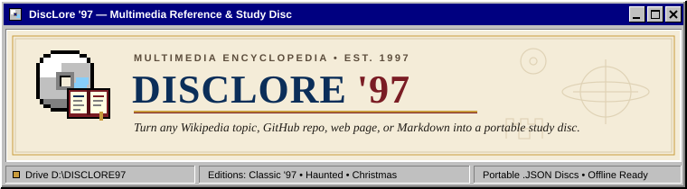
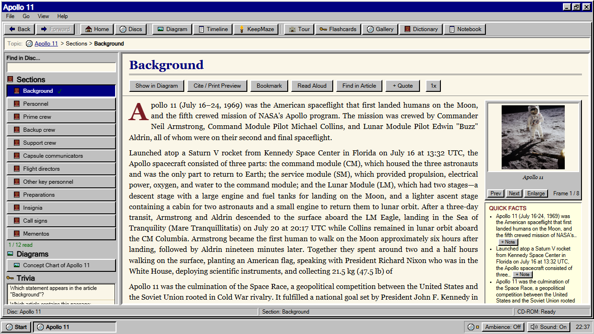
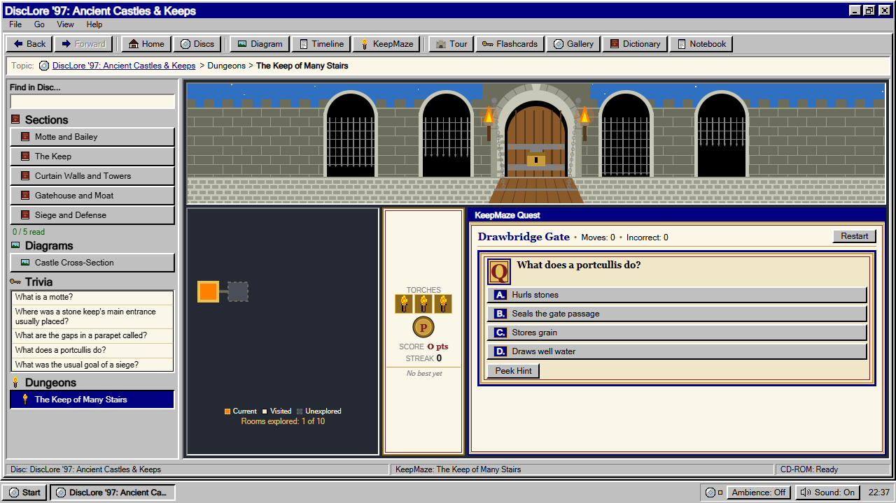
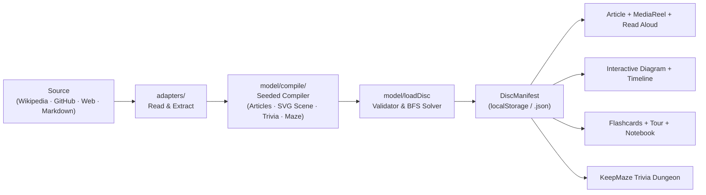

<p align="center">
  
</p>

<p align="center">
  <a href="https://disclore-97.reprodev.com"></a>
  <a href="#how-it-was-built"></a>
  <a href="#getting-started"></a>
  <a href="#deploying-to-cloudflare-pages"></a>
  <a href="LICENSE"></a>
</p>

<p align="center">
  <a href="#try-it-in-30-seconds">Try It in 30 Seconds</a> ·
  <a href="#screenshots">Screenshots</a> ·
  <a href="#features">Features</a> ·
  <a href="#how-it-was-built">How It Was Built (Kiro)</a> ·
  <a href="#architecture">Architecture</a> ·
  <a href="#getting-started">Run Locally</a>
</p>

# DiscLore '97

> **Live demo:** [https://disclore-97.reprodev.com](https://disclore-97.reprodev.com) · **Source:** [github.com/reprodev/disclore-97](https://github.com/reprodev/disclore-97)

Studying a subject on the web usually means a dozen tabs, sidebars, pop-ups, and autoplaying video, and nothing you can take with you when you close them. **DiscLore '97** turns a subject into a focused, self-contained study disc in the style of a 1997 Encarta CD-ROM. The source can be a Wikipedia topic, a GitHub repository, a web page, or your own Markdown. A disc holds one subject: short articles with Quick Facts and a chronology, an illustrated diagram, flashcards, a guided tour that can read itself aloud, and KeepMaze, a trivia dungeon that quizzes you on what you just read. Discs are compiled in the browser, checked by the same validator as the built-in ones, kept on your machine, and portable as a single `.json` disc image.

### Try It in 30 Seconds

Use a desktop browser window of 1280 x 720 or larger. Sound starts after your first click, and the **Sound** button in the taskbar mutes everything.

| Step | Action | Direct Jump |
| --- | --- | --- |
| **1. Burn a Wikipedia topic** | On Home, type `Lighthouse` into **Pinpointer** and pick **Burn CD-R for "Lighthouse" (Wikipedia)...** to compile a full disc with its own diagram, trivia, and dungeon. | [`?topic=Lighthouse`](https://disclore-97.reprodev.com/?topic=Lighthouse) |
| **2. Play KeepMaze** | Press **KeepMaze** in the toolbar, click **Start**, and pick an exit. Answer illuminated **Q** questions (`A`–`D`) as rooms shift from gate to passage, library, tower, and hall. | [`?disc=castles&view=keepmaze`](https://disclore-97.reprodev.com/?disc=castles&view=keepmaze) |
| **3. Tour or Flashcards** | Press **Tour → Play Show** for stop-by-stop narration, or **Flashcards** and flip cards with `Space`. | [`Tour`](https://disclore-97.reprodev.com/?disc=castles&view=tour) · [`Flashcards`](https://disclore-97.reprodev.com/?disc=halloween&view=flashcards) |
| **4. Switch Editions** | Open **Start > Edition Switcher** to switch between **Classic '97**, **Haunted Edition**, and **Christmas Edition**. Colours, artwork, lettering, and chimes all change. | *Taskbar → Start* |

The live site needs no account or key. It also works on a phone, with a stacked layout.

## Screenshots

Captured at 1280 x 720 from the production build (`npm run build` then `vite preview`) in headless Microsoft Edge.

| | |
| --- | --- |
|  |  |
| **Home.** The Encarta '97-style masthead, the disc shelf with the Pinpointer, Quick Jump Modes, and Utilities. | **Article and MediaReel.** A disc burned from the Wikipedia topic "Apollo 11", with its pinned header, picture reel, and Quick Facts. |
|  |  |
| **KeepMaze.** The gate room under a starry sky, the mini-map, the torch rack and "P" medallion, and an open "Q" question. | **Haunted Edition.** The same Home window in the Kiroween edition. |

The article screenshot shows text from the English Wikipedia article [Apollo 11](https://en.wikipedia.org/wiki/Apollo_11), available under [CC BY-SA 4.0](https://creativecommons.org/licenses/by-sa/4.0/), so that one image is shared under the same license. Its picture is [*A Man on the Moon*](https://commons.wikimedia.org/wiki/File:A_Man_on_the_Moon,_AS11-40-5903_(cropped).jpg) by Neil A. Armstrong (NASA), in the public domain. The other three screenshots show only this project's original content.

## Features

### Read and study

- **A 1997 CD-ROM encyclopedia.** Windows 95 chrome, four original built-in discs, and any number of discs you burn yourself.
- **A window that holds still.** The title bar, menus, toolbar, and article header stay in view. Only the contents sidebar and the article body scroll.
- **Pinpointer search.** Searches every mounted disc, and its last row always offers **Burn CD-R for "<query>" (Wikipedia)...**, so a search never ends in a dead end.
- **Articles.** Quick Facts, a Chronology strip, See Also, inline cross-links between articles, **Find in Article** (`Ctrl+F`), Bookmarks, and a check mark on every article you have read.
- **Interactive diagrams.** Numbered hotspots with hover previews and a Callout Key. Burned discs get an illustrated scene that matches the source: an atlas plate for a topic, a 1997 browser for a web page, a CRT workstation for GitHub, and an open folio for Markdown.
- **Explore History.** A **Timeline** view gathers every dated event on the disc into century columns.
- **Encarta Dictionary** (`Ctrl+D`). Finds a word across every mounted disc, and **Look Up** adds a short definition when you are online.
- **Pictures.** A MediaReel frame in each article, a pop-out Picture Viewer with a slideshow, and a Gallery contact sheet.
- **Read Aloud.** Web Speech narration, one highlighted paragraph at a time, at 1x or 1.2x.
- **Take a Tour.** One stop per article, and **Play Show** narrates each stop and moves on by itself.
- **Flashcards.** A deck built from the disc's trivia and Quick Facts, with Got It and Need Review.
- **Research Notebook.** Per-disc notes with **+ Note** and **+ Quote**, export to `.txt` or `.md`, printing, a desktop icon, and share links that carry the notes.
- **Cite / Print Preview.** Copy a citation or print just the citation sheet.

### KeepMaze

- **A MindMaze-style trivia dungeon.** A panoramic room stage over a console with the mini-map, torch rack, Score Medallion, and an illuminated **Q** card with A to D answers.
- **Five room scenes.** Gate, passage, library, tower, and hall, each with its own walls, floor, and furniture. At 1280 x 720 a full question fits with no scrolling.
- **Scoring.** Streak bonuses, three torches, a Scholar Rank on the Victory Certificate, and a Personal Best per disc. A wrong answer never locks you out.
- **Always solvable.** Every dungeon is checked by breadth-first search, so the throne room can always be reached and no room is cut off.

### The desktop

- **Encarta-style Home.** A parchment masthead with engraved watermarks, the disc shelf, Quick Jump Modes, and Utilities.
- **Demo Discs (4 Built-In).** A checkbox on the shelf (also in **View** and **Start**) hides the built-in discs, so you can study only your own.
- **Start menu, shortcuts, and deep links.** A keyboard-driven Start menu, **Help > Shortcuts...**, and links such as `?disc=castles&view=keepmaze` or `?topic=Lighthouse`, with **View > Copy Share Link**.
- **Three Editions.** Classic '97, Haunted Edition, and Christmas Edition, each with its own colours, artwork, lettering, and chimes.
- **Small hardware touches.** A Drive D: light that flashes on every disc seek, a pixel emblem for each built-in disc, and gentle SVG animations that stop under `prefers-reduced-motion`.
- **Procedural sound.** Every effect, chime, and the optional Ambience is synthesized with WebAudio, with no audio files. The Ambience is a quiet, slowly drifting bed of warm pads and filtered noise, with its own atmosphere for castles, folklore nights, code and lost formats, web pages, and everything else, coloured by the edition. One **Sound** button mutes everything, narration included.
- **Phones and small windows.** Under 768px wide, the desktop icons fold into a strip, the Home columns and disc sidebar stack, and the taskbar keeps **Start** and **Sound** on one row.
- **No blank screens.** An error boundary turns a crash into a Win95 message box with a restart.

Everything you save (burned discs, bookmarks, notes, progress, best scores, and settings) stays in your browser's `localStorage` under `disclore97.*` keys. [docs/BUILD-STORY.md](docs/BUILD-STORY.md) explains how each feature was built, measured, and tested.

## How it was built

The project was built with [Kiro](https://kiro.dev) using Spec-Driven Development. Each step feeds the next:

1. `.kiro/steering`: project-wide guidance and conventions. Four hooks in `.kiro/hooks/` and a custom agent in `.kiro/agents/` enforce them (see below).
2. `requirements.md`: user stories and acceptance criteria.
3. `design.md`: architecture and the correctness properties to test.
4. `tasks.md`: an ordered, dependency-aware implementation plan, executed task by task.

The specs live in `.kiro/specs/`: `disclore-97-core` (the app and the built-in discs) and `dynamic-disc-compiler` (Burn New CD-R Disc). The later multimedia, palette, and Wikipedia work was done as follow-up changes. See [docs/BUILD-STORY.md](docs/BUILD-STORY.md) for the whole story.

### Lessons & surprises

- **The reviewer agent caught what the regex tests could not.** The static tests ban hex values outside `tokens.css`, rounded corners, gradients, and blurred shadows, but a font stack typed out by hand breaks none of those patterns. The read-only `compliance-reviewer` agent reads a diff against the steering files rather than matching regexes. It flagged the same monospace stack repeated in four stylesheets, against the rule that fonts are defined once. It became a `--font-mono` token in `tokens.css`.
- **A feature that worked, reverted on purpose.** A Multi-Source Stitcher burned 2 to 4 sources into one cross-linked disc, and every stitched disc passed `loadDisc` and the BFS solver. In use it diluted rich sources to the thinnest one's paragraph split. The diagram had no single scene to draw, and one KeepMaze dungeon asked about two unrelated subjects. It was reverted in full to keep one source per cohesive disc. Search across discs (Pinpointer, Dictionary) connects subjects instead.
- **A blank screen that would not reproduce.** A report of a bare teal desktop after the boot splash could not be reproduced in headless Edge. The structural cause was that the app had no error boundary, so any render error unmounted everything. `AppErrorBoundary` now turns a crash into a Win95 message box with a restart. The next report showed the real error, `Cannot read properties of undefined (reading 'forEach')`, from a `PixelIcon` map lookup coming back empty. That fits a dev server holding stale modules across an icon-name change. `PixelIcon` now falls back to the CD-ROM icon for any unknown name, the other `.forEach` paths were guarded, and `tests/components/icon-hardening.test.tsx` renders the bad cases.

### Kiro hooks

Four agent hooks in `.kiro/hooks/` run checks automatically. The file-save matchers accept both `/` and `\` path separators, so they work on Windows too.

| Hook file | Runs when | Command |
| --- | --- | --- |
| `static-rules-on-src-save.json` | a file under `src/` is saved | `npx vitest run tests/static.test.ts tests/dynamic-static.test.ts` |
| `properties-on-model-or-discs-save.json` | a file under `src/model/` or `src/discs/` is saved | `npx vitest run tests/properties/` |
| `api-extract-adapter-guard.json` | a file under `src/extract/`, `functions/api/`, or `src/adapters/` is saved, or `vite.config.ts` | `npx vitest --run tests/extract/ tests/adapters/ tests/dynamic-static.test.ts` |
| `typecheck-lint-gate-on-stop.json` | the agent finishes a turn (`Stop`) | `npx tsc --noEmit && npm run lint` |

### Kiro custom agent

`.kiro/agents/compliance-reviewer.md` is a project custom agent in Kiro's Markdown format: front matter for the configuration, and the body as the system prompt. It is a read-only verification specialist. Its tools are `read` and `shell`, and its permissions deny every file write and every command except the checks it needs (`npm test`, `npm run lint`, `npx tsc --noEmit`, `npx vitest --run ...`, and read-only `git status`, `git diff`, and `git log`). It loads both steering files and both static tests as context, audits a change against them, and replies with a PASS or FAIL verdict, findings with the file, line, and exact fix, and the exact result of each check. It audits:

- hex values only in `tokens.css`, `border-radius: 0`, no gradients, no blurred shadows, and no `innerHTML`;
- compiler purity: no React, DOM, network, upward imports, or nondeterminism;
- SSRF, fixed API hosts, safe media addresses, and the three `/api/*` routes staying in sync;
- the static tests, the property tests, the type check, and lint.

Pick it with the agent selector in Kiro (or `/agent` in the CLI) and ask it to "review the current diff".

### Testing

Correctness properties from the design are tested as property-based tests with [Vitest](https://vitest.dev) and [fast-check](https://fast-check.dev). Unit and component tests cover specific examples and edge cases. Two static tests, `tests/static.test.ts` and `tests/dynamic-static.test.ts`, scan the repository for rule violations: hex colors outside `tokens.css`, nonzero `border-radius`, gradients, blurred shadows, `AudioContext` outside `src/audio/`, absolute URLs other than the GitHub ones in `src/`, and more.

Run `npm test` for the current file and test counts. They change as the project grows, so they are not copied here.

## Architecture



```text
src/
  model/       Pure logic: manifest types, validator, BFS solver, KeepMaze reducer,
               media rules, and the seeded disc compiler (model/compile/).
  adapters/    Source readers for Burn New CD-R Disc: github, webpage, topic, markdown, burn.
  extract/     Server-side logic shared by the Pages Functions: SSRF guard, HTML extractor,
               /api/extract, /api/topic and /api/define handlers.
  library/     localStorage persistence (burned discs, bookmarks, notes, settings), and disc image
               (.json) save and mount.
  audio/       The only code that touches AudioContext (effects and ambience), plus Web Speech narration.
  components/  Win95 components: windows, viewers, MediaReel, Picture Viewer, KeepMaze UI.
  discs/       The four built-in discs and the loader.
  styles/      CSS, with all colors defined once in tokens.css.
functions/api/ Cloudflare Pages Functions: extract.ts, topic.ts and define.ts.
```

The model layer has no React and no DOM. The compiler is pure and seeded, so the same source always gives the same disc, apart from pictures, which never change the seed.

## Pre-Baked Discs

Four original discs ship with the app, so a first visit fills a 2 by 2 grid on the Home shelf. Each is a typed `DiscManifest` object in `src/discs/`, works offline, and passes the same validator and BFS solver as a burned disc.

The built-in discs are on by default, so a first visit has something to explore. Clear **Demo Discs (4 Built-In)** on the Home shelf, or use **View > Demo Discs (Built-In)** or **Start > Demo Discs (Built-In)**, to hide them from the shelf, Pinpointer, the Dictionary, Did You Know?, Surprise Me!, and **Start > Mounted Discs**. Only your burned and mounted discs remain. The choice is saved under `disclore97.demoDiscs`, and a mounted disc image still cannot reuse a built-in disc's ID while they are hidden.

| Disc | Sections | Diagrams / hotspots | Trivia questions | Dungeons |
| --- | --- | --- | --- | --- |
| DiscLore '97: Ancient Castles & Keeps | 5 | 1 diagram, 4 hotspots | 6 | 1 (10 rooms) |
| DiscLore '97: Retro Computing & Dial-Up Era | 7 | 1 diagram, 4 hotspots | 6 | 1 (10 rooms) |
| DiscLore '97: Folklore, Samhain & Halloween | 5 | 1 diagram, 5 hotspots | 8 | 1 (10 rooms) |
| DiscLore '97: Lost Formats & Digital Resurrection | 5 | 1 diagram, 5 hotspots | 8 | 1 (10 rooms) |

- **Castles:** the dungeon is "The Keep of Many Stairs". The diagram is a castle cross-section.
- **Retro:** the dungeon is "The Cursor Catacombs". The diagram is a dial-up home setup.
- **Halloween:** the dungeon is "The Hollow Halls of Hallowtide". The diagram is a haunted hill with a flickering bonfire, castle windows, and a glinting moon. Sections cover Samhain, jack-o'-lanterns, gargoyles and Gothic fiction, Victorian ghost stories, and modern Halloween.
- **Resurrection:** the dungeon is "The Archive of Lost Formats". The diagram is an archive workbench with a blinking CRT cursor and a glinting CD-ROM. Sections cover the CD-ROM, HyperCard, floppy disks, CRT screens, and software preservation.

## Burn New CD-R Disc

Choose **Burn New CD-R Disc**, pick a source, and press Burn. The app fetches or reads the source, compiles it into a `DiscManifest`, runs the same validator and BFS solver as the built-in discs, and opens the result.

Four source kinds are supported:

| Source | How it is read |
| --- | --- |
| **github** | A public repository, read from your browser through the GitHub REST API: description, facts, languages, README text, the owner's avatar, and README images. |
| **webpage** | A public web page, fetched through `/api/extract`. The text and safe `og:image`, `twitter:image`, and `` pictures are extracted. |
| **topic** | A free-text topic, looked up on English Wikipedia through `/api/topic`. The article text, section headings, and pictures become a disc. |
| **markdown** | Markdown text you paste in. |

**When a source cannot be read.** A failed burn never leaves you stuck. A failed GitHub or web-page burn offers **Burn offline from "<name>"**, which builds an offline study outline. A web page that blocks readers or cannot be fetched (`fetch-failed`), or a missing page reader (`unavailable`), also offers **Try as Wikipedia topic: "<subject>"**. It guesses the page's subject from the address with `topicFromUrl` in `src/model/topicGuess.ts`, and burns that subject through `/api/topic`. The guess is the last meaningful path segment, so `.../history/lighthouses-of-maine.html` gives "lighthouses of maine", or else the site's name. The Wikipedia option is not offered when the network itself is down, because a topic lookup would fail too.

**Topic fallback.** If a topic lookup fails (offline, no matching article, a disambiguation page, or no `/api/topic` function), the burn still succeeds. It builds an **offline study outline** that says plainly that it is an outline and not an encyclopedia article.

**Refreshing an outline.** Every offline outline remembers the GitHub address, web page, or topic it stands in for. Opening it shows a yellow banner with **Refresh Full Disc from Source...** (also **File > Refresh Disc from Source...**). When the source can be read, the full disc replaces the outline in the same place on the shelf, under the same disc ID, so its notes, bookmarks, and Personal Best stay. If the source still cannot be read, the outline is left as it was and a message box says why.

**Pictures.** A disc can carry up to 8 pictures. Only public `https` image addresses are kept. The compiler and the validator reject `http`, `javascript:`, `data:`, localhost and private addresses, credentials, odd ports, and SVG files.

**Sample burns.** While the library has no burned discs, the empty **Burned CD-Rs** tab on the Home shelf offers three quick-start buttons: **Burn Sample: Halloween**, **Burn Sample: Gothic fiction**, and **Burn Sample: CD-ROM**. Each opens the Burn dialog and starts a Wikipedia topic burn for that topic (or the offline outline, if the lookup fails). The topics depend on the active edition: Haunted offers Halloween, Gothic fiction, and Ghostlore, and Christmas offers Christmas, A Christmas Carol, and Christmas tree.

### Save and mount disc images

Any disc can be exported and shared as a plain `.json` file.

- **File > Save Disc Image (.json)** (when a disc is open) downloads the disc's manifest as `<disc_id>.json`.
- **File > Mount Disc Image (.json)...**, or the **Mount Disc Image** card under Utilities on the Home window, opens a file picker. The file goes through `JSON.parse` and then `loadDisc(parsed, false)`, the same validator and BFS solver every burned disc passes, including the safe-media rules. A file that is not JSON, not a disc, too large (over 5 MB), reuses a built-in disc's ID, or fails validation is rejected with a Win95 message box that lists the first problems, and nothing is mounted. A valid disc opens and is added to the `localStorage` library.

Because a disc image is just the manifest, it works offline and can be edited by hand. The validator is the only gatekeeper, so treat images from other people like any other downloaded file.

### The server functions

Three optional Cloudflare Pages Functions do the work the browser cannot. The app builds and runs without them. Only the `webpage` and `topic` sources need the first two, and the topic source falls back to the outline. The Dictionary needs `/api/define` only for its online definition and falls back to matches from the mounted discs.

| Route | File | Shared logic | What it does |
| --- | --- | --- | --- |
| `/api/extract?url=...` | `functions/api/extract.ts` | `src/extract/handler.ts` | Fetches a public web page and returns its title, headings, paragraphs, and pictures. |
| `/api/topic?q=...` | `functions/api/topic.ts` | `src/extract/topicHandler.ts` | Searches English Wikipedia and returns the best article's text and pictures. |
| `/api/define?word=...` | `functions/api/define.ts` | `src/extract/defineHandler.ts` | Looks one English word up in the free Dictionary API and returns up to three short meanings. The word must be a single run of letters, and the host is fixed in code. |

`/api/extract` has an SSRF guard. It rejects non-HTTP(S) URLs and private, loopback, and link-local addresses, and it re-checks every redirect. The guard cannot fully prevent DNS rebinding, because the hostname is resolved again when the request is made. Treat it as defense in depth, not a complete barrier. `/api/topic` only ever calls the English Wikipedia API, and the search text is passed as data.

### Limits

- **GitHub rate limit.** GitHub sources are read straight from your browser through the public GitHub REST API, with no token and no server in between. GitHub allows 60 unauthenticated requests per hour per IP address, and a repository burn uses 3 (repository info, languages, and README), so you can burn about 20 repositories an hour. The limit belongs to your address and is not shared by everyone using the site, though people behind one shared address (an office, a school, or a VPN) share it. When it runs out, the burn reports "All lines to the GitHub archive are busy", quotes the wait in minutes when GitHub sends a reset time, and offers **Burn offline**. An outline burned that way can be refreshed into the full disc later.
- **Disc library.** Burned discs are stored in `localStorage` in your browser, up to 10 discs. They never leave your device.

## Getting started

Requires Node.js and npm.

```bash
npm install        # install dependencies
npm run dev        # start the Vite dev server
npm test           # run the test suite once
npm run lint       # run ESLint
npm run build      # type-check and build to dist/
```

`npm run dev` also serves `/api/extract`, `/api/topic` and `/api/define`, through a small Vite middleware plugin in `vite.config.ts`. It calls the same handlers as the Pages Functions. It applies only to the dev server (`apply: 'serve'`), so it is not part of `npm run build` or the deployed site. Burning web pages and topics, and Dictionary definitions, work in dev with no extra setup.

To try the real Pages Functions locally:

```bash
npm run build
npx wrangler pages dev dist
```

## Deploying to Cloudflare Pages

The app is a static site plus optional Pages Functions, live at the custom domain [https://disclore-97.reprodev.com](https://disclore-97.reprodev.com). The Cloudflare Pages project `disclore-97` also answers at its default `disclore-97.pages.dev` address. The source is pushed to the public GitHub repository [reprodev/disclore-97](https://github.com/reprodev/disclore-97). Use these settings:

- **Build command:** `npm run build`
- **Build output directory:** `dist`

Cloudflare Pages picks up `functions/api/extract.ts`, `functions/api/topic.ts` and `functions/api/define.ts` automatically. No API keys or environment variables are needed.

### wrangler.toml

The repository root holds a minimal, secret-free `wrangler.toml` with three keys and nothing else:

```toml
name = "disclore-97"
pages_build_output_dir = "dist"
compatibility_date = "2026-11-19"
```

It has no `account_id`, `zone_id`, routes, `vars`, bindings, or secrets. Because it sets `pages_build_output_dir`, Pages treats it as the [source of truth](https://developers.cloudflare.com/pages/functions/wrangler-configuration/#source-of-truth) for the project's configuration. The matching dashboard fields become read-only. Any setting the app ever needs must be added to this file. Secrets, if any are ever needed, belong in the dashboard or `wrangler secret`, never in the repository.

### Privacy audit of the public repository

The public repository [reprodev/disclore-97](https://github.com/reprodev/disclore-97) was audited across every tracked file and the full history of every ref when the site went live. The findings below describe that audit. Re-run it before relying on it for later commits.

- **Credentials and keys.** No API keys, tokens, private keys, passwords, `account_id`, or `zone_id` were found in any tracked file or in any line ever added. The check covered the common token formats (AWS, GitHub, Slack, Google, OpenAI-style, PEM private keys, and `key = "..."` assignments).
- **Local files.** No `.env`, `.dev.vars`, key, or credential file was ever committed. `.gitignore` excludes `node_modules`, `dist`, `.env`, `.env.*`, `.wrangler`, and `*.tsbuildinfo`. One build cache, `tsconfig.tsbuildinfo`, was committed early and later untracked. It holds only relative paths.
- **Personal data.** No local user paths (such as a home-directory path) appear in the files or the history. The only email addresses are `example.com` and `example.org` test fixtures. Every commit uses the GitHub `users.noreply.github.com` address, so no personal email is exposed.
- **Content.** The built-in discs are original text and art. Wikipedia text and Commons pictures are only fetched at run time into a visitor's own browser, and never committed (see the next section).

## Attribution and Content Licensing

- **Built-in discs.** The text, SVG artwork, and sound are original to this project and are released with it under the MIT License. Sound is generated at runtime.
- **Wikipedia topics.** Topic article text comes from English Wikipedia and is available under the [Creative Commons Attribution-ShareAlike 4.0 license (CC BY-SA 4.0)](https://creativecommons.org/licenses/by-sa/4.0/). The first section of each burned topic disc ends with a Source line that names the Wikipedia page it came from. If you redistribute a burned disc, you must keep that attribution and share it under the same license.
- **Wikimedia Commons media.** Topic pictures come from Wikimedia Commons and keep their own licenses. These differ from file to file, and some require attribution or share-alike terms. The app shows each picture's file name as its caption but does not display per-file license details. Check the Commons file page before you reuse an image.
- **Web page and GitHub sources.** Text and pictures from pages and repositories belong to their authors and are used under whatever terms they publish. A burned disc names its source in the first section. These discs are built on your device and stay in your browser, and the project does not redistribute them.
- **Trademarks.** Wikipedia and Wikimedia Commons are projects of the [Wikimedia Foundation](https://wikimediafoundation.org/). DiscLore '97 is not affiliated with or endorsed by the Wikimedia Foundation, GitHub, or any other source. The names of the real CD-ROM products that inspired this project are used only as inspiration.

## License

The code is released under the [MIT License](LICENSE). Content that you burn from other sources keeps the license of that source, as described above.
