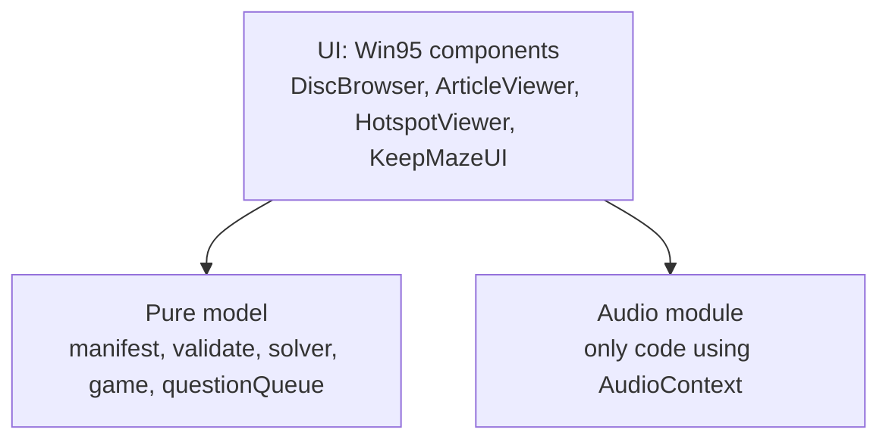

# The Build Story of DiscLore '97 and KeepMaze

This is how DiscLore '97 went from a half-remembered childhood habit to a tested, static web app. It is based on the repository history, the steering file in `.kiro/steering/`, and the spec in `.kiro/specs/disclore-97-core/`.

## 1. The inspiration

In the 1990s, a CD-ROM encyclopedia was a small miracle. You put a disc in the drive, listened to it spin up, and clicked through articles, pictures and little interactive diagrams. Titles like Microsoft Encarta were the model for this: dense, slightly strange, and fun to wander.

DiscLore '97 is a tribute to that feeling. It is a completely original work and is not affiliated with, endorsed by, or derived from any real product or company.

- **Trademark-safe naming.** The project, discs, and in-app names are invented. The real product names appear only here, as the inspiration.
- **Original content.** The article text, the SVG artwork, and the audio are all written or generated for this project. No third-party text, images, or sound files are used.
- **Win95 look, not Win95 assets.** The chrome is built from plain CSS borders and a small set of colour tokens.

The disc content was reviewed for originality by hand, because no automated test can prove it.

## 2. One steering file

The project started with the rules, before any code. The first commit adds a single steering file, `.kiro/steering/disclore-97-design-system.md`, with `inclusion: always`, so Kiro reads it on every request.

The rules began as separate concerns: visual style, audio, data invariants, and deployment. They were consolidated into one unified file. Splitting them risked two rules disagreeing, or one being left out of the context. One file keeps them together:

1. **Visual aesthetic.** Square corners, flat fills, crisp 2px bevels, Win95 colours, and colours and fonts defined once as tokens.
2. **Procedural WebAudio.** No audio files, one global Mute, a lazily created `AudioContext`, and all sound code in one module.
3. **Data invariants.** One typed `DiscManifest`, hotspots inside 0..100, every dungeon solvable by BFS with no orphan rooms, and every trivia question citing a real section.
4. **Deployment and hygiene.** Static Cloudflare Pages output, no secrets in the repo, and an MIT license.
5. **Working rules.** Small, typed, dependency-light code.

## 3. Spec-Driven Development

The feature was built with Kiro's Build a Feature flow, which produces three documents in order:

1. `requirements.md`: what the app must do, as numbered requirements.
2. `design.md`: how it will be built, plus the correctness properties to test.
3. `tasks.md`: a dependency-ordered plan, executed one task at a time.

The git history follows that order. Requirements, design, and tasks are separate commits, and the implementation commits follow: scaffold, model and solver, validator, audio, game logic, discs, Win95 components, viewers, and the app shell.

### Three layers

The design splits the code into three layers.

- **Pure `model/`.** Manifest types, the validator, the BFS solver, the KeepMaze reducer, and the question queue. It has no React and no DOM, so it is easy to test with property-based tests.
- **Isolated `audio/`.** The only code that touches `AudioContext`. Components call one function per sound effect and never build oscillators.
- **Win95 `components/`.** Windows, buttons, menus, viewers, and the KeepMaze UI. They call the other two layers and hold no game rules.

### Decisions that kept it small

- **Runtime dependencies are `react` and `react-dom` only.** The validator is hand-written instead of using a schema library, and there is no router. Navigation is a small state object in `App`.
- **The validator reuses the solver.** The "unsolvable" and "orphan room" errors are defined by the solver's output, so there is one implementation and nothing to drift.
- **The game is a pure reducer.** Moves, scoring, wrong answers, and restart can be tested without rendering anything.
- **The `AudioContext` is injectable.** The audio module exposes a test hook for a context factory. Tests supply a mock context and assert that nothing sounds while muted.
- **KeepMaze falls back gracefully with no trivia.** If a disc has no trivia questions, the Start button is disabled and shows a message, and the game never starts on an empty queue. A component test covers this case.

## 4. Engineering catches during the build

Some problems only showed up while building and verifying. These are the real ones.

- **Missing Node type definitions.** `static.test.ts` reads files from disk to check the CSS and manifests, and `tsc --noEmit` rejected the Node imports. Adding the Node.js type definitions package (`types/node`) as a dev dependency fixed the type check without touching runtime code.
- **A weak property test.** `p09-unsolvable-orphans.test.ts` first built its cases from `arbManifest` with isolated orphan rooms added through `addOrphans`. It was hardened with the `arbDungeon` generator, which makes dungeons with cycles, self-loops, unknown exits, and arbitrary exits. The test filters to dungeons that contain the reserved entrance and throne rooms, so the property is checked against much nastier input.
- **Missing keyboard focus styles.** An accessibility check found that `menubar.css` had no `:focus-visible` rules. Menu bar buttons and menu items were not visible to keyboard users. The rules were added with token-based outlines, and a style test now asserts they exist for the button and menu bar selectors.
- **Tooltips over SVG coordinates.** Hotspots are defined on a 0..100 SVG grid, but tooltips need real HTML. `HotspotViewer` uses positioned button overlays: each hotspot is an absolutely positioned anchor placed by percentage over the SVG, so an HTML tooltip and a native, focusable button sit exactly where the SVG coordinates say.

## 5. Final verification

The first checkpoint, at the end of Spec #1, ran the whole suite and build:

- **Tests:** 24 test files and 111 tests pass with Vitest and fast-check.
- **Types and build:** `tsc --noEmit` is clean, and `vite build` writes the static site to `dist/`.
- **Lint:** ESLint is clean.

The result is a static site that can be deployed to Cloudflare Pages with `npm run build` and the `dist` output directory.

## 6. Spec #2: the dynamic disc compiler

The second spec, `.kiro/specs/dynamic-disc-compiler/`, added the Burn New CD-R Disc flow. It followed the same requirements, design, tasks order as Spec #1.

- **Same invariants.** Compiled discs are ordinary `DiscManifest` objects. They go through the existing validator and BFS solver, so a generated dungeon is held to the same rules as the hand-written ones.
- **Layers kept.** Source adapters (`src/adapters/`) and the compiler (`src/model/compile/`) hold the logic. The compiler is pure and seeded, so the same source gives the same disc and property tests can cover it.
- **Static first.** The only server code is one optional Pages Function, `functions/api/extract.ts`. Its logic lives in `src/extract/` so it can be unit tested, and the app works when the function is absent.
- **Still dependency-light.** Runtime dependencies are still `react` and `react-dom`. A static test scans `src/` and `functions/` for secrets and unsafe HTML.

## 7. Dynamic Disc Compiler

Spec #2 (section 6) is where DiscLore '97 stopped being a fixed set of discs. The finished system is a small pipeline:

1. **Adapter.** `src/adapters/` reads a source (GitHub, web page, topic, or Markdown) into one plain `ExtractedSource`: a title, headings, paragraphs, and metadata.
2. **Compiler.** `compileDisc` in `src/model/compiler.ts` turns that into a `DiscManifest`. It is pure and seeded, so the same source always gives the same disc. Separate seeded streams build the sections, the diagram, the trivia, and the dungeon.
3. **Gate.** The `burn` orchestrator passes the manifest through `loadDisc`, which runs the same validator and BFS solver as the built-in discs. Nothing reaches the screen without passing.
4. **Library.** Burned discs are saved to `localStorage`, up to 10, oldest first out.

Two design choices paid off later:

- **Sanitizing at one door.** All untrusted text goes through `sanitizeLine` and `sanitizeParagraph` inside the compiler. Adapters can stay simple, and one property test (`dc09-sanitize`) covers markup, control characters, and Markdown images for every source kind.
- **Static scans as tests.** `tests/dynamic-static.test.ts` checks that the compiler stays pure (no React, no `Math.random`, no `fetch`), that `src/` has no `innerHTML`, and that the only absolute URLs in `src/` are GitHub's. That last rule shaped the later server work: any other address has to live in a Pages Function or be built from parts.

## 8. 1997 Encarta Palette and UI Polish

After the compiler worked, the app was made to look the part. The original dark navy and neon-green terminal colors read as "AI tool", not "1997 multimedia encyclopedia". The re-theme changed values, not names:

- **Tokens, not hunting.** Because every color lived in `src/styles/tokens.css`, the palette changed in one file: Royal Sapphire for the splash and hero, Warm Ivory for paper, Burgundy for accents, and Antique Gold for borders. The seven required Win95 chrome tokens were left alone.
- **CRT green stayed where it belongs.** The phosphor tokens now appear only on computer-monitor screens. The boot console and the Home badge got new ivory-on-slate console tokens, and the KeepMaze mini-map got a warm dungeon slate.
- **Per-source diagrams.** The compiler's diagram builder gained four scenes: a blueprint for GitHub, a browser site map for web pages, an outline for Markdown, and a concept chart for topics. All are built from rectangles, circles, and lines in 12 allowed colors, and they keep the geometry property tests passing.
- **Study tools.** A Chronology strip, Show in Diagram, Cite / Print Preview, a KeepMaze Quest card with a mini-map legend, Peek Hint, a Victory Certificate, a taskbar clock and Drive D: light, and a boot chime.

Through all of this, the static tests held the line: hex colors only in `tokens.css`, `border-radius: 0`, no gradients, no blurred shadows, and `AudioContext` only under `src/audio/`.

## 9. Dev Middleware for /api/extract and /api/topic

A screenshot of a failed web-page burn exposed a gap. In `npm run dev`, Vite had no `/api/extract` route, so the burn dialog said the page reader was not available. The route only existed as a Cloudflare Pages Function.

The fix is a small Vite plugin in `vite.config.ts`. For `/api/extract` and later `/api/topic`, it turns the Node request into a web `Request`, calls the same handler the Pages Function uses, and writes the `Response` back. Three details matter:

- **Dev only.** `apply: 'serve'` keeps it out of `vite build`. The deployed site is unchanged.
- **One handler.** The logic lives in `src/extract/`, shared by the Pages Function, the dev middleware, and the unit tests, so dev and production cannot drift.
- **Same guard.** The dev route runs the same SSRF checks. A request for a loopback address is refused in dev just as it is in production.

## 10. 1997 Multimedia Experience and Pop-Out Picture Viewer

Real pictures and narration made the burned discs feel like multimedia, not just text. The work started with the data rules:

- **A safe `media` field.** `DiscManifest` and `ExtractedSource` gained an optional list of `{ url, caption }`, at most 8. One module, `src/model/media.ts`, decides what is allowed: public `https` addresses only, no private hosts, credentials, or odd ports, and no SVG. The validator, the compiler, and every adapter use that same module, and each re-checks what the one before it passed along.
- **Extraction.** `extractImages` reads `og:image`, `twitter:image`, and `` tags, skips icons and tracking pixels, and is bounded so a hostile page cannot make it slow. The GitHub adapter adds the owner's avatar and README images, turning relative paths into raw file addresses.
- **MediaReel.** A beveled picture frame with Prev, Next, Enlarge, and a frame counter. Pictures load without a referrer and lazily, show a loading note, and fall back to the SVG plate when they fail.
- **Picture Viewer.** Clicking a picture, or Enlarge, opens a Win95 modal window. It reuses the existing modal hook for Escape, the focus trap, and focus return. It shares the reel's current frame, so the two never disagree. Arrow keys step, Space toggles Play, and a thumbnail strip with a gold active border jumps to a frame. Play started out in the sidebar reel too, and was later moved into the viewer alone (see section 12). A small detail: focus starts on the picture, so pressing Space cannot press the Close button.
- **Read Aloud.** Narration uses the browser's Web Speech API, so there are still no audio files. Each paragraph is its own utterance, because long utterances get cut off in some browsers. The button shows live progress, for example "Stop (2/5)", and the narration stops on Mute, on a section change, and on unmount. The speech code sits in `src/audio/`, next to the rest of the sound code.

One rule from the static tests shaped the code in a small way. `src/` may not contain `https://` addresses other than GitHub's, so the raw GitHub file host is assembled from parts in `github.ts`.

## 11. Wikipedia-Backed Topic Burns

At first, burning a topic produced a disc of "write down what you already know" prompts. It worked, but it taught nothing. The upgrade makes a topic burn fetch a real article.

- **A new function.** `functions/api/topic.ts` calls the shared handler in `src/extract/topicHandler.ts`. The handler searches English Wikipedia for the best match, then reads that article's plain text and its images. The Wikipedia host is fixed in the code and built from parts, and the search text only ever travels as a query parameter, so a caller cannot aim it anywhere else.
- **Cleaning.** Section headings become disc sections. "See also", "References", and similar sections, short list fragments, and disambiguation pages are dropped. Images must be JPEG, PNG, or WebP of a reasonable size, with icons, flags, and logos filtered out by file name. Every address then goes through the shared media rules.
- **Graceful fallback.** `burn` tries `/api/topic` first. If anything goes wrong (offline, no match, a disambiguation page, or no function at all), it falls back to `topicToSource`, so a topic burn never fails just because Wikipedia could not be reached. That fallback text was rewritten to say plainly that it is an offline study outline and not an article.
- **Attribution.** Wikipedia text is CC BY-SA 4.0 and Commons pictures carry their own licenses. Each burned disc names its Wikipedia page in the Source line of its first section, and the README and in-app ReadMe describe the licensing.

A live check against the real service showed the shape of the result: a search for "Lighthouses" returned 12 headings, 40 paragraphs, and 8 pictures, while "Mercury" returned a disambiguation page and was correctly sent to the fallback.

## 12. Refining Multimedia, Sound, and Motion

The next pass tidied the multimedia controls and gave the app a fuller 1997 soundscape.

- **Play lives in the viewer only.** The sidebar reel was crowded at 210px. It now shows Prev, Next, Enlarge, and the frame counter. The Picture Viewer owns Play / Pause and its 4-second timer. Because the timer is part of the window, closing the window pauses the show with no extra bookkeeping. The footer lists the shortcuts: Space, the arrow keys, and Esc.
- **Read Aloud you can follow.** The speech module reports which paragraph is being read, so the article highlights it with a gold rule. A 1x / 1.2x button sets the speed, and changing it mid-narration restarts from the current paragraph at the new speed.
- **A fuller soundscape.** The existing effects became soft triangle and sine chords with gentler envelopes, with every export name kept so existing tests and mocks still worked. New effects cover slide clicks, a burn completion ding, and a victory fanfare. Buttons that play their own sound got a `quiet` option so they do not double up with the standard click.
- **Disc-aware ambience.** An Ambience button in the taskbar, Off by default, plays a looping bed of filtered noise and soft drones chosen by the open disc: castles, code and web discs, or everything else. It is silent while Sound is muted, comes back when Sound does, and stops when the control unmounts. All of it stays inside `src/audio/`, so the `AudioContext` rule still holds.
- **Quiet motion.** A blinking cursor on the CRT screens, flickering torch windows, and a CD glint, all as opacity steps in CSS and all off under `prefers-reduced-motion`. The two built-in diagrams are data, so shapes gained an optional `anim` field limited to `blink`, `flicker`, and `glint`. The validator rejects any other value, and the viewer turns only those three names into classes.

## 13. Built with Kiro

Kiro shaped the project in five ways.

- **Steering.** Two always-included files. `.kiro/steering/disclore-97-design-system.md` sets the Win95 look, the procedural-audio rules, the manifest and dungeon invariants, and the deployment rules. `.kiro/steering/disclore-97-architecture.md` was added later and codifies the layering: the pure compiler (no fetch, DOM, or React), the SSRF and safe-media rules, and the requirement that `/api/extract`, `/api/topic` and `/api/define` stay in sync between `functions/api/` and `vite.config.ts`. Two static tests turn the rules into checks that fail the build.
- **Hooks.** Four agent hooks in `.kiro/hooks/` run checks without being asked. Two run on file save: the static scans (`tests/static.test.ts` and `tests/dynamic-static.test.ts`) when anything under `src/` is saved, and the property tests (`tests/properties/`) when a file under `src/model/` or `src/discs/` is saved. A third guards the server-side code: saving a file under `src/extract/`, `functions/api/`, or `src/adapters/`, or `vite.config.ts` itself, runs the extract and adapter tests and the dynamic static scan, so the SSRF guard, the fixed API hosts, and the three `/api/*` routes are re-checked the moment one of them changes. The fourth is a gate on Kiro's `Stop` event, which fires when the agent finishes a turn: it runs `npx tsc --noEmit && npm run lint`, so a turn cannot end with a type error or a lint failure left behind. The save matchers accept both `/` and `\` separators, because Windows reports paths with backslashes. A rule break shows up seconds after the edit, not at the end of a pass.
- **Specs.** Two specs in `.kiro/specs/` drove the large features, each with requirements, design, and a dependency-ordered task list. `disclore-97-core` produced the app, the validator, the BFS solver, and the two built-in discs. `dynamic-disc-compiler` produced Burn New CD-R Disc: source adapters, the seeded compiler, the library, and 25 correctness properties.
- **Custom agent.** `.kiro/agents/compliance-reviewer.md` is a project-scoped custom agent in Kiro's Markdown format (front matter for the configuration, the body as the system prompt). It is a read-only verification specialist, so it can check work without touching it. It has only the `read` and `shell` tools, and its permissions deny every file write and every command except `npm test`, `npm run lint`, `npx tsc --noEmit`, `npx vitest --run ...`, and read-only `git status`, `git diff`, and `git log`. It deliberately cannot run `npm run build`, because that writes `dist/`. Its resources are the two steering files and the two static tests, and its prompt turns them into a numbered checklist: hex values only in `tokens.css`, square corners, no gradients or blurred shadows, a pure compiler, SSRF and fixed API hosts, safe picture addresses, the three routes in sync, and the static and property tests. It answers with a PASS or FAIL verdict, findings that name the file, line, and exact fix, and the exact result of each command it ran. The steering says what is allowed, the hooks catch a break on save, and the agent gives a second, independent reviewer before a pass is called done.
- **Default-mode passes.** Everything after the specs was done as iterative conversations in Kiro's default mode: the Win95 desktop and boot splash, the 1997 palette, blueprint diagrams, the dev middleware, the multimedia experience, Wikipedia topics, and the soundscape. Each pass was small, ended with the same three commands (`npm test`, `npm run build`, `npm run lint`), and was held to the steering file and the static tests. When a pass hit a rule, such as the ban on stray absolute URLs in `src/`, the fix was made to fit the rule rather than to bend it.
## 14. Disc images

A disc is only a manifest, so it can live in a file. File > Save Disc Image (.json) downloads the open disc, and Mount Disc Image (.json)... (in the File menu and under Utilities on the Home window) loads one back. The mount path trusts nothing: `JSON.parse`, then `loadDisc(parsed, false)`, the gate every burned disc already passes. Rejections (bad JSON, the wrong shape, an unsafe picture address, an unsolvable dungeon, an ID that collides with a built-in disc, or a file over 5 MB) show a Win95 message box and mount nothing. The test suite round-trips every built-in disc and a burned disc with pictures, then tries malformed and hostile files.

## 15. Four built-in discs

The Home shelf is a two-column grid, and a first visit showed only two cards. Two more built-in discs fill it: Folklore, Samhain and Halloween, and Lost Formats and Digital Resurrection, written as ordinary `DiscManifest` objects with their own diagrams and dungeons. Like the first two, each validates itself when its module loads, so a mistake in the data fails the build rather than the visitor. A test checks that every pin links to a section, that no two pins crowd each other, that every color is a defined token, and that each dungeon has a real shortest path. The diagrams reuse the `anim` shapes: a bonfire, castle windows, and a moon glint on one, a blinking CRT cursor and a CD glint on the other. The ambience follows too: Halloween gets the castle wind and hearth, Resurrection the CRT hum.

An empty Burned CD-Rs tab used to be a dead end. It now offers three sample burns (Halloween, Gothic fiction, CD-ROM) that open the Burn dialog and start a Wikipedia topic burn at once, falling back to the offline outline if the lookup fails.

## 16. An Encarta-style Home screen

The Home window had the right parts but a generic look. A screenshot of a 1997 encyclopedia's title screen set the target: warm paper, a big serif name with a large numeral, engraved line art in the background, and a plain list of actions down the right side.

- **Masthead.** The navy banner became a parchment header with a tracked uppercase eyebrow, a serif DISCLORE next to a large burgundy 97 with a gold offset, and a wide-tracked lowercase subtitle. All of the tracking and capitals is CSS, so the page text stays plain words and the heading's accessible name is still "DiscLore '97".
- **Engraved watermarks.** A new component draws four flat SVG marks behind the content: a ringed planet, an open book, an arch beside a keep, and orbiting CD rings. They use two new tokens, a sepia stroke and a faint tint, at about half opacity. A test scans the markup for hex colors, gradients, filters, and images, because the design system forbids them.
- **Action rail.** The cards became rows: a 24px icon, a bold title, and a one-line italic subtitle. They rest flat, raise with a Win95 bevel on hover or focus, and sink when pressed. Titles and accessible names were left alone, so no existing test had to change.
- **Search anything.** The Pinpointer's dropdown now ends with `Burn CD-R for "<query>" (Wikipedia)...`. With no local matches it replaces "No matching articles.", and it reuses the same auto-start Burn dialog as the sample-burn buttons. The keyboard moves across the local results and that last row as one list.

A small repository clean-up came with it: `*.tsbuildinfo` is ignored and the committed `tsconfig.tsbuildinfo` was untracked, and four empty `.gitkeep` files under `src/` were removed.

## 17. Encyclopedia and gameplay depth

A reference disc is more than a list of articles, and a game needs a reason to try again. One pass added both.

- **Explore History.** Every article already carried a few dated events, but they were visible only inside that article. A pure function now gathers them for the whole disc: it reads the first year in each date, sorts by it, and groups by century. Dates with no year, such as "Middle Ages" or the "Part 2 of 10" of burned discs, go last under "Other dates" instead of being guessed at. The timeline is a new place in the navigation history, so Back and Forward treat it like any other page, and the toolbar button is dimmed for a disc with nothing to show.
- **Pin previews.** A diagram pin used to show only its label. It now previews the target article's title and first Quick Fact on hover or focus. The tooltip component took an optional card body, so the old plain tooltip, and the tests that cover it, did not change.
- **Cross-links without HTML.** Linking article titles inside paragraphs is a classic way to end up with `dangerouslySetInnerHTML`, which the design system forbids. Instead, a small pure function splits a paragraph into plain pieces and link pieces, and React renders each one as text or a button. A test feeds it text with tags, ampersands, and regular-expression characters, and checks that the pieces always rebuild the original string.
- **Bookmarks.** The reader owns the toggle and the sidebar owns the list, so the state lives one level up, in the app shell, next to the library. Bookmarks use their own storage key per disc and are checked against the disc's real sections when read, so a removed section cannot leave a dead entry.
- **MindMaze.** KeepMaze gained a score, a streak, and three torches. The design question was how to add stakes without breaking the rule that every dungeon can always be finished. The answer is that nothing is ever taken away: the score only goes up, a wrong answer only ends the streak and dims a torch, and torches stop at zero. A test fails eight answers in a row and then finishes the maze. The Peek Hint button, added earlier as a convenience, now has a price: a hinted answer is worth 50 and gets no streak bonus. The scholar rank compares the score with the best possible one for the same number of moves, so a short maze and a long one are judged fairly.

## 18. Dictionary, gallery, and study tools

The last pass made the disc easier to study from. It added four things, and none of them needed a new dependency.

- **Encarta Dictionary.** A reader who meets an unfamiliar word should not have to leave the disc. Double-clicking a single word in an article opens a Win95 dialog filled with that word, and the same dialog opens from the toolbar, the View menu, and the Home Utilities. Two sources feed it. The first is offline and instant: `findMentions` scans every mounted disc for whole-word matches in section titles, Quick Facts, and body sentences, with the same word-boundary rule as the cross-links. The second is a short definition from a new route, `/api/define`, which asks the free Dictionary API. It follows the pattern of `/api/topic`: one shared handler in `src/extract/defineHandler.ts`, a Pages Function, and a route in the dev plugin, and the architecture steering file lists it in the route-sync table. The host is built from parts, because the static tests forbid other absolute addresses in `src/`, and the word is checked against a letters-only pattern, so a caller cannot steer the request anywhere else. When the word is unknown or the network fails, the dialog says so and keeps the disc matches. Before choosing the service, I checked it live: a real word returned 200 and a made-up one returned 404.
- **Media Gallery.** The picture reel shows one picture at a time. The gallery is a contact sheet for the whole disc, and it is a new place in the navigation history, so Back and Forward treat it like the Timeline. A disc with extracted pictures shows each one with its caption, and a click opens the existing Picture Viewer at that frame. Built-in discs have no pictures, so the gallery shows each article's SVG plate instead and a click opens the article. To avoid a figure inside a button, the plate drawing was split out of `Plate` into a small `PlateImage`.
- **Visited tracking.** The app remembers which articles you opened, per disc, under `disclore97.visited.<disc_id>`. It reuses the bookmark storage code, which was generalised into one list loader and saver, so both lists get the same checks against the disc's real sections. The contents sidebar shows a check mark and an "X / Y read" note. One ordering detail matters: the effect that loads the saved list must run before the effect that marks the open article, or a freshly opened disc would overwrite its own history.
- **Find in Article.** A search bar in the article tools highlights matches with `<mark>` and steps through them with Previous, Next, Enter, Shift+Enter, and Escape. The highlighting is a pure function that splits each piece of text around the query, applied to the plain and link pieces of every paragraph. Cross-links therefore stay buttons with the highlight inside, and no HTML is ever built.
## 19. Personal Best, real printing, and shortcuts

The last polish pass finished three small things that make the disc feel like software you keep using.

- **Personal Best.** KeepMaze already ranked each run, but the result vanished when the certificate closed. Each disc now keeps its best run under `disclore97.best.<disc_id>`, in the same style as bookmarks and visited articles: a small helper that reads defensively, so a missing, corrupt, or hand-edited value counts as "no best" and never throws. The comparison is a pure function next to the scoring rules: a higher score wins, and on a tie the higher Scholar Rank wins. The ranks are now an ordered list, so "higher" has one definition. The save happens in one effect when the throne room is reached, and it reads the stored value fresh at that moment, so two mazes on one disc cannot overwrite each other with stale data. A design choice: the first finished run on a disc counts as a record and gets the badge. The KeepMaze component takes the storage as a prop, and with none it records and shows nothing, which keeps its older tests unchanged.
- **Real printing.** Cite / Print Preview used to be a preview of nothing. The Print... button now calls `window.print()`, and a print stylesheet decides what reaches the page. The dialog is drawn inside the desktop, so hiding "the chrome" means hiding everything around it. While the dialog is open it puts a class on `<body>`, and the `@media print` rules scoped to that class hide the taskbar, the desktop furniture, the dialog's own title bar and buttons, and the backdrop, then flatten the sheet: no scroll box, no offset shadow, dark ink on ivory. The class is removed when the dialog closes, so ordinary printing of the app is untouched. A test cannot see a printed page, so the tests check that the button calls `window.print()`, that the class comes and goes, and that the rules name the right selectors.
- **Keyboard shortcuts.** Ctrl or Cmd+F opens the Find in Article bar, and Ctrl or Cmd+D opens the Dictionary. Both take over a key the browser already uses, so each is limited to the moment it makes sense: Find only while an article is showing, Dictionary only while a disc is open. Neither fires when a dialog is already on top, so the browser's own find still works inside, for example, a long Cite preview. The Help menu is a fourth menu on the disc window, with a Shortcuts... item that opens a compact dialog listing every shortcut. The menu bar component only renders the menus it is given, so its own tests did not change. Shortcut text lives in one list that both the dialog and its test read.
## 20. Tour, Notebook, Flashcards, and Haunted Edition

The next pass added four more things a 1990s disc would have had, each built on pieces that already existed.

- **Take a Tour and the Media Show.** A tour is one stop per article, so it is a pure function of the disc: `buildTour` in `src/model/tour.ts` reads the sections in order and pairs each with its plate, a picture chosen by index modulo the picture count, a spotlight fact, and the first dated event. The spotlight reuses the same "first Quick Fact, else first sentence" rule as the Home screen, with the title as a last resort so it is never empty, even for a hostile or thin burned disc. The property test (`tests/properties/tour.test.ts`) runs the function over hand-built discs, discs with pictures, and discs compiled from extracted, thin, and hostile sources. The Media Show was the harder half. Narration and a timer both have to end cleanly, and speech has a trap: stopping the voice calls its "ended" callback, which looks exactly like a stop finishing. Pausing, pressing Previous, muting, or closing the tour would each have triggered an extra advance. The fix was to give the callback two facts to check, whether the show is still playing and whether the tour is still on screen, and to treat a mute as a pause. The timer path (5 seconds a stop) covers a muted or voiceless browser, and the show stops at the last stop instead of looping.
- **Research Notebook.** Study notes needed a home that matched the existing storage pattern, so they got their own per-disc key, `disclore97.notes.<disc_id>`, in the same defensive style as bookmarks, visited articles, and the Personal Best: a bad or missing value reads as empty, and a refusing storage never throws. The + Note button sits on each Quick Fact rather than once per article, so a note is exactly the fact you were looking at. Export (.txt) reuses the disc-image download helper with a text type.
- **Flashcards Study Mode.** The disc already held a quiz (trivia) and a fact list (Quick Facts), so a deck is those two lists reshaped as cards. `buildFlashcards` in `src/model/flashcards.ts` is pure, and so are the deck rules (flip, Got It, Need Review, restart), which made the "no card is ever lost or duplicated" claim easy to state as a property. An article with no Quick Facts still yields a card from its first sentence, so every disc with an article has a deck. Deck progress lives in the app shell, not in the view, so opening a card's source article and pressing Back does not reset the deck. The property test is `tests/properties/flashcards.test.ts`.
- **Kiroween Haunted Edition.** The rule that hex values live only in `tokens.css` turned a theme into a small job: a `:root.theme-haunted` block that redefines values of tokens that already exist, with no component changed. One design call mattered. A dark theme needs light text, but the same ink token is used on dark-on-light paper, so the window surfaces became a slate-lavender that keeps near-black ink readable, and the midnight indigo went to the desktop and title bars. A test computes the contrast ratio of ink against each surface and fails below 7 to 1. The choice is saved under `disclore97.theme` and applied as a class on the document element, and it is removed when the app closes. This theme later grew into a three-edition system (section 21), and the third edition became the Christmas Edition (section 22).
## 21. Start menu, deep links, and three editions

The next pass turned existing pieces into things that feel like a whole desktop.

- **A working Start menu.** The taskbar already had a Start button with a short list of discs. It became its own component, `StartMenu.tsx`, with the vertical "DiscLore 97" strip and the programs a 1997 Start menu would hold. Two items open submenus, Mounted Discs and Edition Switcher, and they open inline under their item, because a submenu that floats beside the menu can fall off a narrow window. The real work was the keyboard. Up and Down stay inside whichever list the focus is in, Right opens a submenu and moves into it, Left closes it and returns, Escape closes everything and gives the focus back to the Start button, and the button's `aria-expanded` follows. An item with no action is dimmed, which let the menu be tested on its own with only some actions wired. Each item reuses an action the app already had (the Burn dialog, the file picker, the Dictionary, the tour and flashcard jumps), so the menu holds no logic of its own.
- **Deep links.** A shared link is untrusted input, so `src/model/deepLink.ts` treats it that way: parsing and resolving are pure, and the rule is that nothing in a link can throw or break the page. An unknown disc leaves you where you were, an unknown section or an empty view opens the disc's cover, and long, blank, or control-character values are dropped. The links are `?disc=`, `&section=`, `&view=`, and `?topic=`. A topic link skips the boot splash and starts the same Wikipedia burn as the Pinpointer's last row, so there is one burn path and no second one to keep safe. A property test feeds the parser random strings. The link is applied once, in an effect after the discs are known, and it enters the history like a normal visit, so Back still works. Copy Share Link is the reverse: `shareQuery` builds the query, and a test round-trips every view kind through parse and resolve. One catch in testing was that the user-event library installs its own clipboard, so the failure path needed the test to replace it.
- **Three editions.** The Haunted toggle was a two-state switch, and the brief called for a third look, so the theme became an edition. `src/model/editions.ts` is pure data: each edition's name, the line above the title, the boot subtitle, three sample-burn topics, and the discs that suit it. `src/library/theme.ts` stays the storage and class code, and it still reads a saved `haunted` from the earlier version. The Winter Solstice colors are another block in `tokens.css`, the only place hex values are allowed, with evergreen desktop and title bars, frost-ivory paper, hearth-gold accents, and holly-berry crimson. The contrast test now runs over both themes and also checks title text on the desktop. Beyond color, the edition changes copy and content: the masthead and boot subtitle, the first Did You Know? fact, and the sample burns on an empty Burned CD-Rs tab. There is no winter built-in disc, so Solstice leans on the Castles disc (keeps and hearths) and on any burned disc whose title is about winter, solstice, aurora, or lighthouses. A single control cycles the editions in the View menu and the Home Utilities, and the Start menu has a submenu with one radio choice each. The Winter Solstice edition described here was later replaced by the Christmas Edition (section 22), and a saved `solstice` still loads.
## 22. Edition artwork, the Christmas Edition, and a visible crash

The editions had changed colors and copy. This pass made them feel like different discs, replaced Winter Solstice with a Christmas Edition, and closed the gap that let a crash look like a blank screen.

- **Artwork, type, and sound per edition.** `HeroArt` and `EngravedWatermarks` take the edition, so the boot splash and the Home masthead each draw their own scene in flat, token-colored SVG: the castle, CD-ROM, and CRT for Classic, a haunted keep under an amber crescent moon for Haunted, and snowy evergreens, a lit keep and cottage, and a golden star for Christmas. The edition watermarks reuse the four positions of the classic ones, so the Home layout does not move. A `--font-display` token carries the masthead typeface, with system font stacks only: Georgia, a tight, bold Palatino for Haunted, and an airy Cambria for Christmas. In audio, `playEditionSwitch` plays a cue for each edition, and the chime and the ambience pick up the edition too. Classic '97 sounds exactly as before. The two newer built-in discs got their own pixel emblems, a lantern and a floppy disk.
- **Winter Solstice becomes the Christmas Edition.** The third edition became a 1997 holiday disc: evergreen pine, cranberry and holly crimson, frost-ivory paper, warm candle gold, Christmas sample burns, and a Did You Know? that favors festive, historic, and castle discs. Renaming an edition is a data migration, because people already had `solstice` saved under `disclore97.theme`. A plain rename would have left that value pointing at nothing, and `editionOf(...)` would then return `undefined`, so the first read of `edition.eyebrow` on Home would throw. So `toTheme()` in `src/model/editions.ts` now turns every saved or passed value into a known edition: current ids pass through, `solstice` maps to `christmas`, and anything else reads as Classic '97. `editionOf`, `nextTheme`, `applyTheme`, `HeroArt`, and `EngravedWatermarks` all go through it, and `applyTheme` also clears the old `theme-solstice` class.
- **The blank teal screen.** The report was a teal desktop with nothing on it after the boot splash. In a headless Edge driven over the DevTools protocol, the splash handed over to Home every time: by timer, click, Enter, and Skip, in dev and in the production build, in every edition, with burned discs of every source kind in storage, and after live HMR edits to modules that export non-component values. None of those runs logged a console error. The cause it points to is structural. `body` is painted `--color-desktop`, and the app had no error boundary, so any error thrown while drawing Home unmounts the whole React tree and leaves exactly a blank teal screen. The edition rename would have created one such error for anyone with a saved `solstice`, and a dev server holding stale modules across export changes can create others. `AppErrorBoundary` now wraps the app in `main.tsx`. A crash becomes a Win95 message box that names the error, logs it with its component stack, and offers a restart, plus a restart in Classic '97 that clears only the saved edition. Tests now drive the real built-in discs from the splash to Home and check that the Home window, the desktop icons, and the taskbar are on screen, including for legacy and bad saved editions.

## 23. A fuller Research Notebook, and a split bundle

The Notebook began as one pad per disc. This pass turned it into a small study tool, and removed the one warning left in the build.

- **Pinned to the desktop.** A notebook you use often can live on the Win95 desktop as a `<short disc title> Notes.txt` icon. The pinned disc ids are saved under `disclore97.pinnedNotes`, read in the same defensive style as every other key, and a pin for a disc that is not mounted simply shows nothing. The label needed its own small rule, because a disc title such as "DiscLore '97: Ancient Castles & Keeps" is far too long for a desktop icon: the prefix goes, the title is cut at its first " & ", " and ", colon, or comma, and it is capped at 20 characters.
- **One dialog, every disc.** A disc selector inside the dialog switches notebooks without closing it, so comparing notes across discs no longer means opening and closing the window. The pin button, the exports, and the share link all follow the selected disc.
- **Export (.md) and Print.** The Markdown export adds a `# <Disc Title> — Research Notes` heading. Printing reuses the approach of the Cite sheet: while the dialog is open it puts a class on `<body>`, and print rules scoped to that class hide the desktop, the taskbar, the dialog chrome, and the pad, and print a hidden notes page that exists only for paper.
- **+ Quote.** The article tools gained a button that quotes the selected text into the notebook. Two details made it reliable. Pressing a button can clear the selection before the click event arrives, so the selection is read on pointer-down and used on click. And a selection elsewhere on the page is ignored, so the quote always comes from the article; with nothing selected, it falls back to the article's first sentence.
- **Share links as untrusted input.** A `?notes=` link carries the notes themselves, so anyone can hand you one. `src/model/noteShare.ts` encodes the notes as JSON, as UTF-8, as unpadded base64url, which needs no escaping in a URL. Decoding assumes the worst: it checks the alphabet and length first, rejects non-canonical base64, invalid UTF-8, and malformed JSON, strips control characters, clamps every field, and returns `null` rather than throwing. A property test round-trips random Unicode through a real URL and the deep-link parser, and fuzzes the decoder with random strings and with valid links that have been flipped, cut, or extended. Opening a link never writes anything by itself: the Shared Notes dialog shows the notes read-only, and only **Save to My Notebook** appends them, to the same disc when it is mounted or to one you choose. When the clipboard refuses a copy, the link is shown inside the Notebook rather than in a second dialog on top, because two stacked modal dialogs would both answer the same Escape key.
- **No more chunk-size warning.** The production bundle had grown past Vite's 500 kB warning. `build.rollupOptions.output.manualChunks` in `vite.config.ts` now splits React and React DOM into a `react-vendor` chunk and the four built-in discs (pure data) into a `discs` chunk, which leaves every chunk well under the limit. Vitest does not bundle, so this changes nothing for the tests.
- **A finding from the compliance reviewer.** The custom agent from section 13 flagged the monospace font stack written out by hand in four stylesheets. The design system asks for fonts to be defined once, so `:root` in `tokens.css` now has a `--font-mono` token, and every one of those rules uses `var(--font-mono)`.

## 24. Why we prototyped and reverted the Multi-Source Stitcher

We built a Multi-Source CD-R Stitcher (commit `c3b02fa`): a Burn dialog mode that combined 2 to 4 sources, in any mix of Wikipedia topics, GitHub repositories, web pages, and Markdown, into one cross-linked disc. It worked as engineered. A property test showed that every stitched disc passed `loadDisc`, was BFS-solvable, and kept each source's text in its own articles. We tried it, then reverted it on purpose (the revert restores the tree exactly to `717bef5`). The lesson was about the product, not a bug.

- **The even split punished rich sources.** `compileDisc` spreads a source's paragraphs evenly across its section headings, in order. To keep each source's text inside its own articles, every article had to hold the same number of paragraphs, so the thinnest source set the pace. Stitching a 40-paragraph Wikipedia article with a two-paragraph README gave one paragraph per article, and most of the encyclopedia text was merged or dropped. The only real fix was to change how the compiler splits paragraphs, which would have changed every existing disc and broken the guarantee that the same source always compiles to the same disc.
- **The Diagram had nothing to draw.** Each source kind has its own diagram scene: a repository blueprint, a site map, a Markdown outline, or a topic concept chart. A mix of a repository and an article fits none of them, so a stitched disc fell back to a generic concept chart whose pins joined unrelated subjects.
- **KeepMaze asked about two subjects at once.** Trivia is built from all of a disc's articles, so one dungeon mixed questions about a code repository with questions about lighthouses. That broke the feel of a themed quest, and the Flashcards deck had the same problem.
- **One source, one cohesive disc.** A 1997 CD-ROM was about one subject, and that is what makes the encyclopedia, the Diagram, KeepMaze, and the Flashcards feel authentic here, especially for the Resurrection category. Cross-source discovery does not need a mixed disc: the Pinpointer already searches every mounted disc, and the Dictionary finds a word on all of them. So we keep **1 source = 1 cohesive CD-ROM**, and let search connect the discs.

## 25. Illustrated scenes, a Callout Key, and a drive light

The burned-disc diagrams still looked like flowcharts next to the hand-drawn built-in ones. This pass made them look like 1997 CD-ROM illustrations, and added two small touches that make the disc feel like hardware and a reference work.

- **Four illustrated scenes.** `src/model/compile/diagram.ts` keeps its pure, seeded structure and its 12 `ALLOWED_TOKENS`, and each source kind got a real picture behind its pins. A topic becomes an Encarta atlas or orrery plate: a double parchment cartouche border, a ringed celestial globe with latitude and longitude arcs, an 8-point compass rose at the hub, and stars that `glint`. A web page becomes a 1997 browser window with a title bar and three window buttons, an address bar, a status bar, and hypertext page nodes around a globe, with a `glint` connection light. A GitHub repository becomes a CRT workstation showing the blueprint, beside a server rack with `blink` status LEDs and circuit traces. Markdown becomes an open leather-bound folio with a spine, ruled parchment pages, a bookmark ribbon, and a desk lamp whose bulb `flicker`s.
- **No schema change.** The manifest's `Shape` union has only `rect`, `circle`, `line`, and `polygon`. Adding a `polyline` kind would have meant changes to the validator, the renderer, and every test that walks shapes, so a small helper draws a polyline as joined `line` segments instead. The shape helpers gained an optional `anim` argument, and stars come from a `star()` point generator rounded to one decimal.
- **The pins did not move.** The scene slots, the seeded jitter, and the hotspot-to-section rule are unchanged, so every existing compiler and property test passed as written. Two details needed care: the bookmark ribbon is drawn in the backdrop so it passes under the cards rather than over them, and the topic spokes now run from the compass hub. `SCENE_SLOTS` is exported so a test can check the layouts directly. The diagram property test (`dc06`) was taught that `anim` must be `blink`, `flicker`, or `glint` and that polygon points must sit inside 0..100. A new test, `tests/compiler/diagram-scenes.test.ts`, checks each scene's colors, its own animation, and that pins stay inside 5..95 and at least 8 apart for any title.
- **Numbered Callout Key.** Printed encyclopedia figures have a key, so `HotspotViewer` now lists every pin under the diagram as `[1] <section title>` on a sunken ivory plate. An entry is a real button that opens its article, with the same page flip as the pin. The highlight runs both ways from one `previewIndex` state: hovering or focusing an entry lights its pin with a gold fill and a dashed crimson frame, and hovering or focusing a pin lights its entry. The key is a sibling of the square diagram plate, not a child, so the percentage-positioned pins still match the SVG. The visible `[n]` prefix also gives each entry an accessible name that cannot clash with the pin labels and section titles that existing tests look up by exact name.
- **Drive D: activity LED.** The taskbar's Drive D: light was a plain on or off. `App` now bumps a `seekPulse` counter whenever a disc is opened, burned, or mounted, or the reader moves between articles and views, and passes it to the Taskbar as `activityKey`. The Taskbar flashes the LED while the latest key has not yet been settled by a 700 ms timer (`SEEK_PULSE_MS`), then returns to the steady mounted gold. The timer's state update happens in a timeout callback rather than directly in the effect, and the LED element is keyed by the activity, so a new seek mid-flash restarts the step animation from the first frame. The flash is a `steps(1, end)` CSS animation between `--color-flame-hot` and `--color-gold-light`, and it is off under `prefers-reduced-motion: reduce`.
- **A slower property test.** The richer scenes add about 100 shape strings to every compiled disc, and the sanitization property test (`dc09`) scans every string of 200 hostile discs. Alone it takes about 2.5 seconds, but under a fully parallel test run on a busy machine it passed its 15-second limit. Its timeout was raised to 30 seconds; the property itself is unchanged.

## 26. A MindMaze-style KeepMaze

KeepMaze played well but looked like a form: a plain archway, a yellow question box, and a row of buttons. The target was the 1997 Encarta MindMaze screen, with a furnished castle room, a decorated question card, and a game-show scoreboard. The constraint was that nothing a test or a screen reader relies on could move.

- **A furnished room.** `DungeonViewport.tsx` is still flat SVG in token colors, with no gradients and no text. Timber ceiling beams with corner braces run across the top. Lighter dressed stones are scattered through the wall by a fixed rule, so the wall reads as blocks rather than stripes. A framed portrait and a navy tapestry hang above two new arched oak side doors, and a crimson-and-gold woven rug lies in front of the main door. The two torches moved in beside the archway and got a faint flat glow. The glow sits inside the existing flame group, so it flickers with the same CSS steps and stops under reduced motion. The main door, its padlock cues, and the victory view were left exactly as they were.
- **An illuminated question card.** The open question sits on parchment inside a stepped navy, gold, and burgundy frame. The frame is a border, an outline drawn inside it, and a keyline from a pseudo-element, all with square corners and no shadow. A large drop-cap Q in the display font sits on a gold square at the top left. Two existing test helpers read the prompt as the question group's first `
`, so the drop cap is an `aria-hidden` ``, not a paragraph.
- **A. to D. answer strips.** Each option became a full-width strip led by a navy letter badge. Dozens of tests click an answer by its exact accessible name, for example `getByRole('button', { name: 'Q0 right' })`. The badge is therefore `aria-hidden`, and there is no space text between it and the option, so the computed name is still only the option text. The gap is CSS margin.
- **Torch rack and Score Medallion.** A third column beside the mini-map shows three 24px pixel torches and a gold P medallion with the score, the streak, and the Personal Best. The column appears only during play, and it is `aria-hidden`, because the Quest card already says all of this to assistive technology. That choice also protected the tests. The Quest card's `Score`, `Streak`, and `Torches` labels, its "3 of 3 torches lit" image, and its "Personal Best:" line are unchanged, and the medallion says "Best" rather than "Personal Best:", so a text query never finds two matches.
- **Checked by eye and by test.** A headless Edge run opened the Castles dungeon, started a question, and answered one wrong. The screenshots showed the framed Q card, the lettered strips, and a slate spent torch. `tests/components/keepmaze-mindmaze-look.test.tsx` covers the scene parts and checks that every paint is a token defined in `tokens.css`. It also covers the hidden Q emblem, the A to D badges with unchanged button names, the torch rack dimming after a wrong answer, and the medallion's score and best. Every earlier KeepMaze test passed without a change.

## 27. A full-pane MindMaze layout and five room scenes

The first MindMaze pass (section 26) dressed up the old layout but kept its shape: a small room picture beside a small mini-map, then two half-width panels, and a large empty gray slab under them whenever the pane was taller than the game. Every room was also the same great hall. This pass rebuilt the screen around the room and gave the castle variety.

- **A panoramic stage.** `DungeonViewport` moved from a 120 x 80 view to a 440 x 200 panorama across the full width, between 200px and 300px tall (`aspect-ratio: 440 / 200`). The first try used `preserveAspectRatio="xMidYMid slice"`. A headless Edge screenshot showed the problem: on a 976px-wide stage it cut off the top and bottom of the room, rafters and rug included. The fix was to switch to `meet` and paint the wall and floor beyond the 440 x 200 frame. An SVG clips to its element box, not to its viewBox, so on a wide or tall pane that extra stone fills the letterbox. The room is never cropped and no empty band shows. The original central door was kept intact: it is the same drawing, scaled 2.5 times inside a group, so its padlock cues and victory view did not change.
- **Five scenes from one function.** `roomVariant(room)` returns `gate`, `passage`, `library`, `tower`, or `hall`. It checks keywords in the room name first, in that order, so "Gatehouse Passage" is a gate and "Crypt Stairs" a tower. Then it checks the reserved ids (the entrance is a gate, the throne room a hall). Anything left gets a scene from an FNV-1a hash of its id. The compiler names every room "Hall of <article>", which would have made every compiled room a hall, so that prefix is ignored and the hash decides. A test checks that ten such rooms give at least three different scenes. Each scene draws a back layer behind the door and, where needed, a front layer over it: the gate's drawbridge chains and the hall's rafters would otherwise disappear behind the arch.
- **A console, not two panels.** Below the stage, the `KeepMaze Quest` region became a console strip that stretches to the bottom of the pane (`.keepmaze` takes `min-height: 100%`, as the disc cover already did, and the console takes the rest). On the left, the HUD cluster holds the mini-map and its legend beside an ivory plaque with the torch rack and the Score Medallion. On the right, one ivory manuscript panel with a navy caption bar and gold and burgundy trim holds whatever the moment needs: a Welcome card before Start, the room card while exploring, and the illuminated Q card with its A to D strips during a question.
- **One scoreboard, not two.** Section 26 kept the Quest card's stats and added an `aria-hidden` copy beside the map. With one console that copy became the real thing. The plaque holds the `Score`, `Streak`, and `Torches` labels, the "3 of 3 torches lit" image, and the single "Personal Best:" line, so the existing tests found them inside the same region with no change. "pts" after the score is a CSS `::after`, because tests read the Score value as a bare number. A new test checks that none of these, nor "Rooms explored:", appears twice.
- **What did not move.** The existing tests rely on exact texts and roles: the room name and description, "Moves: 0", a single `role="status"` at victory, the prompt as the question group's first paragraph, and every button name. The welcome and room cards were built around those, and the victory view drops the console, so its certificate's status line stays the only one.
- **Checked by eye and by test.** Headless Edge runs walked the Castles and Halloween dungeons from the Welcome card to the Victory Certificate. They recorded the scene in each room (gate, hall, passage, library, and tower all appeared), and the screenshots confirmed the stage, the full-height console, and no gray space. Four tests from section 26 described the old hidden rack, so they were replaced. The new tests cover the layout, the three panel states, the styling, the variant rules, each scene's own furniture and token-only paints, and a five-room walk that goes gate, passage, library, tower, hall. Every earlier KeepMaze test passed without a change.

## 28. A zero-scroll question screen and five room materials

Section 27 filled the pane, but on a common 1280 x 720 screen an open question did not fit: the 300px stage and a full room card pushed the last answers and Peek Hint below the fold, and the player had to scroll to answer. And although the five scenes had different furniture, they all stood in front of the same grey stone wall on the same stone floor.

- **A thinner stage.** The stage went from `aspect-ratio: 440 / 200` (200px to 300px tall) to `height: clamp(130px, 26vh, 175px)`. The room stays a 440 x 200 drawing under `meet`, so a thin, wide stage shows much more of the scene's sides. That only works if there is something there, so the painted area beyond the scene grew from 320 to 400 units, and each scene gained side furniture: more shelves, portcullises, barred windows, wall chains, a second lancet, and heraldic shields. These use new class names, so tests that count exactly two side doors, one portrait, one tapestry, and two torches still pass.
- **A one-row question header.** While a question is open, the room card folds into a single row: `<Room Name> • Moves: X • Incorrect: Y` and Restart. The description and the exits return once the door is decided. The exits were disabled during a question anyway, and every existing test that reads the room paragraph or clicks an exit does so before a door is tried or after it is answered, so none had to change. The separators are `aria-hidden`, and "Moves: X" and "Incorrect: Y" stay their own elements, because tests look them up by exact text.
- **Small savings that added up.** The A to D strips lost a few pixels of padding, the gaps between them went from 4px to 3px, the Q drop cap shrank from 40 x 44 to 34 x 38, and Peek Hint got a compact button. The mini-map legend went to 10px and may wrap, and the Torches and P plaque centres itself and clips rather than overflowing the console.
- **Measured, not guessed.** A headless Edge run set the viewport to exactly 1280 x 720 with `Emulation.setDeviceMetricsOverride`, walked the Castles and Halloween dungeons, and measured in every scene. The scroll container (`.disc-main`) and `.keepmaze` had 0px of vertical overflow. The last answer ended at y = 515 and Peek Hint at y = 542, inside a console that ends at y = 652. The map, the legend, the plaque, and the panel body had no overflow.
- **Materials, not just furniture.** `Wall` now takes a stone material (grey, dark slate, or pale), a top and a bottom, and `Floor` takes one of four materials (flagstones, slate, cobbles, or oak boards). The gate stands under an open night sky in `--color-sky-deep` with stars, behind crenellated battlements and a gatehouse, on a cobbled courtyard. The passage is dark slate in `--color-dungeon-bg` and `--color-dungeon-stone`, damp with moss, on a slate floor. The library has no stone at all: oak panelling in `--color-wood` and `--color-wood-dark` under a gold cornice, an oak board floor, and a crimson runner. The tower is pale stone around a taller lancet onto `--color-night`. The hall is warm plaster with half-timber posts over a stone wainscot and a chair rail. A test reads the back-most surface of each scene and checks that all five are different.

## 29. A locked window and an article that scrolls inside itself

The disc window mostly held still already: its content box was a locked flex column, and the toolbar, breadcrumb, and status bar were `flex: 0 0 auto`. But nothing guaranteed the boxes around it, and the article was a single scrolling sheet, so reading a long article scrolled its title and tool row away. Short articles had the opposite problem: an empty band of paper above Chronology and See Also.

- **Lock every box around the content.** `.disc-browser`, the disc window, its content box, and `.disc-workspace` are flex boxes with `min-height: 0` and `overflow: hidden`. The `min-height: 0` matters: a flex item's default minimum is its content's height, so without it a long sidebar or article would stretch its parent instead of scrolling. Inside the workspace, the contents sidebar (`.disc-tree`) and the main pane each scroll on their own. A 12-section burned disc now scrolls inside the sidebar.
- **A pinned header and a scrolling body.** `ArticleViewer` was split into an `article-header` (the title, the tool row, and the Find bar) and an `article-body` (the picture, Quick Facts, paragraphs, Chronology, and See Also). The article is a fixed-height column with `overflow: hidden`, and the body alone has `overflow-y: auto`. Two existing behaviours depended on which element scrolled. One test sets `scrollTop` on the `<article>` and expects a section change to reset it, so the reset now clears both the article and the body. "Read Aloud" and Find already call `scrollIntoView` on the paragraph or match, and that now scrolls the body without any change.
- **Why short articles had a gap.** Chronology and See Also used `clear: both`, so they always started below the floated picture and Quick Facts, which in a short article run well past the text. As `display: flow-root` blocks they form their own block formatting context. That places them beside the float, right after the last paragraph, and in a long article they simply span the width once the float ends. A `::after` clear on the body keeps the float inside the scroll area.
- **Making every built-in article fit, not just one.** A headless Edge run at exactly 1280 x 720 opened all 22 built-in articles and recorded the body's overflow. At first, 12 of them overflowed by 8px to 22px, and in every case the Quick Facts column was the long part. Two ideas made it worse. Floating "+ Note" to the right narrowed every line of a fact and added a wrap. Widening the column made the square picture taller by as much as it saved. What worked was making "+ Note" a 10px inline micro-button that rides at the end of the fact's last line, setting the facts at 11px with a 1.25 line height, letting the empty "Added to Notebook." line take no room, and trimming a few pixels of spacing. After that all 22 fit with 0px of overflow.
- **Checked.** In the same run, the page and every locked box had 0px of overflow, and wheel scrolling never moved the title bar, menu bar, toolbar, breadcrumb, article header, or status bar. A burned Wikipedia disc on Lighthouses, with 12 sections, scrolled 333px inside its longest article's body, and its sidebar scrolled 130px on its own. `tests/components/scroll-lock-layout.test.tsx` checks the lock rules, the order of the parts in the window, the header and body split, the scroll reset, the flow-root blocks, and the + Note buttons.

## 30. Going live on Cloudflare Pages, and a privacy audit

The steering file asked from the start for a Cloudflare Pages deployment that stays static assets plus optional Pages Functions, with no keys in the repository. The last step was to put it online and check that the public repository holds nothing it should not.

- **A minimal `wrangler.toml`.** The file has three keys: `name = "disclore-97"`, `pages_build_output_dir = "dist"`, and `compatibility_date = "2026-11-19"`. Nothing else, so no `account_id`, `zone_id`, routes, `vars`, bindings, or secrets. Cloudflare's documentation was checked before adding it, because `pages_build_output_dir` has a side effect: it makes the file the source of truth for the project's configuration, and the same fields become read-only in the dashboard. With so few keys there is little to drift, but any future setting has to go into the file, and any secret into the dashboard or `wrangler secret`. The three Pages Functions need no configuration at all, because their hosts are fixed in the shared handlers.
- **Live, and checked.** The site runs at `https://disclore-97.pages.dev`. A request returned HTTP 200 with the page title "DiscLore '97" and the hashed bundle. A call to `/api/define?word=castle` returned JSON from the deployed Pages Function, so the functions run in production and not only in the dev middleware.
- **A privacy audit of the public repository.** `reprodev/disclore-97` is public, so the audit covered the full history of every ref, not only the current files. At the time it held 87 commits, 280 paths ever committed, and 52,559 added lines.
  - **Credentials.** Common token and key formats (AWS, GitHub, Slack, Google, OpenAI-style, PEM private keys, and quoted `key`, `token`, `secret`, and `password` assignments), `account_id`, and `zone_id`. None in any tracked file or any line ever added.
  - **Risky file names.** Env files, `.dev.vars`, keys, and credentials. None was ever committed. The only build artefact in the history is the early `tsconfig.tsbuildinfo`, which was untracked in section 16 and holds only relative paths.
  - **Personal data.** No local home-directory paths. The only email addresses are `example.com` and `example.org` fixtures in the SSRF and media tests. Every commit's author and committer is the GitHub `users.noreply.github.com` address.
  - **Ignore rules.** `.gitignore` already excludes `node_modules`, `dist`, `.env`, `.env.*`, `.wrangler`, and `*.tsbuildinfo`, so the local `.wrangler` state and the build output never leave the machine.

  The README's deployment section records the same results for anyone reviewing the repository.
- **A Quick-Start for judges.** The README now opens with the live link and a five-minute tour: Pinpointer to Burn CD-R, KeepMaze, Take a Tour, Flashcards, and the three Editions, each with a deep link (`?topic=Lighthouse`, `?disc=castles&view=keepmaze`, and so on). The in-app ReadMe has the same tour in plain words. The in-app copy writes the addresses without a scheme, because the static tests allow no absolute URL in `src/` other than GitHub's.

## 31. Verification today

The count in section 5 is where the project stood after the first spec. It has grown since then. Run `npm test` for the current numbers. Alongside the property and unit tests, `tests/static.test.ts` and `tests/dynamic-static.test.ts` run on every change, and they decide what may appear in `src/`: for example, no absolute URL other than GitHub's. `npm run build` and `npm run lint` are the other two gates.
## Appendix A: Architecture at a glance

## Appendix B: The 16 property tests

Each file in `tests/properties/` checks one correctness property from the design with fast-check.

| File | Property |
| --- | --- |
| p01-result-shape | Validator result shape |
| p02-round-trip | Manifest JSON round trip |
| p03-missing-fields | Missing or mistyped fields are reported by path |
| p04-duplicate-ids | Duplicate identifiers are rejected |
| p05-coordinates | Out-of-range hotspot coordinates are rejected |
| p06-dangling | Dangling references are rejected |
| p07-index-range | Answer index out of range is rejected |
| p08-missing-room | Missing entrance or throne room is rejected |
| p09-unsolvable-orphans | Unsolvable and orphaned dungeons are reported (plus an "iff" check that the validator agrees with the solver) |
| p10-partition | Reachable rooms and orphans partition the rooms |
| p11-shortest-path | The solver path is valid and minimal, and empty when unreachable |
| p12-correct-answer | A correct answer moves the player to the exit destination |
| p13-incorrect-answer | An incorrect answer keeps the player in place |
| p14-restart | Restart yields the entrance, 0 moves, 0 incorrect answers, and no pending question |
| p15-no-repeat | Questions do not repeat until all are used |
| p16-muted-silent | Muted audio is silent |

## Appendix C: Commit progression

From `git log --oneline`, oldest first:

1. `c71cd1b` Add steering rules.
2. `e46932a`, `36dd294`, `abf18de` Add the spec: requirements, design, tasks.
3. `caf66cf` Scaffold the Vite, React, and TypeScript app, with Win95 tokens and static tests.
4. `5129928` Add manifest types and the BFS solver, with property tests.
5. `303ed61` Add the runtime validator, with property tests.
6. `242f65f` Add the procedural WebAudio module with mute.
7. `f4df8f6` Add the question queue and game reducer, with property tests.
8. `55f05f9` Mark Checkpoint 6 complete.
9. `713e20d` Add the two pre-baked discs, the loader, and invariant tests.
10. `8c9e0f4` Add Win95 chrome components, token CSS, and accessibility tests.
11. `7ce6534` Add the disc browser, article viewer, hotspot viewer, and KeepMaze UI.
12. `71bc46a` Wire the app shell, mute toggle, and `loadDisc` validation, with integration tests.
13. `749dece` Complete the final checkpoint.
14. `06a3562`, `5e0cc63` Add the README and this build story.