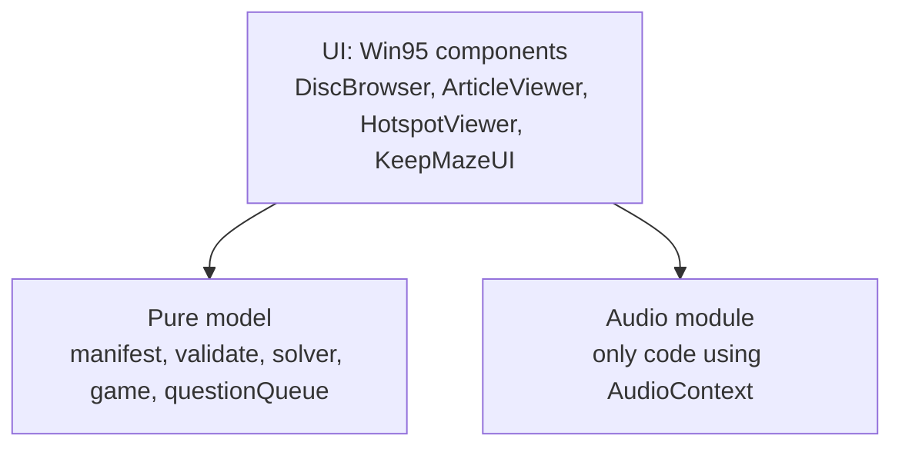

# The Build Story of DiscLore '97 and KeepMaze

This is how DiscLore '97 went from a half-remembered childhood habit to a tested, static web app. It is based on the repository history, the steering file in `.kiro/steering/`, and the spec in `.kiro/specs/disclore-97-core/`.

## 1. The inspiration

In the 1990s, a CD-ROM encyclopedia was a small miracle. You put a disc in the drive, listened to it spin up, and clicked through articles, pictures and little interactive diagrams. Titles like Microsoft Encarta were the model for this: dense, slightly strange, and fun to wander.

DiscLore '97 is a tribute to that feeling. It is a completely original work and is not affiliated with, endorsed by, or derived from any real product or company.

- **Trademark-safe naming.** The project, discs, and in-app names are invented. The real product names appear only here, as the inspiration.
- **Original content.** The article text, the SVG artwork, and the audio are all written or generated for this project. No third-party text, images, or sound files are used.
- **Win95 look, not Win95 assets.** The chrome is built from plain CSS borders and a small set of colour tokens.

The disc content was reviewed for originality by hand, because no automated test can prove it.

## 2. One steering file

The project started with the rules, before any code. The first commit adds a single steering file, `.kiro/steering/disclore-97-design-system.md`, with `inclusion: always`, so Kiro reads it on every request.

The rules began as separate concerns: visual style, audio, data invariants, and deployment. They were consolidated into one unified file. Splitting them risked two rules disagreeing, or one being left out of the context. One file keeps them together:

1. **Visual aesthetic.** Square corners, flat fills, crisp 2px bevels, Win95 colours, and colours and fonts defined once as tokens.
2. **Procedural WebAudio.** No audio files, one global Mute, a lazily created `AudioContext`, and all sound code in one module.
3. **Data invariants.** One typed `DiscManifest`, hotspots inside 0..100, every dungeon solvable by BFS with no orphan rooms, and every trivia question citing a real section.
4. **Deployment and hygiene.** Static Cloudflare Pages output, no secrets in the repo, and an MIT license.
5. **Working rules.** Small, typed, dependency-light code.

## 3. Spec-Driven Development

The feature was built with Kiro's Build a Feature flow, which produces three documents in order:

1. `requirements.md`: what the app must do, as numbered requirements.
2. `design.md`: how it will be built, plus the correctness properties to test.
3. `tasks.md`: a dependency-ordered plan, executed one task at a time.

The git history follows that order. Requirements, design, and tasks are separate commits, and the implementation commits follow: scaffold, model and solver, validator, audio, game logic, discs, Win95 components, viewers, and the app shell.

### Three layers

The design splits the code into three layers.

- **Pure `model/`.** Manifest types, the validator, the BFS solver, the KeepMaze reducer, and the question queue. It has no React and no DOM, so it is easy to test with property-based tests.
- **Isolated `audio/`.** The only code that touches `AudioContext`. Components call one function per sound effect and never build oscillators.
- **Win95 `components/`.** Windows, buttons, menus, viewers, and the KeepMaze UI. They call the other two layers and hold no game rules.

### Decisions that kept it small

- **Runtime dependencies are `react` and `react-dom` only.** The validator is hand-written instead of using a schema library, and there is no router. Navigation is a small state object in `App`.
- **The validator reuses the solver.** The "unsolvable" and "orphan room" errors are defined by the solver's output, so there is one implementation and nothing to drift.
- **The game is a pure reducer.** Moves, scoring, wrong answers, and restart can be tested without rendering anything.
- **The `AudioContext` is injectable.** The audio module exposes a test hook for a context factory. Tests supply a mock context and assert that nothing sounds while muted.
- **KeepMaze falls back gracefully with no trivia.** If a disc has no trivia questions, the Start button is disabled and shows a message, and the game never starts on an empty queue. A component test covers this case.

## 4. Engineering catches during the build

Some problems only showed up while building and verifying. These are the real ones.

- **Missing Node type definitions.** `static.test.ts` reads files from disk to check the CSS and manifests, and `tsc --noEmit` rejected the Node imports. Adding the Node.js type definitions package (`types/node`) as a dev dependency fixed the type check without touching runtime code.
- **A weak property test.** `p09-unsolvable-orphans.test.ts` first built its cases from `arbManifest` with isolated orphan rooms added through `addOrphans`. It was hardened with the `arbDungeon` generator, which makes dungeons with cycles, self-loops, unknown exits, and arbitrary exits. The test filters to dungeons that contain the reserved entrance and throne rooms, so the property is checked against much nastier input.
- **Missing keyboard focus styles.** An accessibility check found that `menubar.css` had no `:focus-visible` rules. Menu bar buttons and menu items were not visible to keyboard users. The rules were added with token-based outlines, and a style test now asserts they exist for the button and menu bar selectors.
- **Tooltips over SVG coordinates.** Hotspots are defined on a 0..100 SVG grid, but tooltips need real HTML. `HotspotViewer` uses positioned button overlays: each hotspot is an absolutely positioned anchor placed by percentage over the SVG, so an HTML tooltip and a native, focusable button sit exactly where the SVG coordinates say.

## 5. Final verification

The last checkpoint ran the whole suite and build:

- **Tests:** 24 test files and 111 tests pass with Vitest and fast-check.
- **Types and build:** `tsc --noEmit` is clean, and `vite build` writes the static site to `dist/`.
- **Lint:** ESLint is clean.

The result is a static site that can be deployed to Cloudflare Pages with `npm run build` and the `dist` output directory.

## Appendix A: Architecture at a glance

## Appendix B: The 16 property tests

Each file in `tests/properties/` checks one correctness property from the design with fast-check.

| File | Property |
| --- | --- |
| p01-result-shape | Validator result shape |
| p02-round-trip | Manifest JSON round trip |
| p03-missing-fields | Missing or mistyped fields are reported by path |
| p04-duplicate-ids | Duplicate identifiers are rejected |
| p05-coordinates | Out-of-range hotspot coordinates are rejected |
| p06-dangling | Dangling references are rejected |
| p07-index-range | Answer index out of range is rejected |
| p08-missing-room | Missing entrance or throne room is rejected |
| p09-unsolvable-orphans | Unsolvable and orphaned dungeons are reported (plus an "iff" check that the validator agrees with the solver) |
| p10-partition | Reachable rooms and orphans partition the rooms |
| p11-shortest-path | The solver path is valid and minimal, and empty when unreachable |
| p12-correct-answer | A correct answer moves the player to the exit destination |
| p13-incorrect-answer | An incorrect answer keeps the player in place |
| p14-restart | Restart yields the entrance, 0 moves, 0 incorrect answers, and no pending question |
| p15-no-repeat | Questions do not repeat until all are used |
| p16-muted-silent | Muted audio is silent |

## Appendix C: Commit progression

From `git log --oneline`, oldest first:

1. `c71cd1b` Add steering rules.
2. `e46932a`, `36dd294`, `abf18de` Add the spec: requirements, design, tasks.
3. `caf66cf` Scaffold the Vite, React, and TypeScript app, with Win95 tokens and static tests.
4. `5129928` Add manifest types and the BFS solver, with property tests.
5. `303ed61` Add the runtime validator, with property tests.
6. `242f65f` Add the procedural WebAudio module with mute.
7. `f4df8f6` Add the question queue and game reducer, with property tests.
8. `55f05f9` Mark Checkpoint 6 complete.
9. `713e20d` Add the two pre-baked discs, the loader, and invariant tests.
10. `8c9e0f4` Add Win95 chrome components, token CSS, and accessibility tests.
11. `7ce6534` Add the disc browser, article viewer, hotspot viewer, and KeepMaze UI.
12. `71bc46a` Wire the app shell, mute toggle, and `loadDisc` validation, with integration tests.
13. `749dece` Complete the final checkpoint.
14. `06a3562`, `5e0cc63` Add the README and this build story.